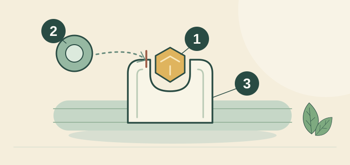
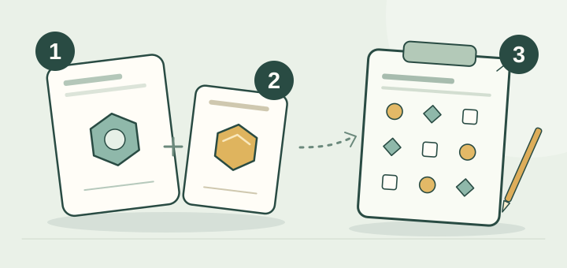
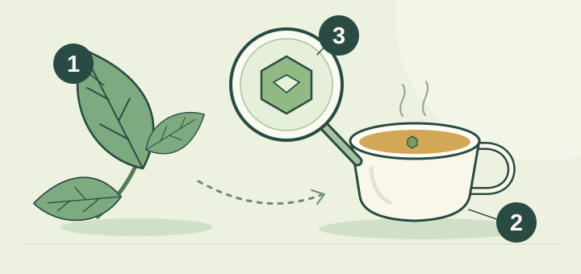



<!-- reader-guide:start -->
::: {.reader-guide}
**A question to start with**

Three chemical names can make a cup sound like a supplement label. This lesson gives each a place in the story, while keeping the amount in a drink separate from the amount used in a study.

**As you read:** For each compound, note its name, the preparation being discussed, and the timing claim. Follow the footnote before comparing a cup with a capsule.

[Home](../../index.qmd) · [Chapter map](../../modules/index.qmd)
:::
<!-- reader-guide:end -->

<!-- reading-fold:start -->
:::::::: {.callout-note collapse="true" title="Earlier introduction and reading notes"}


::: {.callout-tip}
**Chapter 1 · Section 4 of 4** — part of [Chapter 1 · The Chemical Core](index.qmd). New here? Start at the [chapter hub](index.qmd) for the full chapter map.
:::

::: {.callout-note collapse="true" title="How to read this section (footnotes + foldouts)"}
The superscript numbers are clickable footnotes. You jump to the source, the caret jumps back, and a hover often pops the note. The collapsed "More detail…" boxes hold the formulas, the half-life tables, the receptor and pathway labels, and the capsule-versus-tin math, so the open page can stay in everyday language.
:::
::::::::
<!-- reading-fold:end -->
## Guests who arrive on different clocks

<!-- lesson-illustration:compound-clocks:start -->
```{=html}
<figure class="tea-lesson-figure" data-lesson-illustration="compound-clocks">
  
  <figcaption>Timing matters when discussing compounds. The clock is a reminder, not an absorption curve or a precise timetable.</figcaption>
</figure>
```
<!-- lesson-illustration:compound-clocks:end -->

Most everyday talk about tea chemistry centers on three names. Meet them as guests who arrive at different speeds and leave at different times, after the plant ([1.1](01-plants.qmd)), the factory fork ([1.2](02-processing.qmd)), and the kettle ([1.3](03-brewing.qmd)) have already done their work.

For the open story, keep one distinction in mind: a blood-concentration timeline is not a schedule for a feeling. Amounts and timing vary with tea and preparation; measured details and mechanisms live in the foldouts.

::: {.callout-tip title="Everyday words for this sitting"}
- **Wake-up guest** is caffeine, and it blocks the "time for sleep" feeling.
- **Research question:** L-theanine is an amino acid in tea that has been studied for possible effects on attention and mood. A cup does not guarantee a calming effect.[^8][^10][^11]
- **Green-tea plant-compound guest** is [EGCG](../../glossary.qmd#egcg), the standout catechin in green tea.
- **Not instant Zen** reminds us that study timings describe specific measurements, not a guaranteed moment when a cup will feel calming.
:::

## Caffeine — the familiar wake-up guest

<!-- tea-compound-illustration:caffeine:start -->
```{=html}
<figure class="tea-compound-figure" data-tea-compound="caffeine">
  
  <figcaption>
    <div class="tea-compound-heading"><strong>Caffeine: a place already taken</strong><span class="tea-compound-formula">C₈H₁₀N₄O₂</span></div>
    <ol class="tea-compound-legend" role="list">
      <li><span class="tea-compound-key" aria-hidden="true">1</span><strong>Caffeine</strong><span>Occupies an adenosine receptor.</span></li>
      <li><span class="tea-compound-key" aria-hidden="true">2</span><strong>Adenosine</strong><span>Its signaling at this site is blocked.</span></li>
      <li><span class="tea-compound-key" aria-hidden="true">3</span><strong>Receptor</strong><span>Shown as a simplified docking pocket.</span></li>
    </ol>
    <p class="tea-compound-note">The shapes are symbols, not molecular structures. This sketch does not predict your alertness or how long it lasts.</p>
  </figcaption>
</figure>
```
<!-- tea-compound-illustration:caffeine:end -->

**Caffeine** supports alertness. In plain terms, it blocks the brain's "you're getting sleepy" signal, so you keep working. The typical story in blood is that it often hangs around for **hours**, though people differ a lot.[^1]

That last clause matters. Your friend's "still buzzing at dinner" can be biochemistry, and it need not be drama. Open the foldout below when you want the formula, the half-life range, and the liver-enzyme name behind that spread.

## L-theanine — an amino acid under study

<!-- tea-compound-illustration:l-theanine:start -->
```{=html}
<figure class="tea-compound-figure" data-tea-compound="l-theanine">
  
  <figcaption>
    <div class="tea-compound-heading"><strong>L-theanine: from ingredient to study question</strong><span class="tea-compound-formula">C₇H₁₄N₂O₃</span></div>
    <ol class="tea-compound-legend" role="list">
      <li><span class="tea-compound-key" aria-hidden="true">1</span><strong>L-theanine</strong><span>An amino acid found in tea.</span></li>
      <li><span class="tea-compound-key" aria-hidden="true">2</span><strong>Caffeine</strong><span>Often studied alongside L-theanine.</span></li>
      <li><span class="tea-compound-key" aria-hidden="true">3</span><strong>Attention task</strong><span>Researchers measure performance.</span></li>
    </ol>
    <p class="tea-compound-note">The dotted link means “studied together,” not a guaranteed benefit. The tokens are symbols, and a study preparation is not automatically equivalent to a cup.</p>
  </figcaption>
</figure>
```
<!-- tea-compound-illustration:l-theanine:end -->

**L-theanine** is an amino acid found in tea. Researchers have studied it, alone and with caffeine, for possible effects on attention and mood. Those studies do not establish a reliable calming effect from an everyday cup: tea varies in composition and preparation, while some trials use purified, measured doses.[^8][^10][^11] Human blood measurements give L-theanine a shorter time course than caffeine, but that does not predict how a person will feel.[^5][^6]

## EGCG — the green-tea catechin guest

<!-- tea-compound-illustration:egcg:start -->
```{=html}
<figure class="tea-compound-figure" data-tea-compound="egcg">
  
  <figcaption>
    <div class="tea-compound-heading"><strong>EGCG: one compound in a mixture</strong><span class="tea-compound-formula">C₂₂H₁₈O₁₁</span></div>
    <ol class="tea-compound-legend" role="list">
      <li><span class="tea-compound-key" aria-hidden="true">1</span><strong>Tea leaf</strong><span>Contains a mixture of compounds.</span></li>
      <li><span class="tea-compound-key" aria-hidden="true">2</span><strong>Brewed cup</strong><span>Some compounds pass into water.</span></li>
      <li><span class="tea-compound-key" aria-hidden="true">3</span><strong>EGCG</strong><span>One catechin within that mixture.</span></li>
    </ol>
    <p class="tea-compound-note">The magnifier identifies a compound. It does not show a molecule’s real shape, the amount in your cup, absorption, or a health effect.</p>
  </figcaption>
</figure>
```
<!-- tea-compound-illustration:egcg:end -->

**EGCG** is a major green-tea plant compound, a catechin. In everyday Chapter 1 talk, it is the guest that needed more heat and more time to leave the leaf in [Chapter 1 · Section 3](03-brewing.qmd). In the research literature it shows up in inflammatory and cell-signaling conversations. The typical story in blood is a **multi-hour** scale after oral doses, sitting between caffeine's long hang and L-theanine's shorter clock.[^4]

## Why "I drank tea an hour ago" is three stories

"Half-life," in everyday clothes, means roughly how long until the amount in blood falls by about half. It does not mean "gone completely." That matters because "I drank tea an hour ago" is not the same story for each compound. Caffeine often hangs around for hours. L-theanine's plasma clock is shorter. EGCG sits in between. Human time-course studies measure blood concentrations, but those measurements do not predict when or how someone will feel an effect from tea.[^5][^6]

Blood concentration, brain-wave recordings, task scores, and subjective feelings are different measurements. Studies report outcomes after specific doses and protocols; those results do not give a dependable timetable for how an ordinary cup will feel. Keep the preparation, dose, participant group, and measured outcome in view.[^5][^6][^8][^10]

"Tea gives instant Zen focus" goes beyond what these studies show. Results from controlled doses and measured tasks do not establish that every cup produces a calming or focused feeling.[^8][^10][^11]

::: {.callout-note collapse="true" title="More detail: formulas, half-lives, and why people differ"}
| Guest | Formula | Approx. molecular weight | Typical plasma half-life | Everyday role |
| --- | --- | --- | --- | --- |
| Caffeine | C₈H₁₀N₄O₂ | 194.19 g/mol | About **3–7 hours** | Blocks adenosine "sleepy" receptors |
| L-Theanine | C₇H₁₄N₂O₃ | 174.20 g/mol | About **50–80 minutes** | Studied for possible effects on attention and mood; a cup does not guarantee an effect |
| EGCG | C₂₂H₁₈O₁₁ | 458.37 g/mol | About **2–5 hours** | Major green-tea catechin; inflammatory / cell-signaling research |

Half-life means "about how long until blood levels fall by half," and it does not mean "gone completely." Caffeine often hangs around for hours, L-theanine's plasma clock is shorter, and EGCG sits in between.[^1][^4][^5]

**Why caffeine's range is wide.** Most caffeine clearance runs through the liver enzyme **CYP1A2**, and that activity varies a lot between people. Smoking, hormones, medications, liver health, and genetics (including common CYP1A2 variants) all shift how long a dose sticks around.[^9] That is why "I had tea three hours ago" is not the same story for every drinker, even before you count cup strength.

**Receptor and pathway labels (for Chapter 2 cross-links).** Caffeine's everyday action is adenosine-receptor antagonism.[^1] L-theanine can weakly compete at certain glutamate receptor sites (AMPA, kainate, and NMDA-related), far less potently than glutamate itself, which fits the "turn down the noisy chatter" picture.[^2][^3] EGCG appears in NF-κB-related and other cell-signaling talk in the sources. Chapter 1 only needs the timing and the green-tea identity.[^4]

Cognition trials measure separate outcomes under particular protocols; they do not provide a precise timetable for how someone will feel after an ordinary cup.[^8][^10]
:::

::: {.callout-note collapse="true" title="More detail: lab milligrams vs grocery mug"}
Many cognition and EEG trials use **purified** L-theanine and caffeine in known milligram doses. Owen and colleagues, for example, used **50–100 mg** L-theanine with **50 mg** caffeine, and other designs (including Haskell and colleagues) use higher isolated doses.[^8][^10] Your grocery bag is a mixture, and it varies by leaf, brand, and steep.

Keenan's cup measurements remind us that ordinary two-minute cups often deliver **tens of milligrams** of L-theanine, and not a 200 mg capsule.[^11] Matcha and shaded greens can climb. A quick black bag is usually lower on theanine and higher on the "familiar caffeine" side. Keep the [Cup reference](../../cup-reference.qmd) open when a headline says "tea does X," and ask **which milligrams, which matrix, which clock**.

Chapter 2 will pick up the dual story (caffeine plus L-theanine) in the brain. This lesson only insists on honesty about dose and timing.
:::

::: {.callout-tip}
Once you are done with the three guests, the [chapter hub](index.qmd) keeps a short **drinker's field guide** (green versus black choices, the cold-brew myth, and lab versus mug doses) before you step into Chapter 2.
:::


## Story in one minute

<!-- reading-fold:start -->
:::::::: {.callout-note collapse="true" title="Recap when you need it"}

Three compounds raise different questions: caffeine and alertness, L-theanine and possible attention or mood effects, and EGCG and green-tea catechin chemistry. Their measured time courses differ, but blood levels do not translate into a precise schedule for a subjective effect. Lab doses and tea cups are not interchangeable.
::::::::
<!-- reading-fold:end -->
::: {.callout-tip title="You can stop here"}
- These compounds raise different research questions: caffeine and alertness, L-theanine and possible attention or mood effects, and EGCG and catechin chemistry.
- Cups deliver **tens of mg**, while many lab trials use **100–200 mg** capsules, so do not confuse the two.
- "Not instant Zen": study timings do not predict the exact moment, or whether, one person will notice a difference from a cup.
:::

::: {.callout-note collapse="true" title="More detail: what this means when you drink tea"}
- Keep timing claims tied to a study's dose and measured outcome; they are not a schedule for your attention after tea.[^8][^10]
- Do not compare your tea bag to a 200 mg theanine capsule without the [Cup reference](../../cup-reference.qmd).
- Remember that people clear caffeine differently. Your friend's "still buzzing" can be biochemistry, and it need not be drama.[^9]
:::

::: {.callout-note collapse="true" title="More detail: reading study timelines"}
Each study starts its clock from a particular dose and preparation. Blood concentrations, brain measurements, and task scores are different outcomes, and none is a reliable timetable for how an everyday cup will feel. Check what participants took, who took it, and what researchers measured before applying a result to tea drinking.[^5][^6][^8][^10]
:::

::: {.callout-tip collapse="true" title="Click for more detail: take-home checklist for Chapter 1 · Section 4"}
1. Caffeine is an adenosine antagonist, and its half-life range runs for hours.[^1]
2. L-theanine is low-affinity glutamate antagonism, on a shorter plasma clock.[^2][^3]
3. EGCG is the major green catechin, with multi-hour PK.[^4]
4. Dose honesty means cups are not capsules (see the [Cup reference](../../cup-reference.qmd)).
5. CYP1A2 and more: people differ.[^9]
6. Next, Chapter 2 follows the guests after you swallow.
:::

## How the three guests set up Chapter 2

Chapter 2's dual story only works if you remember who is in the bloodstream.

1. **Caffeine** keeps the sleepy signal from parking as easily, and that can last for hours in many people.[^1]
2. **L-theanine** has been studied for possible attention and mood effects; results from isolated doses do not establish what an ordinary cup will feel like.[^8][^10][^11]
3. **EGCG** is the green-tea catechin headline compound. It matters for what was extracted ([Chapter 1 · Section 3](03-brewing.qmd)), even when Chapter 2 spends more words on caffeine and theanine together.

If you skip dose and timing, Chapter 2 turns into a slogan. If you keep them, Chapter 2 becomes a map.

::: {.callout-note collapse="true" title="More detail: reading a supplement label beside a tea tin"}
Suppose a capsule says **200 mg L-theanine**, and a paper reports attention effects at 60 minutes. Keenan's ordinary cups often land near **tens of milligrams** of theanine after a two-minute steep.[^11] That does not make tea "useless." It means three quieter things.

- Several cups, matcha or shaded leaf, or longer steeps change the math.
- Capsule trials answer capsule questions.
- Your honest move is to ask what *your* mug delivers before you claim the trial's effect size.

The [Cup reference](../../cup-reference.qmd) exists for that translation.
:::

***

**Navigate:** [↑ Chapter 1 hub](index.qmd) · [← Previous](03-brewing.qmd) · [Next module →](../module-02/index.qmd)

[^1]: Fredholm, B. B., Bättig, K., Holmén, J., Nehlig, A., & Zvartau, E. E. (1999). Actions of caffeine in the brain with special reference to factors that contribute to its widespread use. *Pharmacological Reviews, 51*(1), 83–133. https://pharmrev.aspetjournals.org/content/51/1/83

[^2]: Kakuda, T., Nozawa, A., Sugimoto, A., & Niino, H. (2002). Inhibition by theanine of binding of [³H]AMPA, [³H]kainate, and [³H]MDL 105,519 to glutamate receptors. *Bioscience, Biotechnology, and Biochemistry, 66*(12), 2683–2686. https://doi.org/10.1271/bbb.66.2683

[^3]: Kakuda, T. (2011). Neuroprotective effects of theanine and its preventive effects on cognitive dysfunction. *Pharmacological Research, 64*(2), 162–168.

[^4]: Chow, H. H. S., et al. (2001). Pharmacokinetics and safety of green tea polyphenols after multiple-dose administration of epigallocatechin gallate and Polyphenon E in healthy individuals. *Clinical Cancer Research, 7*(5), 1204–1212.

[^5]: van der Pijl, P. C., et al. (2010). Human pharmacokinetic profile of green tea catechins and L-theanine. *British Journal of Nutrition, 104*(8), 1157–1164.

[^6]: Scheid, L., et al. (2012). Kinetics of L-theanine uptake and metabolism in healthy humans (cited *Journal of Nutrition* entry).

[^7]: Nobre, A. C., Rao, A., & Owen, G. N. (2008). L-theanine, a natural constituent in tea, and its effect on mental state. *Asia Pacific Journal of Clinical Nutrition, 17*(S1), 167–168. https://pubmed.ncbi.nlm.nih.gov/18296328/

[^8]: Owen, G. N., et al. (2008). The combined effects of L-theanine and caffeine on cognitive performance and mood. *Nutritional Neuroscience, 11*(4), 193–198. https://doi.org/10.1179/147683008X301513

[^9]: Nehlig, A. (2018). Interindividual differences in caffeine metabolism and factors driving caffeine consumption. *Pharmacological Reviews, 70*(2), 384–411. https://doi.org/10.1124/pr.117.014407

[^10]: Haskell, C. F., et al. (2008). The effects of L-theanine, caffeine and their combination on cognition and mood. *Biological Psychology, 77*(2), 113–122. https://doi.org/10.1016/j.biopsycho.2007.09.008

[^11]: Keenan, E. K., et al. (2011). How much theanine in a cup of tea? Effects of tea type and method of preparation. *Food Chemistry, 125*(2), 588–594. https://doi.org/10.1016/j.foodchem.2010.08.071
