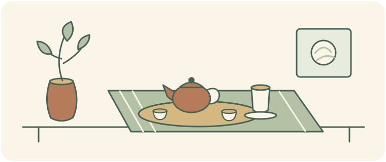



<!-- reader-guide:start -->
::: {.reader-guide}
**A question to start with**

A tea counter, a shared table, a carefully arranged serving: each scene gives you something different to notice. Read these portraits as situated practices, with people and places in view.

**As you read:** Compare two portraits using the same questions: who prepares, who serves, what equipment appears, and what the occasion asks of the participants.

[Home](../../index.qmd) · [Chapter map](../../modules/index.qmd)
:::
<!-- reader-guide:end -->

<!-- reading-fold:start -->
:::::::: {.callout-note collapse="true" title="Earlier introduction and reading notes"}


::: {.callout-tip}
**Chapter 3 · Section 4 of 4** — part of [Chapter 3 · History & Culture](index.qmd). If you are new here, start at the [chapter hub](index.qmd) for the full chapter map.
:::

::: {.callout-note collapse="true" title="How to read this section (footnotes + foldouts)"}
Superscript numbers are clickable footnotes. A click jumps to the source, and the caret jumps back; hover often pops the note. The collapsed "More detail…" boxes hold the denser implements, the dated chronologies, and the fences between folklore and chronicle, so the open page can stay a story of living scripts. It is not a world tour, and it is not a lab-ritual lesson.
:::
::::::::
<!-- reading-fold:end -->
<!-- tea-table:start -->
## Set the Tea Table {#set-the-tea-table}

```{=html}
<link rel="stylesheet" href="../../assets/tea-table-game.css">
<div data-tea-table data-locale="en">
<div class="tea-table-fallback">
<p>Without JavaScript, you can still compare the three example tables below. Ask which tools, rhythm, and purpose each source describes, rather than treating the examples as universal rules.</p>
<h3>An everyday Chaoshan table</h3>
<p>Friends gather around a small pot while conversation continues across repeated infusions. Set up the everyday scene described in d’Abbs’s fieldwork.</p>
<ul>
<li><strong>Tools on the table:</strong> Small clay pot + small cups. A small clay pot and small cups accompany repeated infusions in this portrait. Similar tools also appear in Taiwan tea art: the tools do not make the social context identical.</li>
<li><strong>Serving rhythm:</strong> Repeated short infusions. Repeated short infusions let the gathering continue with the same leaf. This is a description of the portrait, not a universal sequence or a brewing recipe.</li>
<li><strong>What this occasion emphasizes:</strong> Conversation and everyday hospitality. d’Abbs describes tea woven into everyday social connectedness. The same fieldwork also discusses refined cultivation and commercial tea-house leisure, so everyday hospitality is one frame, not the only one.</li>
</ul>
<p>Sources behind this portrait: <a href="https://doi.org/10.1080/14442213.2019.1611908">d’Abbs (2019)</a></p>
<h3>A Hong Kong milk-tea counter</h3>
<p>A café prepares milk tea as part of its daily service. Build the counter-craft portrait in this lesson, rather than a formal small-pot gathering.</p>
<ul>
<li><strong>Tools on the table:</strong> Fine cotton strainer + serving cup. Hong Kong Memory describes a fine cotton strainer. Its tea-stained shape inspired the “silk-stocking” nickname; it is not a literal stocking. This simplified table does not specify a full recipe.</li>
<li><strong>Serving rhythm:</strong> Repeatable café preparation and service. The lesson emphasizes repeatable counter craft and café service. This is a contrast of settings, not a claim that everyone in Hong Kong drinks hurriedly.</li>
<li><strong>What this occasion emphasizes:</strong> A café counter’s working routine. The portrait follows the drink’s postwar localization through eateries and its spread into cha chaan teng. Café service is the focus here; conversation and other meanings can still be part of a café visit.</li>
</ul>
<p>Sources behind this portrait: <a href="https://www.hkmemory.hk/en/collections-ichhk_ii-hong_kong_style_milk_tea_making_technique-history_hong_kong_style_milk_tea.html">Hong Kong Memory / 香港記憶 / 香港记忆</a></p>
<h3>A Taiwan tea-art gathering</h3>
<p>The host arranges a tea setting for a gathering that pays attention to gesture, utensils, and atmosphere. Build the tea-art portrait discussed by Yu and Zhang.</p>
<ul>
<li><strong>Tools on the table:</strong> Small pot + cups on an arranged tea setting. A gongfu-style small pot and small cups are a basic set in this portrait. The arranged tea setting, or chaxi, makes spatial design part of the occasion. This does not mean all Taiwan tea drinking uses this setup.</li>
<li><strong>Serving rhythm:</strong> Deliberate brewing gestures and arrangement. The sources discuss formalized movement and arrangement as part of tea art. They do not establish one mandatory gesture sequence for every gathering.</li>
<li><strong>What this occasion emphasizes:</strong> A designed sensory and aesthetic gathering. Yu describes fragrance, light, sound, utensils, and atmosphere as a sensory setting. An aesthetic focus does not exclude hospitality, and it should not be equated with all tea drinking in Taiwan.</li>
</ul>
<p>Sources behind this portrait: <a href="https://doi.org/10.1016/j.ajss.2022.08.007">Yu (2022)</a> · <a href="https://doi.org/10.1525/gfc.2016.16.1.53">Zhang (2016)</a></p>
<p>These are situated teaching examples, not rules for a whole culture. People, venues, and occasions vary; the drawings are simplified, not historical reconstructions.</p>
</div>
</div>
<script src="../../assets/tea-table-data.js" defer></script>
<script src="../../assets/tea-table-game.js" defer></script>
```

::: {.callout-note collapse="true" title="About these examples" #tea-table-notes}
Adapted from the three portraits in this lesson: d’Abbs on everyday Chaoshan gongfu, Hong Kong Memory on milk-tea making, and Yu and Zhang on Taiwan tea art. This activity compares contexts, not brewing recipes, authentic identities, or strict etiquette. No choices are stored or sent anywhere.
:::

```{=html}
<div id="tea-table-reading"></div>
```
<!-- tea-table:end -->

## After the tea-room doorway

[Section 2](02-monastic-path.qmd) ended with monastery timetables and with the leveling inside a Japanese tea room. This lesson asks a different question. What other **scripts** does the leaf wear when the room is a Chaoshan table, a Taiwan tea-art gathering, or a Hong Kong milk-tea counter?

A script, here, means a way of **staging** the drink: the tools, the sequence, and the social roles. It is not a shopping label from [Tea basics](../../tea-basics.qmd), and it is not an extraction dial from [Chapter 1](../module-01/03-brewing.qmd). Commodity leaf from [Section 3](03-plantation-aftershock.qmd) can travel anywhere. Local scripts decide how people actually sit with it. The estate aftershock explains why a bag can be historically cheap. This sitting asks how three living rooms stage the same leaf family differently.

::: {.callout-caution title="Not lab ritual"}
Predictable shared steps will return in [Chapter 4 · Section 2](../module-04/02-ritual-stress.qmd), where they are treated as *context psychology*. This page does **not** teach Hobson, heart-rate buffering, or error-related negativity. Culture comes first. The psychology waits for the next chapter.
:::

## Portrait 1 — Chaoshan gongfu as everyday staging

<!-- history-illustration:chaoshan-table:start -->
```{=html}
<figure class="tea-history-figure" data-history-illustration="chaoshan-table">
  
  <figcaption><strong>Small cups, everyday company</strong> Repeated pours make room for everyday hospitality in the Chaoshan portrait. This invented gathering illustrates the setting, not a fixed national ceremony or a rule for every household.</figcaption>
</figure>
```
<!-- history-illustration:chaoshan-table:end -->

**The scene.** In Chaoshan, in north-eastern Guangdong, people gather around a small clay pot and small cups. The same leaves are steeped repeatedly while conversation continues. Ethnographic research describes gongfu tea as an **everyday social practice**, woven into daily relationships rather than a single formal "Chinese tea ceremony."[^1]

**The social role.** The practice does not have only one mode. d'Abbs describes everyday hospitality, refined tea cultivation, and commercial tea-house leisure. These settings share a regional tradition, but they do not amount to one required sequence or etiquette.[^1]

**How the story changed.** Scholarship distinguishes the long history of local tea drinking from later claims that one unbroken, thousand-year-old ceremony represents all of China.[^2] Zhang traces how modern tea art drew on Chaozhou gongfu, Taiwanese reinvention, and Japanese *senchadō* aesthetics before spreading more widely in the twentieth century.[^3]

::: {.callout-note collapse="true" title="More detail: Chaoshan gongfu — practice vs packaged ceremony"}
d'Abbs's fieldwork distinguishes everyday practice, refined cultivation, and commercialised tea-house leisure in Chaoshan today.[^1] A longer thesis trail argues that claims of an unbroken thousand-year continuity, treating Chaoshan gongfu as a national ceremony, are an **invented tradition**. Tea was long drunk locally, but the packaged continuity story is not supported as primary medieval evidence.[^2]

Zhang's historical essay sharpens the regional fence. Gongfucha was identified with Chaozhou and with the south-eastern coast of Fujian and Guangdong. Lin Yutang (1937) already noted that the style was generally unknown in North China, and unknown in connoisseur practice elsewhere.[^3] Qing observers treat small-pot repeated infusions as a **novelty** to outsiders—Yuan Mei on Wuyi practice, and Yu Jiao around 1800 on Guangdong—not as a national ceremony already on the books.[^3] Around mid-century, the Chaoshan native Weng Huidong wrote a dedicated gongfucha treatise (**1957**, circulated, though not formally published, in Zhang's account). It gives a utensil list and a procedure. Visitors from elsewhere find it astonishing, and yet it is popular in fields and in factories.[^3] Do **not** treat any single "seven steps" paraphrase as universal Chaoshan law, unless you mark that it is a paraphrase of a local treatise.[^3]

The modern nationwide packaging also has a twentieth-century transmission trail: Taiwanese uptake, and the influence of Japanese *chadō* and *senchadō*, which later narratives sometimes obscure. The detail sits in the transmission foldout below.[^3]

**Beginner implements (foldout only):** a small clay pot, small cups, and attention to repeated short infusions. This is not a Chapter 1 temperature spreadsheet, and it is not a claim that everyday Chaoshan practice *is* Taiwan *chayi*.
:::

::: {.callout-note collapse="true" title="More detail: Chaoshan / Chaozhou formation chronology (Liu)"}
Liu (2023) offers a department-bulletin chronology for how Chaozhou kungfu practice took shape. Treat it at **Med confidence**. It is a foldout spine, not an open-story primary.[^7] It complements d'Abbs's contemporary ethnography. It does not replace it.

| Beat | What the abstract supports | Fence |
| --- | --- | --- |
| **Geography** | Chaozhou kungfu tea is popular in Yuedong (eastern Guangdong), with Chaozhou at the center[^7] | Regional, not national |
| **18th c.** | Wuyi (Fujian) oolong emerges, and tea merchants introduce it to Chaozhou. Tasting practice is prevalent under Qianlong and Jiaqing[^7] | Abstract phrasing. No invented first-year dates |
| **19th c.** | Chaozhou kungfu practice takes shape by integrating Fujian oolong practice into a local one[^7] | Merchants are essential in Liu's thesis line |
| **Early 20th c.** | Oolong production is localized, and matures, in Fenghuang Mountain (Chaozhou)[^7] | Production geography, not a cafe lesson |
| **Mid/late 20th c.** | Fenghuang Dancong is largely used instead of Wuyi leaf for Chaozhou kungfu[^7] | A shift in the leaf source, not a claim that the practice began then |
| **Thesis line** | The creation was heavily influenced by Fujian tea culture, and Chaozhou merchants were essential[^7] | A chronology job is not an ethnography job |

**Honesty:** this page gives no production tonnages, and it does not claim that Liu overturns d'Abbs on everyday social glue.
:::

## Portrait 2 — Hong Kong milk-tea counter

<!-- lesson-illustration:milk-tea-tools:start -->
```{=html}
<figure class="tea-lesson-figure" data-lesson-illustration="milk-tea-tools">
  
  <figcaption>A cloth filter and serving cup introduce the counter-craft portrait. The filter is not a literal stocking, and the drawing is not a full recipe.</figcaption>
</figure>
```
<!-- lesson-illustration:milk-tea-tools:end -->

**The scene.** Hong Kong-style milk tea is made at a café counter with strong tea, a fine cotton strainer, and condensed milk. The nickname "silk-stocking milk tea" refers to the tea-stained mesh, whose shape and color evoke a stocking; it is not made with a stocking.[^4]

**How it changed.** Hong Kong Memory traces the drink from Western-style tea in elite restaurants under British rule to a localized café drink after the Second World War. The cotton strainer, stronger tea, and condensed milk helped shape a style that suited local tastes and the economics of everyday eateries.[^4]

**What it means now.** As cafés became more widespread, milk tea moved beyond the small eateries where the style took shape.[^4] Mak examines how it later became a heritage symbol and how official, commercial, and popular accounts can give the same craft different meanings.[^5]

::: {.callout-note collapse="true" title="More detail: Hong Kong milk tea — counter script timeline"}
The dated beats come from Hong Kong Memory's ICH Oral Legacies trail, a public-history page that gives a readable spine for the localization:[^4]

| Beat | What the source supports | Fence |
| --- | --- | --- |
| **Nickname** | "Silk stocking milk tea" comes from a fine-mesh **cotton** strainer that stains tea-brown. The shape and the color evoke stockings[^4] | Cotton mesh, not a literal stocking recipe |
| **After 1842** | Western-style tea (fine Ceylon, milk, sugar) is introduced under British administration[^4] | Introduction is not the same thing as an instant popular cup |
| **Early 20th c.** | High-class Western restaurants meant elite privilege[^4] | Mild, and expensive, for local popular taste |
| **Postwar / 1950s** | The drink is truly localised after the Second World War. A population boom leads to demand for food and drink, and to many licences for *bing sutt* and *dai pai dong* eateries[^4] | A localization window, not a single founding day |
| **Craft innovations** | A fine cotton strainer; lower-grade leaf used to strengthen flavour; condensed milk in place of fresh milk, for calories and for cost[^4] | Do not invent a leaf-grade % or brew ratios |
| **Venue shift** | *Bing sutt* gives way to the *cha chaan teng*. Street stalls dwindle, and milk tea becomes a wide restaurant offering[^4] | A story of ubiquity, not a franchise history |

**Craft monograph pointer (bibliographic only):** 劉智鵬、黃君健、盧惠玲 (2023). 《港式奶茶製作技藝》. 香港：中華書局. ISBN 9789888860357 (~208 pp.; Lingnan / ICH Funding Scheme). Publisher blurbs place the technique on Hong Kong's **2017** first ICH Representative List and promise history, materials, utensils, steps, hot versus iced, and inheritance. **Do not** invent numbered brew steps, ratios, or "secrets" on this page without a page-level paste from that book.
:::

::: {.callout-note collapse="true" title="More detail: heritagization (Mak)"}
Mak (2020) follows how the technique of making milk tea became an object of heritage and of placemaking in Hong Kong, a lens on postcolonial cultural governance, on identity, and on city branding.[^5] Government, entrepreneurs, and consumers interactively commodify tradition and skills, for branding, for economic development, and for identity politics.[^5]

At the level of the abstract, the honesty about meaning is this. An official narrative can support a vision of a harmonious society with **docile labor**. Younger readers may treat milk tea as an icon of **rebelliousness**. That is a widening gap under rapid political change.[^5] The open story keeps the counter script: the strainer, the strength, the condensed milk, and the *cha chaan teng*. Heritage politics stay in the foldout, so this page does not become a city-branding essay or a label table from Tea basics.
:::

## Beyond the milk-tea counter: herbal tea and yum cha

Hong Kong’s tea history has more than one kind of cup. Herbal-tea shops sold simmered plant mixtures as decoctions, a different drink from an infusion of *Camellia sinensis*. Hong Kong Memory says the start of the commercial trade is hard to date; some family-run brands have histories of more than a century. Early shops could combine a street-front counter with a brewing kitchen behind it.[^10][^11]

A colonial-era record gives a glimpse of how these practices travelled with people. A 1869 ordinance required ships carrying Chinese labourers overseas to carry medicinal herbs in proportion to their passengers, so herbal tea could be prepared for people who became ill on the voyage.[^10] This is evidence of a maritime rule, not a measure of how often every household drank herbal tea or proof of a medical effect. In the 1950s and 1960s, herbal-tea shops also became inexpensive neighbourhood places to meet, listen to music and watch television. Later, businesses adapted with instant, canned and bottled products as Western medicine became more popular.[^10]

Tea also belongs to the shared meal. In yum cha, tea is served with dim sum in teahouses and restaurants. A University of Hong Kong thesis studies yum cha as a whole food practice—covering preparation, provision and eating—rather than treating dim sum making as the whole tradition.[^12] A study of Hong Kong tea cafés likewise describes their hybrid foods and spaces in relation to migration and colonial history.[^13] Taken together, these histories show several local scripts: a medicinal shop, a shared meal, and a quick café cup. They overlap in the city, but they are not one unchanging tradition.

::: {.callout-note collapse="true" title="More detail: herbal tea, shops and shared meals"}
| Window | What the sources describe | What to keep in view |
| --- | --- | --- |
| **Dating the trade** | Hong Kong Memory says there is no exact timeline for when herbal tea became a commercial business; some family brands have histories of over a century.[^11] | Do not assign a single founding date to the whole trade. |
| **1869** | A colonial ordinance required ships carrying Chinese labourers overseas to carry medicinal herbs for preparing herbal tea during long voyages.[^10] | A shipping regulation is not a record of every passenger’s experience. |
| **1950s–60s** | Neighbourhood herbal-tea shops offered a low-cost place to drink, talk, listen to music and watch television.[^10] | The shop was also a social space. |
| **Later adaptations** | Shops and producers adopted instant, canned and bottled products as the business changed.[^10] | Continuity included commercial change. |
| **Yum cha** | Tea and dim sum form a shared practice in teahouses and restaurants; scholarship examines the whole foodway, not only a single craft.[^12] | A meal practice is wider than a recipe or drink. |
:::

## Portrait 3 — Taiwan tea art

<!-- history-illustration:taiwan-tea-art:start -->
```{=html}
<figure class="tea-history-figure" data-history-illustration="taiwan-tea-art">
  
  <figcaption><strong>The setting becomes part of the cup</strong> The Taiwan tea-art portrait pays attention to gesture, utensils and the designed tea space. The tall aroma cup is one discussed feature, not a required object in every gathering.</figcaption>
</figure>
```
<!-- history-illustration:taiwan-tea-art:end -->

**The scene.** Contemporary Taiwan tea-art (*cha yi*) gatherings use brewing gestures, utensils, and an arranged tea space (*chaxi*) to shape the occasion. Yu describes how fragrance, light, sound, and atmosphere create a sensory setting and help participants interpret social belonging.[^6] These are features of the gatherings studied, not requirements for all tea drinking in Taiwan.

**How it changed.** Zhang traces one path by which Taiwanese tea art reworked Chaozhou gongfu, with aesthetics shaped partly by Japanese *senchadō*, before the style spread to mainland China from the 1980s.[^3] Yu also notes that a practice identified with Taiwan has been adopted on the mainland as "traditional."[^6]

High-mountain tea (*gaoshancha*) is a related story about place and taste. Jiang traces how it became a signature commodity from the 1980s, with "freshness" shaped by cultural ideas as well as growing conditions.[^8]

::: {.callout-note collapse="true" title="More detail: twentieth-century transmission — Taiwan *chayi*, *senchadō*, mainland return (Zhang)"}
Zhang (2016) argues that today's packaged "standard Chinese tea ceremony," the national gongfucha story, was originally a **Chaozhou regional custom**. Taiwanese pioneers took it up, repackaged it as quintessential Chinese culture, and exported it back to the mainland from the **1980s**. Japanese *senchadō*, and tea-ceremony aesthetics more broadly, infused that reimagination. The foreign contribution was later obscured by a national narrative.[^3]

| Beat | What Zhang supports | Fence |
| --- | --- | --- |
| ***Chayi* as neologism** | The term *chayi* ("tea arts") lacks a pre-~1970 dictionary pedigree in the entries Zhang checked. It was chosen partly to avoid confusion between *chadao* or *chadō* and Japan[^3] | The neologism claim is Zhang's lexical check, not a census of all speech |
| **1970s incubation** | Tea-art houses (*chayiguan*) appear in Taiwan in the **1970s**, and they proliferate with rising living standards, leisure, and the wish for distinction[^3] | A social history of venues, not a claim of temple continuity |
| **1981 hinge** | The ROC Tea Arts Association is formed. Its mandate language includes "**revive** Chinese tea arts culture…". Zhang notes that "revive" is paradoxical, because *chayi* itself is new[^3] | An institutional hinge, not evidence of a medieval revival |
| **Why Chaozhou base** | Taiwanese links run to Chaozhou, Fujian, and Guangdong. Gongfu was already familiar. Small-pot skill, plus a full set of implements, suited an elevation into "art," against the utilitarian large-cup norms elsewhere[^3] | A base is not the same thing as an erasure of identity |
| ***Chaxi* + movement** | The spatial tea-setting (*chaxi*), and formalized body movement, were largely **new** to Chinese gongfu discourse before the **1970s**. They run parallel to a Japanese emphasis, especially in *senchadō*, on arrangement and process. Older Chaoshan texts, for example Weng, focus on brewing technique, not on the aesthetics of the table[^3] | Do not equate this with *matcha chadō* as a direct template |
| **Aroma cup** | A Taiwanese technical addition: the elongated aroma cup (*wenxiangbei*). Tea is poured to the aroma cup before the drinking cup, unlike the customary Chaozhou pour directly to the cup[^3] | A technical modification, not an ancient universal law |
| **Mainland unfamiliarity (author framing)** | Zhang's teaching line: about thirty years before the writing, in most of China, this small-pot method would have been virtually unheard of, or read as foreign[^3] | The **author's rhetorical framing**, not a census |

**Fence:** do not rebuild the Okakura or *chadō* syllabus here. Section 2 owns the tea-room doorway. Do not claim a Chan continuity from monastery timetables to café elegance.
:::

::: {.callout-note collapse="true" title="More detail: Taiwan tea art — utensils and sense-scape (Yu)"}
In Yu's teaching sketch, a gongfu-style small pot and small cups appear as a basic set. What Taiwan tea art adds, for this portrait, is the cultivated performance of elegance—gesture, costume, *chaxi*, and spatial design—beyond Chaoshan's everyday social glue.[^6] Public gatherings organize a sense-scape: fragrance, light, sound, utensils, and atmosphere, and with them the boundaries of who counts as "we" and who counts as "they."[^6]

**Bridge to high-mountain leaf:** research on place-taste as a commodity (Jiang) is a related trail, for why Taiwan leaf can carry mountain romance into the same rooms. Catechin, theanine, and altitude chemistry are left to Chapter 1.[^8]
:::

::: {.callout-note collapse="true" title="More detail: high-mountain leaf as place-taste commodity (Jiang)"}
Jiang (2024) tracks Taiwan high-mountain tea (*gaoshancha*) as a commodity whose taste is tied to ideas of nature and of place, not as a lab sheet from Chapter 1.[^8]

| Beat | What the abstract supports | Fence |
| --- | --- | --- |
| **Rise** | *Gaoshancha* starts in the **1980s**, grows quickly, and becomes a signature Taiwanese tea[^8] | A commodity chronology, not a first-garden myth invented here |
| **Place-taste construction** | The sector connects *gaoshancha* with the "fresh" taste of high-mountain nature and place. Cultural meanings of nature and of place shape the commodity[^8] | A social construction of taste, not milligrams-per-litre chemistry |
| **"Greening" trade-off** | Lighter oxidation ("greening") can narrow the taste, reduce the skill agency of makers, and—**as Jiang claims**—even bring negative effects on the consumer's body. **Attribute** the claim. Do not amplify it clinically[^8] | The author's claim, not a medical lesson on this page |
| **Alternate makers** | Some makers work outside the grid centered on *gaoshancha*, and engage the complexity of the leaf material[^8] | Plural practice, not a single orthodox cup |

**Hard fence:** no tables of altitude and milligrams; no TRES flavor-wheel as a primary citation; no re-teaching of the plants in Chapter 1.
:::

## Compare the settings

These examples share tea, but not one script. The table highlights what each source helps us notice; it is a guide to these portraits, not a checklist for every household or venue.

| Setting | What happens | What it can help us notice |
| --- | --- | --- |
| **Chaoshan gongfu** | Small pots, repeated pours, and conversation around an everyday table[^1] | Hospitality and social connection; the same practice can also include refined tasting and commercial tea-house leisure |
| **Hong Kong milk-tea counter** | A cotton strainer, strong tea, condensed milk, and café service[^4] | How local craft adapted an imported drink to postwar tastes and working routines |
| **Hong Kong herbal-tea shop** | Herbs are simmered into decoctions and sold in neighborhood shops[^10][^11] | A local drink tradition distinct from steeped *Camellia sinensis* tea |
| **Hong Kong yum cha** | Tea accompanies dim sum as part of a shared meal in teahouses and restaurants[^12] | Tea as one part of a wider food practice |
| **Taiwan tea-art gathering** | Utensils, gestures, and a designed tea setting shape the occasion[^6] | How aesthetics and sensory attention can organize a gathering |

The sources describe particular practices and moments in time. They do not define what everyone in Chaoshan, Hong Kong, or Taiwan does. They also show why it helps to keep local practice, later branding, and claims of ancient continuity separate.[^2][^3]

## Chapter close — and a bridge into psychology

This chapter followed tea through trade, religious and social life, plantation production, and regional practice. Chapter 4 turns to a different question: how warmth, ritual, and expectation may shape experience. Cultural traditions provide context; by themselves, they do not show that ritual reduces anxiety.

::: {.callout-tip title="You can stop here"}
- Tea practices reflect their setting: an everyday gathering, a café counter, a herbal-tea shop, a shared meal, or a designed tea-art occasion.
- Local customs change over time. Later heritage stories and national labels do not make every practice ancient or universal.[^2][^3][^5]
- Chapter 4 studies context and ritual effects; it does not treat every cultural practice as a laboratory ritual.
:::

***

**Navigate:** [↑ Chapter 3 hub](index.qmd) · [← Previous](03-plantation-aftershock.qmd) · [Chapter 4 hub →](../module-04/index.qmd)

## References

1. d'Abbs, P. H. (2019). Tea art as everyday practice: Gongfu tea in Chaoshan, Guangdong, today. *The Asia Pacific Journal of Anthropology, 20*(3), 213–231. https://doi.org/10.1080/14442213.2019.1611908
2. d'Abbs, P. H. N. (2018). *Art as everyday practice: A study of gongfu tea in Chaoshan, China* (Master's thesis, University of New England). https://hdl.handle.net/1959.11/23092
3. Zhang, L. C. L. (2016). A foreign infusion: The forgotten legacy of Japanese *chadō* on modern Chinese tea arts. *Gastronomica, 16*(1), 53–62. https://doi.org/10.1525/gfc.2016.16.1.53
4. Hong Kong Memory. The History of Hong Kong-style Milk Tea (ICH Oral Legacies Series II). https://www.hkmemory.hk/en/collections-ichhk_ii-hong_kong_style_milk_tea_making_technique-history_hong_kong_style_milk_tea.html
5. Mak, V. S. W. (2020). The heritagization of milk tea: Cultural governance and placemaking in Hong Kong. *Asian Anthropology*. https://doi.org/10.1080/1683478x.2020.1773616
6. Yu, S.-D. (2022). Sense-making in Taiwan's tea art ritual. *Asian Journal of Social Science, 50*(3), 229–235. https://doi.org/10.1016/j.ajss.2022.08.007
7. Liu, Changyun (劉嫦雲). (2023). A Study of the Creation of Chaozhou Kungfu Tea Practice / 潮州工夫茶の成立に関する考察. *比較日本文化学研究*, 16, 23–43. https://doi.org/10.15027/53587
8. Jiang, H. (2024). Commodity, nature, and taste: The making of Taiwan's high-mountain tea. *Geographical Review*. https://doi.org/10.1080/00167428.2024.2319255
9. 劉智鵬、黃君健、盧惠玲 (2023). 《港式奶茶製作技藝》. 香港：中華書局. ISBN 9789888860357. (Bibliographic pointer only—no page-mined steps on this site yet.)

10. Hong Kong Memory. Development of the Herbal Tea Culture in Hong Kong (The Oral Legacies (I) – Intangible Cultural Heritage of Hong Kong). https://www.hkmemory.hk/en/collections-ichhk-herbal_tea-development.html
11. Hong Kong Memory. History of Herbal Tea in Hong Kong (The Oral Legacies (I) – Intangible Cultural Heritage of Hong Kong). https://www.hkmemory.hk/en/collections-ichhk-herbal_tea-herbal_tea.html
12. Lau, H. C. D. (2017). *More than a craft: the food practice of yum cha as an intangible cultural heritage of Hong Kong* (Undergraduate thesis, University of Hong Kong). https://hub.hku.hk/handle/10722/350593
13. Chan, S. C. (2019). Tea cafés and the Hong Kong identity: Food culture and hybridity. *China Information, 33*(3), 311–328. https://doi.org/10.1177/0920203X18773409


[^1]: d'Abbs, P. H. (2019). Tea art as everyday practice: Gongfu tea in Chaoshan, Guangdong, today. *The Asia Pacific Journal of Anthropology, 20*(3), 213–231. https://doi.org/10.1080/14442213.2019.1611908

[^2]: d'Abbs, P. H. N. (2018). *Art as everyday practice: A study of gongfu tea in Chaoshan, China* (Master's thesis, University of New England). https://hdl.handle.net/1959.11/23092

[^3]: Zhang, L. C. L. (2016). A foreign infusion: The forgotten legacy of Japanese *chadō* on modern Chinese tea arts. *Gastronomica, 16*(1), 53–62. https://doi.org/10.1525/gfc.2016.16.1.53

[^4]: Hong Kong Memory. The History of Hong Kong-style Milk Tea (ICH Oral Legacies Series II). https://www.hkmemory.hk/en/collections-ichhk_ii-hong_kong_style_milk_tea_making_technique-history_hong_kong_style_milk_tea.html

[^5]: Mak, V. S. W. (2020). The heritagization of milk tea: Cultural governance and placemaking in Hong Kong. *Asian Anthropology*. https://doi.org/10.1080/1683478x.2020.1773616

[^6]: Yu, S.-D. (2022). Sense-making in Taiwan's tea art ritual. *Asian Journal of Social Science, 50*(3), 229–235. https://doi.org/10.1016/j.ajss.2022.08.007

[^7]: Liu, Changyun (劉嫦雲). (2023). A Study of the Creation of Chaozhou Kungfu Tea Practice / 潮州工夫茶の成立に関する考察. *比較日本文化学研究*, 16, 23–43. https://doi.org/10.15027/53587

[^8]: Jiang, H. (2024). Commodity, nature, and taste: The making of Taiwan's high-mountain tea. *Geographical Review*. https://doi.org/10.1080/00167428.2024.2319255

[^10]: Hong Kong Memory. Development of the Herbal Tea Culture in Hong Kong (The Oral Legacies (I) – Intangible Cultural Heritage of Hong Kong). https://www.hkmemory.hk/en/collections-ichhk-herbal_tea-development.html

[^11]: Hong Kong Memory. History of Herbal Tea in Hong Kong (The Oral Legacies (I) – Intangible Cultural Heritage of Hong Kong). https://www.hkmemory.hk/en/collections-ichhk-herbal_tea-herbal_tea.html

[^12]: Lau, H. C. D. (2017). *More than a craft: the food practice of yum cha as an intangible cultural heritage of Hong Kong* (Undergraduate thesis, University of Hong Kong). https://hub.hku.hk/handle/10722/350593

[^13]: Chan, S. C. (2019). Tea cafés and the Hong Kong identity: Food culture and hybridity. *China Information, 33*(3), 311–328. https://doi.org/10.1177/0920203X18773409
