

<!-- interactive-pilot:start -->
## Try the tea-label detective {#label-detective}

```{=html}
<div data-tea-detective data-locale="en">
<p>The interactive detective needs JavaScript. Try the tables below instead: separate place, style, type, blend and grade words, and leave uncertain meanings open.</p>
</div>
```
<!-- interactive-pilot:end -->

<!-- reader-guide:start -->
::: {.reader-guide}
**A question to start with**

A tea packet can read like a place name, a plant name, a processing method, and a promise all at once. The useful trick is to separate those jobs before deciding what the label tells you.

**As you read:** Pick a real packet or menu entry. Mark which words describe origin, style, grade, or preparation; leave anything you cannot yet classify as a question.

[Home](index.qmd) · [Chapter map](modules/index.qmd)
:::
<!-- reader-guide:end -->

<!-- reading-fold:start -->
:::::::: {.callout-note collapse="true" title="Earlier introduction and reading notes"}


[Tea basics](tea-basics.qmd) got you a first mug and three sample names. This page is the **shelf and cafe dictionary**. It covers Chinese, Japanese, and Western everyday labels, a **classification map** of the six manufactured types, the **grade languages** (particle size versus quality-tier labels), and a **thin** strip on common teapots and brew kits. The strip tells you what the gear *is*. It does not teach extraction chemistry.

It is not a second Chapter 1, not a milligram table, not a kitchen complaint sheet, and not a shopping or “best of” ranking list. Typical milligrams live on the [Cup reference](cup-reference.qmd). Bitter or flat mugs go to [Kitchen troubleshoot](tea-troubleshoot.qmd). Culture depth for Chaoshan gongfu and Hong Kong milk tea lives in [Chapter 3 · Section 4 — Regional scripts](modules/module-03/04-regional-scripts.qmd).

Use **this** page when a box or menu still feels foggy after Basics. That is especially true when you need to match a name to a type, or to ask whether a “grade” word is about leaf size or a quality-tier label.

Tap a footnote number to jump to the source, then the caret to jump back. Hover often shows a popup.

::: {.callout-tip title="5-minute labels path"}
1. **Pick a block.** Choose Chinese names, Japanese names, or Western and cafe names.
2. **Read the usual-meaning row.** Treat it as a translation sheet, not a brand promise.
3. **Type map?** Match the box to the six manufactured types below.
4. **Grade word?** Ask whether it is a particle or size word, or a quality-tier label. Neither is a moral ranking.
5. **Herbals?** Confirm whether the drink is tea-plant leaf or another plant.
6. **Kit name?** Match the thin strip below. For the dials, open [Kitchen troubleshoot](tea-troubleshoot.qmd) or [Chapter 1 · Section 3](modules/module-01/03-brewing.qmd). If the question is culture staging, open [Chapter 3 · Section 4](modules/module-03/04-regional-scripts.qmd).
:::

::: {.callout-tip title="Words to know on this page"}
- **Style name.** A processing or tradition label (sencha, Longjing, oolong…). It is usually still the tea plant.
- **Blend / flavor recipe.** A house mix or aroma add-on (English Breakfast, Earl Grey).
- **Origin label.** A place name on the box (Assam, Darjeeling, Ceylon…).
- **Type-name.** Which of the six manufactured types (green, yellow, white, oolong, black, dark) the box sits under.[^3]
- **Grade language.** It may mean **(a)** particle or size words (OP, BOP, fannings, dust) or **(b)** quality-tier labels (e.g. 特級 / 一級 on some Chinese packs). Neither is a different species, and neither is a shopping “best of” list.
:::

***
::::::::
<!-- reading-fold:end -->
<span id="label-reading"></span>

## How to read a tea label

<!-- lesson-illustration:read-label:start -->
```{=html}
<figure class="tea-lesson-figure" data-lesson-illustration="read-label">
  
  <figcaption>Look closely at the words: place, style, blend, type and grade do different jobs.</figcaption>
</figure>
```
<!-- lesson-illustration:read-label:end -->

Labels mix five things:

1. **Place.** Examples include Assam, Darjeeling, and Yunnan.
2. **Factory style.** Examples include sencha, Longjing, and matcha.
3. **Blend or flavor recipe.** Examples include English Breakfast, Earl Grey, and jasmine green.
4. **Type-name.** Green, oolong, black, white, yellow, or dark (the classification map below).
5. **Grade language.** Particle or size words (Orange Pekoe, fannings, dust), *or* quality-tier labels on some packs. See [Grade languages](#grades).

The tables below are a **usual-meaning** sheet. Brands disagree, and recipes vary. When you want *why* green and black diverge chemically, open [Chapter 1 · Section 2 — Processing](modules/module-01/02-processing.qmd). When you want a first mug again, open [Tea basics](tea-basics.qmd).

***

<span id="label-chinese-names"></span>

## Chinese names you will see

<!-- tea-name-gallery:chinese:start -->
```{=html}
<details class="tea-name-gallery" data-tea-name-gallery="chinese" open>
  <summary>Picture shelf · 12 Chinese names</summary>
  <p class="tea-name-intro">Original schematic examples, not an identification key. Shapes and colours vary; drawings are not to scale. Names, processing and label details matter more than appearance.</p>
  <p class="tea-name-map-key">Maps are north-up and use different scales. Dots locate origins approximately, not estates or growing-area boundaries. Coastlines: <a href="https://www.naturalearthdata.com/about/terms-of-use/">Natural Earth</a>.</p>
<ul class="tea-name-grid" role="list">
  <li><figure class="tea-name-card" data-tea-name="longjing">
    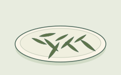
    <figcaption><strong class="tea-name-title">Longjing / Dragon Well</strong><span class="tea-name-kind">Style · green tea</span><span class="tea-name-note">A typical flat-leaf example. Shape and colour vary.</span></figcaption>
  </figure></li>
  <li><figure class="tea-name-card" data-tea-name="jasmine-green">
    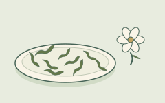
    <figcaption><strong class="tea-name-title">Jasmine green</strong><span class="tea-name-kind">Scented tea · green base</span><span class="tea-name-note">The separate flower is an aroma cue. Blossoms need not remain.</span></figcaption>
  </figure></li>
  <li><figure class="tea-name-card" data-tea-name="gunpowder">
    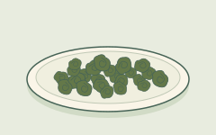
    <figcaption><strong class="tea-name-title">Gunpowder</strong><span class="tea-name-kind">Style · green tea</span><span class="tea-name-note">Small rolled pellets, shown before brewing.</span></figcaption>
  </figure></li>
  <li><figure class="tea-name-card" data-tea-name="tieguanyin">
    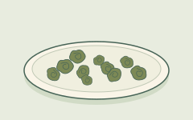
    <figcaption><strong class="tea-name-title">Tieguanyin</strong><span class="tea-name-kind">Style · oolong</span><span class="tea-name-note">One rolled-leaf example. Roast and oxidation vary.</span></figcaption>
  </figure></li>
  <li><figure class="tea-name-card" data-tea-name="baozhong">
    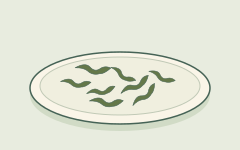
    <figcaption><strong class="tea-name-title">Baozhong</strong><span class="tea-name-kind">Style · oolong</span><span class="tea-name-note">A loose, curled strip-leaf example, not tight balls.</span></figcaption>
  </figure></li>
  <li><figure class="tea-name-card" data-tea-name="da-hong-pao">
    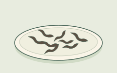
    <figcaption><strong class="tea-name-title">Da Hong Pao</strong><span class="tea-name-kind">Style · oolong</span><span class="tea-name-note">A dark, twisted-leaf example of Wuyi rock oolong.</span></figcaption>
  </figure></li>
  <li><figure class="tea-name-card" data-tea-name="keemun">
    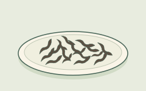
    <figcaption><strong class="tea-name-title">Keemun</strong><span class="tea-name-kind">Style · black tea</span><span class="tea-name-note">A fine, twisted dry-leaf example. Black tea is 紅茶.</span></figcaption>
  </figure></li>
  <li><figure class="tea-name-card" data-tea-name="yunnan">
    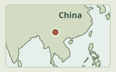
    <figcaption><strong class="tea-name-title">Yunnan (black tea)</strong><span class="tea-name-kind">Origin / style label · black tea</span><span class="tea-name-note">Yunnan, southwestern China. The map locates the region, not a specific tea garden.</span></figcaption>
  </figure></li>
  <li><figure class="tea-name-card" data-tea-name="lapsang-souchong">
    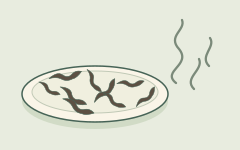
    <figcaption><strong class="tea-name-title">Lapsang Souchong</strong><span class="tea-name-kind">Style · black tea</span><span class="tea-name-note">A smoked-style example. Unsmoked versions also exist.</span></figcaption>
  </figure></li>
  <li><figure class="tea-name-card" data-tea-name="puerh-dark">
    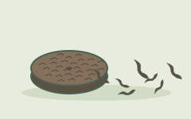
    <figcaption><strong class="tea-name-title">Pu-erh / dark tea</strong><span class="tea-name-kind">Named family / tea type</span><span class="tea-name-note">Loose and compressed examples. Sheng and shou differ; dark tea is 黑茶.</span></figcaption>
  </figure></li>
  <li><figure class="tea-name-card" data-tea-name="white-tea">
    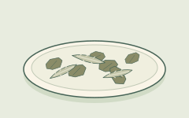
    <figcaption><strong class="tea-name-title">White tea</strong><span class="tea-name-kind">Tea type · white</span><span class="tea-name-note">Buds and leaves are shown. White tea is not always all buds.</span></figcaption>
  </figure></li>
  <li><figure class="tea-name-card" data-tea-name="yellow-tea">
    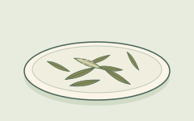
    <figcaption><strong class="tea-name-title">Yellow tea</strong><span class="tea-name-kind">Tea type · yellow</span><span class="tea-name-note">One loose-leaf example. Processing, not colour, defines the type.</span></figcaption>
  </figure></li>
  </ul>
</details>
```
<!-- tea-name-gallery:chinese:end -->

| Label you see | What it usually means | Bridge |
| --- | --- | --- |
| **Longjing / Dragon Well** | A well-known **pan-fired Chinese green** style name, the kind that shows up on many menus | It sits on **green** in the map below. See [Chapter 1](modules/module-01/index.qmd). |
| **Jasmine green** | Green tea **scented** with jasmine blossoms. The base is still tea-plant green | Scenting is not the same thing as an herbal tisane. This is the **green** map row. |
| **Gunpowder** | Green tea rolled into small pellets. The word is a style name | This is the **green** path. |
| **Tieguanyin** | A famous **oolong** tradition name. The oxidation band varies by producer | The **oolong** map row, in the middle of the green↔black ruler.[^1] |
| **Baozhong** | A lighter **oolong** style name, often linked with Taiwan | The **oolong** band. |
| **Da Hong Pao** | A famous **Wuyi rock-oolong** name on menus and shelves | The **oolong** band. This page does not tell the legend. |
| **Keemun** | A Chinese **black** tea style name, common in blends and in cups drunk on their own | The **black** map row.[^1] |
| **Yunnan** (as a black-tea word) | An origin or style label for many malty Chinese black teas | An origin is not a different species. These often follow the **black** path. |
| **Lapsang Souchong** | **Smoky** black tea. In the usual trade picture it has a pine-smoke character | A flavored or smoky **black** path.[^1] |
| **Pu-erh / dark tea** | Yunnan (and related) dark teas with microbial aging. The **raw (sheng)** and **ripe (shou)** methods differ | The **dark** map row. This is the true-fermentation exception.[^2] |
| **White tea** | Light-handled tea-plant leaf. In the usual picture the cup is delicate | The **white** map row, with minimal factory drama.[^1] |
| **Yellow tea** | Rare outside China. Trade lists give it a green-like path with an extra “smothering” step | The **yellow** map row, in the six-type lists.[^3] |

Gongfu as **everyday social staging** (a small pot, and many short pours) is a culture script. Open [Chapter 3 · Section 4](modules/module-03/04-regional-scripts.qmd) for that script. The kit strip below only names the gear.

***

<span id="label-japanese-names"></span>

## Japanese names you will see

<!-- tea-name-gallery:japanese:start -->
```{=html}
<details class="tea-name-gallery" data-tea-name-gallery="japanese" open>
  <summary>Picture shelf · 6 Japanese names</summary>
  <p class="tea-name-intro">Original schematic examples, not an identification key. Shapes and colours vary; drawings are not to scale. Names, processing and label details matter more than appearance.</p>
  <ul class="tea-name-grid" role="list">
  <li><figure class="tea-name-card" data-tea-name="sencha">
    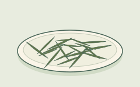
    <figcaption><strong class="tea-name-title">Sencha</strong><span class="tea-name-kind">Style · green tea</span><span class="tea-name-note">A typical rolled, needle-like leaf example.</span></figcaption>
  </figure></li>
  <li><figure class="tea-name-card" data-tea-name="matcha">
    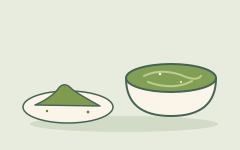
    <figcaption><strong class="tea-name-title">Matcha</strong><span class="tea-name-kind">Powdered green tea</span><span class="tea-name-note">Fine powder and a whisked bowl. The leaf is drunk, not strained out.</span></figcaption>
  </figure></li>
  <li><figure class="tea-name-card" data-tea-name="gyokuro">
    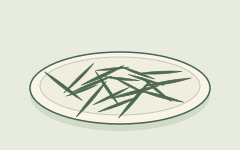
    <figcaption><strong class="tea-name-title">Gyokuro</strong><span class="tea-name-kind">Style · green tea</span><span class="tea-name-note">Shade-grown leaves for steeping. Needles alone do not prove the growing method.</span></figcaption>
  </figure></li>
  <li><figure class="tea-name-card" data-tea-name="tencha">
    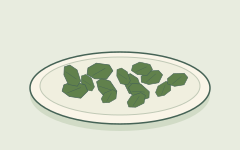
    <figcaption><strong class="tea-name-title">Tencha</strong><span class="tea-name-kind">Style · green tea</span><span class="tea-name-note">Unrolled leaf flakes before milling into matcha.</span></figcaption>
  </figure></li>
  <li><figure class="tea-name-card" data-tea-name="genmaicha">
    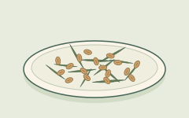
    <figcaption><strong class="tea-name-title">Genmaicha</strong><span class="tea-name-kind">Blend · green tea + rice</span><span class="tea-name-note">Green tea with roasted rice. The rice is an ingredient.</span></figcaption>
  </figure></li>
  <li><figure class="tea-name-card" data-tea-name="houjicha">
    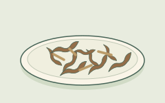
    <figcaption><strong class="tea-name-title">Houjicha</strong><span class="tea-name-kind">Roasted style · green tea</span><span class="tea-name-note">A roasted leaf-and-stem example. Brown does not make it black tea.</span></figcaption>
  </figure></li>
  </ul>
</details>
```
<!-- tea-name-gallery:japanese:end -->

| Label you see | What it usually means | Bridge |
| --- | --- | --- |
| **Sencha** | Everyday Japanese **green**. The leaves are typically **steamed**, then rolled and dried | The **green** map row, and the Basics mini-sheet.[^4] |
| **Matcha** | Shade-grown green processed into **fine powder**. You whisk it into water, and you drink the leaf | The **green** path. Cup ranges often show higher L-theanine. See the [Cup reference](cup-reference.qmd).[^5] |
| **Gyokuro** | Shaded Japanese **green** (steeped leaf, not whisked powder). It is a style and shade-path name, not an OP particle grade | The shade note is in [Chapter 1 · Section 1](modules/module-01/01-plants.qmd). For ranges, use the Cup page.[^5] |
| **Tencha** | Shade-grown leaf, used before it is stone-milled into matcha | The bridge to matcha, on the **green** path.[^4] |
| **Genmaicha** | Green tea mixed with **roasted rice**. It is still a tea-plant base unless the label says otherwise | The **green** path, with rice added. |
| **Houjicha** | **Roasted** Japanese green. In the usual picture the cup is toasty | The **green** path, roasted. |

Processing notes for sencha, matcha, and tencha match the Japanese industry type pages cited on Basics.[^4]

***

<span id="label-western-names"></span>

## Western and cafe names you will see

<!-- tea-name-gallery:western:start -->
```{=html}
<details class="tea-name-gallery" data-tea-name-gallery="western" open>
  <summary>Picture shelf · 10 Western and cafe names</summary>
  <p class="tea-name-intro">Original schematic examples, not an identification key. Shapes and colours vary; drawings are not to scale. Names, processing and label details matter more than appearance.</p>
  <p class="tea-name-map-key">Maps are north-up and use different scales. Dots locate origins approximately, not estates or growing-area boundaries. Coastlines: <a href="https://www.naturalearthdata.com/about/terms-of-use/">Natural Earth</a>.</p>
<ul class="tea-name-grid" role="list">
  <li><figure class="tea-name-card" data-tea-name="english-breakfast">
    
    <figcaption><strong class="tea-name-title">English Breakfast</strong><span class="tea-name-kind">Blend · usually black tea</span><span class="tea-name-note">A black-tea blend example. Leaf size and recipe vary.</span></figcaption>
  </figure></li>
  <li><figure class="tea-name-card" data-tea-name="earl-grey">
    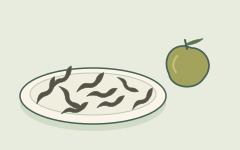
    <figcaption><strong class="tea-name-title">Earl Grey</strong><span class="tea-name-kind">Flavoured tea · usually black</span><span class="tea-name-note">Bergamot is an aroma cue here. Peel need not be in the tea.</span></figcaption>
  </figure></li>
  <li><figure class="tea-name-card" data-tea-name="assam">
    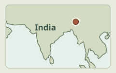
    <figcaption><strong class="tea-name-title">Assam</strong><span class="tea-name-kind">Origin name</span><span class="tea-name-note">Assam, northeast India. A regional locator, not an estate.</span></figcaption>
  </figure></li>
  <li><figure class="tea-name-card" data-tea-name="darjeeling">
    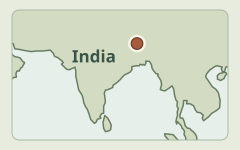
    <figcaption><strong class="tea-name-title">Darjeeling</strong><span class="tea-name-kind">Origin name</span><span class="tea-name-note">Darjeeling, northern West Bengal, India. West of Assam, in the Himalayan foothills.</span></figcaption>
  </figure></li>
  <li><figure class="tea-name-card" data-tea-name="ceylon-kenyan">
    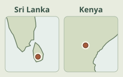
    <figcaption><strong class="tea-name-title">Ceylon / Kenyan</strong><span class="tea-name-kind">Origin name</span><span class="tea-name-note">Left: Sri Lanka (Ceylon). Right: Kenya, East Africa. Two separate origins.</span></figcaption>
  </figure></li>
  <li><figure class="tea-name-card" data-tea-name="nilgiri">
    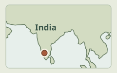
    <figcaption><strong class="tea-name-title">Nilgiri</strong><span class="tea-name-kind">Origin name</span><span class="tea-name-note">The Nilgiri Hills in southern India. A regional locator, not an estate.</span></figcaption>
  </figure></li>
  <li><figure class="tea-name-card" data-tea-name="masala-chai">
    
    <figcaption><strong class="tea-name-title">Masala chai / chai latte</strong><span class="tea-name-kind">Prepared drink · recipe family</span><span class="tea-name-note">One milky, spiced version. Ingredients and proportions vary.</span></figcaption>
  </figure></li>
  <li><figure class="tea-name-card" data-tea-name="milk-tea">
    
    <figcaption><strong class="tea-name-title">Milk tea / Hong Kong style</strong><span class="tea-name-kind">Prepared drink · milk tea</span><span class="tea-name-note">An example cup of black tea with milk. Recipes and colour vary.</span></figcaption>
  </figure></li>
  <li><figure class="tea-name-card" data-tea-name="boba">
    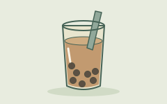
    <figcaption><strong class="tea-name-title">Bubble / boba tea</strong><span class="tea-name-kind">Prepared drink · toppings</span><span class="tea-name-note">A milk-tea-and-pearls example. Other bases and toppings exist.</span></figcaption>
  </figure></li>
  <li><figure class="tea-name-card" data-tea-name="decaf">
    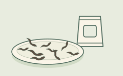
    <figcaption><strong class="tea-name-title">Decaf tea</strong><span class="tea-name-kind">Treatment · reduced caffeine</span><span class="tea-name-note">You cannot see decaffeination. Check the label; decaf does not mean caffeine-free.</span></figcaption>
  </figure></li>
  </ul>
</details>
```
<!-- tea-name-gallery:western:end -->

| Label you see | What it usually means | Bridge |
| --- | --- | --- |
| **English Breakfast** | A **blend** of black teas for a strong morning cup. It often uses Assam and/or other robust blacks, and recipes vary | Usually the **black** path. The Cup page has everyday caffeine ranges.[^1] |
| **Earl Grey** | Usually **black tea flavored with bergamot** (a citrus aroma) | Flavoring on a **black** path. It is not a new plant.[^1] |
| **Assam** | Black tea from Assam (northeast India). In the usual picture it is often malty and strong | Origin, plus the Assam-type plant tip in [Chapter 1 · Section 1](modules/module-01/01-plants.qmd). The **black** map row. |
| **Darjeeling** | Tea from Darjeeling (the Himalayan foothills). It is often delicate and high-grown. It is sold as black, though some lots sit lighter | Geography plus processing. It is not a separate species. |
| **Ceylon / Kenyan** | Black teas named for origin (Sri Lanka; Kenya). They are common building blocks in blends | Origin labels are not different species. These are often **black**.[^1] |
| **Nilgiri** | A South Indian origin label you may see on blacks and blends | On this page it is only an origin word. |
| **Masala chai / chai latte** | In many cafe recipes, spiced **black** tea with milk and sweetener. The base is still tea-plant black unless the label is herbal | A recipe family, not a species. |
| **Milk tea / Hong Kong–style milk tea** | Strong black tea (often fine-grade or CTC) shaken or pulled with milk | For the culture craft, see [Chapter 3 · Section 4](modules/module-03/04-regional-scripts.qmd). |
| **Bubble / boba tea** | A cafe drink family: a tea (or milk-tea) base plus toppings | A cafe cousin. It is not a factory oxidation style. |
| **Decaf tea** | Tea processed to **reduce** caffeine. The words are a product name, and this is not the same claim as herbal caffeine-free | This page only names it. It does not make a residual-percentage claim. |

***

## Six manufactured types (the classification map) {#type-map}

<!-- tea-classification:types:start -->
```{=html}
<section class="tea-classification-visual" data-tea-classification="types" aria-labelledby="tea-type-visual-title">
<p id="tea-type-visual-title" class="tea-classification-title">One plant, six processing families</p>
<p class="tea-classification-intro">Read these as parallel paths, not one oxidation scale. Each sketch highlights a distinguishing step, not a complete factory recipe.</p>
<p class="tea-classification-root">Tea plant · Camellia sinensis</p>
<ul class="tea-classification-grid tea-type-grid"><li><figure class="tea-classification-card" data-tea-classification-card="green">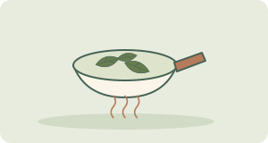<figcaption><strong class="tea-classification-name">Green</strong><span class="tea-classification-note">Early heat limits enzymatic oxidation; shaping and drying finish the tea.</span></figcaption></figure></li><li><figure class="tea-classification-card" data-tea-classification-card="yellow">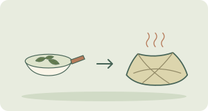<figcaption><strong class="tea-classification-name">Yellow</strong><span class="tea-classification-note">Early heat, then warm, moist yellowing and drying. The extra yellowing step matters.</span></figcaption></figure></li><li><figure class="tea-classification-card" data-tea-classification-card="white">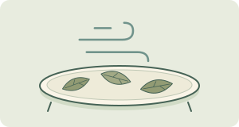<figcaption><strong class="tea-classification-name">White</strong><span class="tea-classification-note">Wither, then dry. Some oxidation occurs; this is not green tea’s early-heat path.</span></figcaption></figure></li><li><figure class="tea-classification-card" data-tea-classification-card="oolong">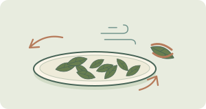<figcaption><strong class="tea-classification-name">Oolong</strong><span class="tea-classification-note">Bruising and partial oxidation, then heat and drying. The extent varies by style.</span></figcaption></figure></li><li><figure class="tea-classification-card" data-tea-classification-card="black">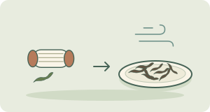<figcaption><strong class="tea-classification-name">Black · hong cha</strong><span class="tea-classification-note">Rolling or cutting allows extensive enzymatic oxidation; drying finishes the process.</span></figcaption></figure></li><li><figure class="tea-classification-card" data-tea-classification-card="dark">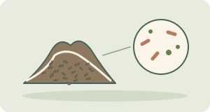<figcaption><strong class="tea-classification-name">Dark · hei cha</strong><span class="tea-classification-note">Microbial fermentation and aging are important here. Ripe Pu-erh is a clear example.</span></figcaption></figure></li></ul>
<p class="tea-classification-caution">Schematic, not a color key or a quality ranking. Raw (sheng) Pu-erh follows a different route from ripe (shou); it changes during storage, and its classification needs that context.</p>
<p class="tea-classification-sources">Sources for this visual guide: <a href="https://www.iso.org/standard/75419.html">ISO tea classification</a> · <a href="https://pmc.ncbi.nlm.nih.gov/articles/PMC8605308/">processing review</a> · <a href="https://cnafun.moa.gov.cn/zt/gjcr/202005/t20200513_6343917.html">raw / ripe Pu-erh</a></p>
</section>
```
<!-- tea-classification:types:end -->

These teas come from the same plant. Factories stop the browning at different points. Trade lists and standards work often name **six** manufactured types: green, yellow, white, oolong, black, and dark.[^3] The UK Tea & Infusions Association puts the everyday split simply. How long oxidation runs during processing, or whether it runs at all, is what separates black, green, oolong, and white character.[^1]

This map is a **shelf ruler**. It is not a health ranking, and it is not a second Chapter 1. For the chemical fork (process, not species), open [Chapter 1 · Section 2](modules/module-01/02-processing.qmd). Basics keeps a thin six-type foldout and points here for the fuller map.[^3]

| Manufactured type | Plain idea | Everyday names (from the tables above) |
| --- | --- | --- |
| **Green** | Heat the leaf early so it does not brown | Longjing, gunpowder, jasmine green; sencha, matcha, gyokuro, houjicha, genmaicha… |
| **Yellow** | Rare outside China. Trade lists give it a green-like path with an extra “smothering” step | Yellow tea (mainly the name).[^3] |
| **White** | Light-handled tea-plant leaf. In the usual picture there is minimal factory drama | The white tea rows.[^1] |
| **Oolong** | A partial-oxidation band between green and black | Tieguanyin, Baozhong, Da Hong Pao…[^1] |
| **Black** | In the usual trade picture, the full enzymatic-oxidation path | Keemun, Assam, the English Breakfast base, Lapsang, and many cafe blacks.[^1] |
| **Dark** | The microbial-aging branch (for example, Pu-erh raw or ripe, as menu words) | Pu-erh and dark tea.[^2] |

**Honesty check (already on Basics).** Tea makers often say “fermentation” for the change from green to black. For ordinary green, oolong, and black they usually mean leaf enzymes plus air. True microbial aging shows up mainly in dark teas such as Pu-erh.[^2]

### How CN / JP / Western names sit on the map

- **Chinese-style names** often *are* the type, or a famous tradition inside a type. Longjing sits with green, Tieguanyin with oolong, Keemun with black, and Pu-erh with dark (see the tables above).
- **Japanese everyday names** are mostly **green-path styles**: sencha, matcha, gyokuro, houjicha, and genmaicha. The factory habits or the serving habits differ, but the manufactured type is the same.[^4]
- **Western and cafe names** mix **type** (green or black), **origin** (Assam), and **blend / flavor** (English Breakfast, Earl Grey). The blend is usually still black-path leaf.[^1]

::: {.callout-note collapse="true" title="ISO 20715 and six-type lists"}
Standards and processing overviews sort tea by **how it was made**, not by cafe English. ISO tea-type classification work (ISO 20715:2023) and processing surveys commonly list the same six manufactured types named in the table.[^3] Cafe menus are messier. They mix type, origin, blend, and flavor words. Yellow tea is rare on most Western shelves, so you do not need it before Chapter 1. This foldout does not paste standard text, and it does not map every cafe name to a clause.
:::

***

## Grade languages: particle size and quality-tier words {#grades}

<!-- tea-classification:grades:start -->
```{=html}
<section class="tea-classification-visual" data-tea-classification="grades" aria-labelledby="tea-grade-visual-title">
<p id="tea-grade-visual-title" class="tea-classification-title">Which kind of word is on the packet?</p>
<p class="tea-classification-intro">Size words and quality tiers answer different questions. Keep manufacturing methods and style names separate too.</p>
<div class="tea-grade-block">
<p class="tea-grade-title">Particle-size words</p><p class="tea-grade-question">What form are the sorted leaf particles?</p>
<ul class="tea-classification-grid tea-grade-sizes"><li><figure class="tea-classification-card" data-tea-classification-card="op">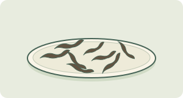<figcaption><strong class="tea-classification-name">OP · Orange Pekoe</strong><span class="tea-classification-note">Whole-leaf grade word</span></figcaption></figure></li><li><figure class="tea-classification-card" data-tea-classification-card="bop">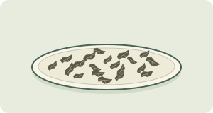<figcaption><strong class="tea-classification-name">BOP · Broken Orange Pekoe</strong><span class="tea-classification-note">Broken-leaf pieces</span></figcaption></figure></li><li><figure class="tea-classification-card" data-tea-classification-card="fannings">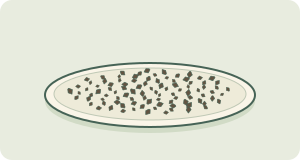<figcaption><strong class="tea-classification-name">Fannings</strong><span class="tea-classification-note">Small leaf particles</span></figcaption></figure></li><li><figure class="tea-classification-card" data-tea-classification-card="dust">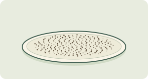<figcaption><strong class="tea-classification-name">Dust</strong><span class="tea-classification-note">Very fine particles</span></figcaption></figure></li></ul>
<p class="tea-classification-caution">Illustrative shapes, not universal sieve sizes. Larger does not automatically mean better; finer particles often infuse faster.</p>
</div>
<div class="tea-grade-block">
<p class="tea-grade-title">Manufacturing methods, not size grades</p>
<ul class="tea-classification-grid tea-grade-methods"><li><figure class="tea-classification-card" data-tea-classification-card="orthodox"><figcaption><strong class="tea-classification-name">Orthodox</strong><span class="tea-classification-note">Rolling can yield whole leaf, broken leaf, fannings and dust after sorting.</span></figcaption></figure></li><li><figure class="tea-classification-card" data-tea-classification-card="ctc">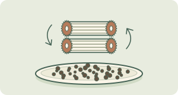<figcaption><strong class="tea-classification-name">CTC · crush, tear, curl</strong><span class="tea-classification-note">A different mechanical method produces granules, which are also sorted by size.</span></figcaption></figure></li></ul>
</div>
<ul class="tea-classification-grid tea-grade-other"><li><figure class="tea-classification-card" data-tea-classification-card="tiers"><figcaption><strong class="tea-classification-name">Quality-tier labels</strong><span class="tea-classification-note">Examples: 特級 / 一級 / 二級. Read the particular tea’s stated standard or grading scheme; these labels do not translate into OP or BOP.</span></figcaption></figure></li><li><figure class="tea-classification-card" data-tea-classification-card="shade">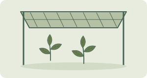<figcaption><strong class="tea-classification-name">Style + shade names</strong><span class="tea-classification-note">Gyokuro, tencha and matcha describe shaded growing and finishing styles. They are not OP grades; matcha powder is not the black-tea dust grade.</span></figcaption></figure></li></ul>
<p class="tea-classification-sources">Sources for this visual guide: <a href="https://teasrilanka.org/tea-grade">Sri Lankan grade examples</a> · <a href="https://www.upasitearesearch.org/orthodox/">orthodox manufacture</a> · <a href="https://www.forestry.gov.cn/c/www/yltl/592556.jhtml">tea-specific quality standards</a> · <a href="https://www.ujicha.or.jp/en/knowledge/kinds/">Japanese tea styles</a></p>
</section>
```
<!-- tea-classification:grades:end -->

Shelf “grade” mixes at least **two** languages. If you separate them, you will not fall for the false story that OP beats BOP “because better,” or that 特級 is a universal quality score that matches Orange Pekoe codes across countries. None of these words is a different species, and none is a moral “best tea” ranking.

### Leaf size / particle words (black-tea trade)

**Bag versus loose** is mostly about **portion and particle size**, not a different plant. A bag is a pre-measured serving. Loose leaf is the same plant sold by weight. Bags often use smaller particles so that color and strength appear quickly. Tea basics and the Cup reference use a common everyday baseline of about **2 g** dry leaf per **250 mL**.[^6]

**Orthodox versus CTC** names **black-tea manufacturing methods**, not leaf-size grades. Orthodox rolling and CTC machinery process the leaf differently; finished tea is then sorted into size grades.[^7]

| | **Orthodox** | **CTC** (crush, tear, curl) |
| --- | --- | --- |
| Typical leaf form | Twisted whole or broken leaf, later sorted by size | Small granules, also sorted by size |
| Brewing note | Extraction depends on the finished particle size and brewing conditions | Small granules often infuse quickly; common in bags and milk tea |

**Orange Pekoe (OP), BOP, fannings, and dust** are **particle and size words** in many black-tea trades. They are not separate species, and they are not a moral ranking. Finer grades often brew fast and look strong in a short mug steep.

If the cup is cloudy, or “too strong too fast,” open [Kitchen troubleshoot](tea-troubleshoot.qmd).

If you want to know why particle size changes exit speed, open [Chapter 1 · Section 3](modules/module-01/03-brewing.qmd).

### Quality-tier languages (separate from particle words)

Some packs use a **different** grade language: quality-tier *labels*. That language is **not** the same system as OP, BOP, fannings, or dust.

**Chinese retail tiers you may see** (特級, 一級, 二級, and so on). On some Chinese-packaged teas these characters are **quality-tier labels** from a producer or region’s own grading language. They are **not** Orange Pekoe particle codes, not a global ranking across countries, and not a guarantee this page can define without a cited standard. This page only names them as shelf words, so you do not crosswalk them to OP by accident.

**Japanese shade-path styles.** Gyokuro, matcha, and tencha are **style and shade-path names**. They describe how the leaf was grown and finished, not an OP particle ladder.[^4] English trade talk may call gyokuro “high-grade.” That habit still does not equal black-tea size codes. Shade notes live in [Chapter 1 · Section 1](modules/module-01/01-plants.qmd). Theanine ranges are on the [Cup reference](cup-reference.qmd).[^5]

::: {.callout-note collapse="true" title="Why “grade” confuses shoppers"}
| Language | Examples | What it is *not* |
| --- | --- | --- |
| **Particle / size** | OP, BOP, fannings, dust | Not a different species, and not “morally better” |
| **Manufacturing method** | Orthodox, CTC | Not a leaf-size grade |
| **Quality-tier label** | 特級 / 一級… on some Chinese packs | Not OP codes, and not a universal world ranking on this site |
| **Style + shade name** | Gyokuro, matcha, tencha | Not an OP ladder. Still usually **green**-path leaf |

A useful refrain: grade language on a box is a **dictionary clue**, not a shopping “best of” list. Famous-tea contests, awards, and brand rankings are out of scope here.
:::

***

## Herbals reminder

| Label you see | What it usually means |
| --- | --- |
| **Chamomile / peppermint / ginger / rooibos “tea”** | Herbal infusions. These are **not** the tea plant unless the label also lists tea leaf |

They sit outside the chemical core of Chapter 1. The short lesson on true tea versus herbal stays on [Tea basics](tea-basics.qmd).[^8][^9]

***

## Thin strip: teapots and brewing methods

These are kit **names** only: what the gear usually is. There are no extraction kinetics, no ceremonial step lists, and no second Troubleshoot matrix.

<!-- tea-brewing-illustrations:start -->
```{=html}
<details class="tea-brewing-gallery" open>
<summary>Recognise the kit · six illustrated examples</summary>
<p class="tea-brewing-intro">Match the names to the shapes. These are examples, not fixed designs or a brewing sequence; drawings are not to scale.</p>
<ul class="tea-brewing-grid">
<li><figure class="tea-brewing-card" data-tea-brewing="mug">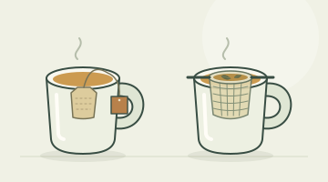<figcaption><strong class="tea-brewing-name">Mug + bag / basket</strong><span class="tea-brewing-note">A tea bag or a removable basket. Cutaway views show the inside.</span></figcaption></figure></li>
<li><figure class="tea-brewing-card" data-tea-brewing="western-pot">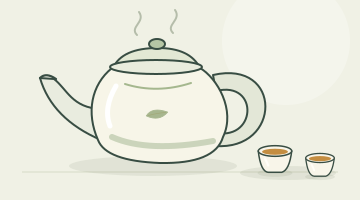<figcaption><strong class="tea-brewing-name">English / Western teapot</strong><span class="tea-brewing-note">A larger lidded pot for sharing.</span></figcaption></figure></li>
<li><figure class="tea-brewing-card" data-tea-brewing="gaiwan">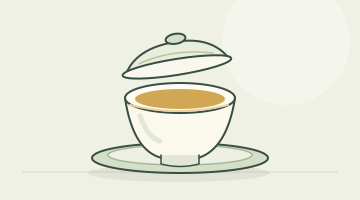<figcaption><strong class="tea-brewing-name">Gaiwan</strong><span class="tea-brewing-note">A bowl with a lid; shown with a saucer.</span></figcaption></figure></li>
<li><figure class="tea-brewing-card" data-tea-brewing="gongfu-kit">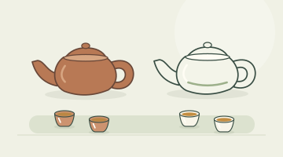<figcaption><strong class="tea-brewing-name">Small pot · gongfu-style kit</strong><span class="tea-brewing-note">Small pots and cups: clay and porcelain examples.</span></figcaption></figure></li>
<li><figure class="tea-brewing-card" data-tea-brewing="grandpa-style">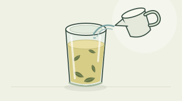<figcaption><strong class="tea-brewing-name">Grandpa style</strong><span class="tea-brewing-note">Loose leaves stay in the glass as water is added.</span></figcaption></figure></li>
<li><figure class="tea-brewing-card" data-tea-brewing="matcha-whisk">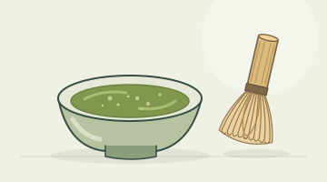<figcaption><strong class="tea-brewing-name">Matcha bowl + whisk</strong><span class="tea-brewing-note">A bowl and bamboo whisk for powdered tea.</span></figcaption></figure></li>
</ul>
</details>
```
<!-- tea-brewing-illustrations:end -->

| Kit / method | Plain meaning | Then open… |
| --- | --- | --- |
| **Mug + bag / basket** | The everyday default: one steep in a cup | The first mug on [Tea basics](tea-basics.qmd). If the cup is off, open [Kitchen troubleshoot](tea-troubleshoot.qmd). |
| **English / Western teapot** | A larger pot. The leaf sits in the pot or in an infuser, and the pot can be shared | [Kitchen troubleshoot](tea-troubleshoot.qmd), and [Chapter 1 · Section 3](modules/module-01/03-brewing.qmd) for time, temperature, and leaf. |
| **Gaiwan** | A lidded bowl for short infusions | Troubleshoot, or Chapter 1 · Section 3. This is not a ceremony lecture. |
| **Small clay or porcelain pot (gongfu-style kit)** | A small pot, small cups, and many short pours | **Culture:** [Chapter 3 · Section 4](modules/module-03/04-regional-scripts.qmd). **Dials:** Troubleshoot, or Chapter 1 · Section 3. |
| **Grandpa style** | The leaf stays in a large cup or glass, and you top up with water | Troubleshoot, or Chapter 1 · Section 3 (second-steep intuition). |
| **Matcha bowl + whisk** | You suspend the powder, and you drink the leaf solids | The matcha row above, and the [Cup reference](cup-reference.qmd) for theanine ranges. |

***

## Where this door sits / where to go next

Read the tea doors as nested maps.

1. **[Tea basics](tea-basics.qmd).** The first mug, true tea versus herbal, the green↔black contrast, three sample labels, and a thin six-type foldout that points here.
2. **Tea labels (this page).** The name sheet, the **six-type classification map**, the **grade languages** (particle versus quality-tier), and the kit nouns.
3. **[Kitchen troubleshoot](tea-troubleshoot.qmd).** The mug is already wrong, so the question is which dial to nudge.
4. **[Chapter 1](modules/module-01/index.qmd).** Plant, factory, brewing, and compounds.
5. **[Cup reference](cup-reference.qmd).** Typical milligrams in a 250 mL mug.
6. **[Chapter 3 · Section 4](modules/module-03/04-regional-scripts.qmd).** Gongfu, HK milk tea, and related culture scripts.
7. **[Reading a tea study](tea-reading-studies.qmd).** A headline checklist.

Still pouring your first cup? Stay on Basics. Ready for numbers? Open the Cup reference.

[^1]: UK Tea & Infusions Association. Types of tea, origins & varieties. https://www.tea.co.uk/types-of-tea (Black/green/white/dark overview; English Breakfast and Earl Grey as black-tea blends; oolong as partial oxidation; Keemun / Lapsang notes on trade type pages.)

[^2]: Ordinary oolong/black “fermentation” is enzymatic oxidation; true microbial fermentation mainly in post-fermented teas such as Pu-erh. See Subramanian et al. (1999) and Tanaka & Kouno (2003) as cited in [Chapter 1](modules/module-01/index.qmd). Wong et al. (2022) treat pu-erh among processing categories: https://doi.org/10.1111/1750-3841.16137

[^3]: Six manufactured types (green, yellow, white, oolong, black, dark) appear in processing overviews and ISO tea-type classification work (e.g. *Food Reviews International* tea-processing chapter, https://doi.org/10.1080/87559129509541052; ISO 20715:2023).

[^4]: Kyoto Prefectural Tea Industry Chamber. Types of tea (sencha; matcha/tencha). https://www.ujicha.or.jp/en/knowledge/kinds/

[^5]: Keenan, E. K., et al. (2011). How much theanine in a cup of tea? *Food Chemistry, 125*(2), 588–594. https://doi.org/10.1016/j.foodchem.2010.08.071 (Cup-reference baseline; shaded gyokuro/matcha noted higher.)

[^6]: Everyday baseline on the [Cup reference](cup-reference.qmd); formal tasting strength under ISO 3103:2019 — https://www.iso.org/standard/73224.html

[^7]: UK Tea & Infusions Association. Creating the perfect blend (orthodox rolling vs CTC / unorthodox smaller particles for quicker brew). https://www.tea.co.uk/tea-processing-and-blending

[^8]: U.S. Food and Drug Administration. (1996). Tea: A story of serendipity. *FDA Consumer*. https://permanent.access.gpo.gov/lps1609/www.fda.gov/fdac/features/296_tea.html

[^9]: Tea Association of the USA. (2019). Comment on FDA food standards of identity modernization (Docket FDA-2018-N-2381). https://downloads.regulations.gov/FDA-2018-N-2381-1376/attachment_1.pdf
