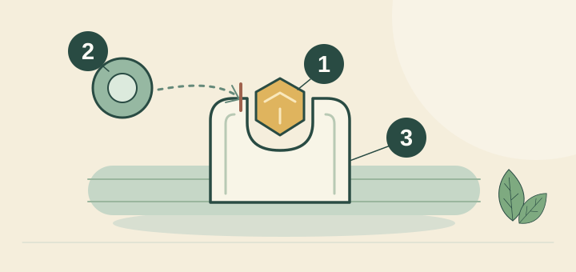
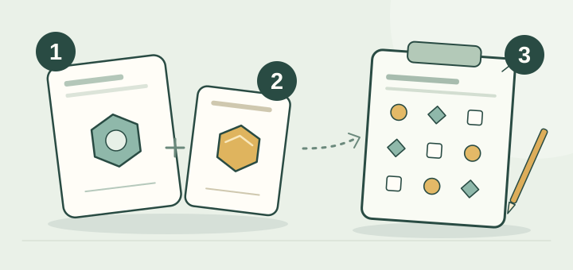
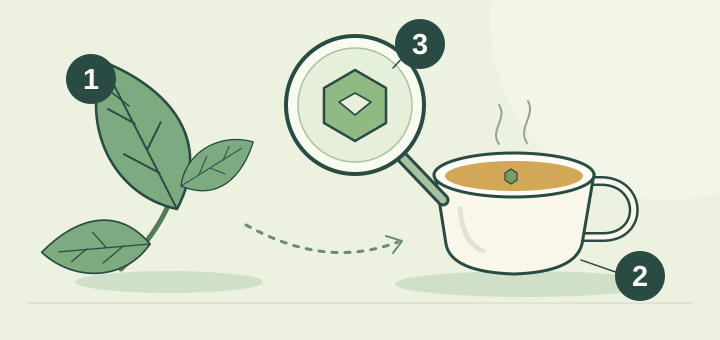



<!-- reader-guide:start -->
::: {.reader-guide}
**从一个问题开始**

三个化学名称，可以让一杯茶听来像补充剂标签。这一节让它们各就其位，也把饮品中的分量与研究使用的剂量分开。

**阅读时试一试:** 每遇到一种成分，记下名称、制备方式和时间相关主张。比较茶杯与胶囊之前，先沿脚注看来源。

[首页](../../index.qmd) · [章节地图](../../modules/index.qmd)
:::
<!-- reader-guide:end -->
::: {.zh-door-nav}
**本站中文入口：** [首页](../../index.qmd) · [茶叶入门](../../tea-basics.qmd) · [茶叶标签](../../tea-labels.qmd) · [杯量参考](../../cup-reference.qmd) · [词汇表](../../glossary.qmd) · [章节总览](../../modules/index.qmd) · [第一章](../module-01/index.qmd) · [第二章](../module-02/index.qmd) · [第三章](../module-03/index.qmd) · [第四章](../module-04/index.qmd) · [第五章](../module-05/index.qmd) · [联结桥梁](../../linkages.qmd) · [参考文献](../../bibliography.qmd)
:::

<!-- reading-fold:start -->
:::::::: {.callout-note collapse="true" title="原有导读与阅读提示"}


::: {.callout-note}
**核对数字和出处，以英文页为准。** 用页顶语言切换栏在英文／繁体／简体之间跳转。
:::

::: {.callout-tip}
**第一章 · 第四节（共四节）** — 属于 [第一章 化学核心](index.qmd)。第一次来？先看 [本章入口](index.qmd) 的整章地图。
:::

::: {.callout-note collapse="true" title="怎样读这一节（脚注＋折叠）"}
上标数字是脚注。点一下，就跳到出处；再点箭头，就回到刚才那一句。鼠标停在数字上，多数时候也会弹出摘要。分子式、半衰期表、受体和通路的标签，以及胶囊对罐子的算术，都收在折叠起来的“更多详情…”里，好让打开的正文继续用白话讲。
:::
::::::::
<!-- reading-fold:end -->
## 按不同时钟到来的客人

<!-- lesson-illustration:compound-clocks:start -->
```{=html}
<figure class="tea-lesson-figure" data-lesson-illustration="compound-clocks">
  
  <figcaption>谈成分时，时间很重要。时钟只是提醒，并非吸收曲线或精确时间表。</figcaption>
</figure>
```
<!-- lesson-illustration:compound-clocks:end -->

日常谈茶的化学，多半绕着三个名字转。不妨把他们想成三位客人：到达的速度不同，离开的时间也不同。在他们出场之前，植物（[第一章第一节](01-plants.qmd)）、厂房里的分叉（[第一章第二节](02-processing.qmd)）和水壶（[第一章第三节](03-brewing.qmd)）都已经做完各自的工作。

正文先记住一个区别：血液浓度的变化，不等于感受的时间表。不同茶叶与冲泡方式会影响成分含量和时间；具体测量与机制留在折叠详情里。

::: {.callout-tip title="这一坐的白话词"}
- **提神的客人**是咖啡因。它挡住那种“该睡觉了”的感觉。
- **研究问题：**茶氨酸是茶里的一种氨基酸，研究者曾探讨它对注意力和情绪可能有什么影响。但不能据此保证一杯茶会令人平静。[^8][^10][^11]
- **绿茶植物化合物这位客人**是 [EGCG](../../glossary.qmd#egcg)，也就是绿茶里最突出的儿茶素。
- **不是即时禅**提醒我们：研究的时间点对应某项测量，不代表喝茶后必然会在某个时刻感到平静。
:::

## 咖啡因 — 熟悉的提神客人

<!-- tea-compound-illustration:caffeine:start -->
```{=html}
<figure class="tea-compound-figure" data-tea-compound="caffeine">
  
  <figcaption>
    <div class="tea-compound-heading"><strong>咖啡因：位置已被占用</strong><span class="tea-compound-formula">C₈H₁₀N₄O₂</span></div>
    <ol class="tea-compound-legend" role="list">
      <li><span class="tea-compound-key" aria-hidden="true">1</span><strong>咖啡因</strong><span>占据腺苷受体。</span></li>
      <li><span class="tea-compound-key" aria-hidden="true">2</span><strong>腺苷</strong><span>在这个位置的信号传递受到阻挡。</span></li>
      <li><span class="tea-compound-key" aria-hidden="true">3</span><strong>受体</strong><span>简化画成可容纳符号的凹槽。</span></li>
    </ol>
    <p class="tea-compound-note">图形只是符号，并非分子结构。这幅示意图不能预测你有多清醒，或能维持多久。</p>
  </figcaption>
</figure>
```
<!-- tea-compound-illustration:caffeine:end -->

**咖啡因**帮人保持清醒。用白话说，它挡住大脑那个“你开始困了”的信号，好让你继续干活。血液里的典型故事是：它往往要待上**几小时**，不过人和人差得很多。[^1]

最后那一句很要紧。朋友说“到了晚饭还兴奋着”，可以是生化上的事，不必是戏剧。想看分子式、半衰期的范围，以及这条差异背后的肝酶叫什么名字，打开下面的折叠就行。

## 茶氨酸——一种正在研究的氨基酸

<!-- tea-compound-illustration:l-theanine:start -->
```{=html}
<figure class="tea-compound-figure" data-tea-compound="l-theanine">
  
  <figcaption>
    <div class="tea-compound-heading"><strong>茶氨酸：从成分到研究问题</strong><span class="tea-compound-formula">C₇H₁₄N₂O₃</span></div>
    <ol class="tea-compound-legend" role="list">
      <li><span class="tea-compound-key" aria-hidden="true">1</span><strong>茶氨酸</strong><span>茶里的一种氨基酸。</span></li>
      <li><span class="tea-compound-key" aria-hidden="true">2</span><strong>咖啡因</strong><span>常与茶氨酸一起接受研究。</span></li>
      <li><span class="tea-compound-key" aria-hidden="true">3</span><strong>注意力测验</strong><span>研究人员测量表现。</span></li>
    </ol>
    <p class="tea-compound-note">虚线表示“一起研究”，并不保证有益处。图形只是符号；研究使用的配方和剂量，不一定等同于日常一杯茶。</p>
  </figcaption>
</figure>
```
<!-- tea-compound-illustration:l-theanine:end -->

**茶氨酸**是茶里的一种氨基酸。研究者单独或与咖啡因一起研究它对注意力和情绪可能产生的影响。现有研究不能证明日常一杯茶必定有稳定的镇静作用：茶叶成分与冲泡方式各异，有些试验使用的是剂量明确的纯化成分。[^8][^10][^11]人体血液测量显示，茶氨酸的时间进程通常比咖啡因短；这并不能预测一个人会有什么感受。[^5][^6]

## EGCG — 绿茶儿茶素客人

<!-- tea-compound-illustration:egcg:start -->
```{=html}
<figure class="tea-compound-figure" data-tea-compound="egcg">
  
  <figcaption>
    <div class="tea-compound-heading"><strong>EGCG：混合物中的一种成分</strong><span class="tea-compound-formula">C₂₂H₁₈O₁₁</span></div>
    <ol class="tea-compound-legend" role="list">
      <li><span class="tea-compound-key" aria-hidden="true">1</span><strong>茶叶</strong><span>含有多种化合物。</span></li>
      <li><span class="tea-compound-key" aria-hidden="true">2</span><strong>泡好的茶</strong><span>部分化合物进入水中。</span></li>
      <li><span class="tea-compound-key" aria-hidden="true">3</span><strong>EGCG</strong><span>混合物中的一种儿茶素。</span></li>
    </ol>
    <p class="tea-compound-note">放大镜用来辨认成分，并非展示分子的真实形状、杯中的含量、人体吸收或健康效果。</p>
  </figcaption>
</figure>
```
<!-- tea-compound-illustration:egcg:end -->

**EGCG** 是绿茶里一种主要的植物化合物，属于儿茶素。用第一章的日常说法，它就是 [第一章第三节](03-brewing.qmd) 里那位需要更多热、更多时间才肯离开叶子的客人。在研究文献里，它出现在关于炎症和细胞信号的讨论中。血液里的典型故事是：口服以后以**数小时**计，介乎咖啡因的长时间逗留和茶氨酸的较短时钟之间。[^4]

## 为什么“我一小时前喝了茶”其实是三个故事

白话里的“半衰期”，大致是血液里的量大约掉到一半要多久。它不是“完全消失”。这一点很要紧，因为“我一小时前喝了茶”对每一种化合物都不是同一个故事。咖啡因往往要待上几小时。茶氨酸的血浆时钟更短。EGCG 介乎两者之间。人体的时程研究显示，口服以后的峰值大约在数十分钟到一两小时，视化合物和剂型而定。[^5][^6]

血液浓度、脑电记录、测验成绩和主观感受，是不同的测量结果。研究报告的是特定剂量与实验设计下的结果；这些数据不能为日常一杯茶的感受排出可靠时间表。阅读研究结论时，要一并看清制备方式、剂量、参与者和测量指标。[^5][^6][^8][^10]

“喝茶即刻带来禅定式专注”超出了这些研究能说明的范围。对照剂量和测验结果，并不能证明每一杯茶都会让人平静或专注。[^8][^10][^11]

::: {.callout-note collapse="true" title="更多详情：分子式、半衰期，以及人为什么不同"}
| 客人 | 分子式 | 大约分子量 | 典型血浆半衰期 | 日常角色 |
| --- | --- | --- | --- | --- |
| 咖啡因 | C₈H₁₀N₄O₂ | 194.19 克/摩尔 | 约 **3–7 小时** | 挡住腺苷“困倦”受体 |
| 茶氨酸 | C₇H₁₄N₂O₃ | 174.20 克/摩尔 | 约 **50–80 分钟** | 研究者探讨其对注意力和情绪可能产生的影响；不保证喝茶后会有特定感受 |
| EGCG | C₂₂H₁₈O₁₁ | 458.37 克/摩尔 | 约 **2–5 小时** | 主要绿茶儿茶素；炎症／细胞信号研究 |

半衰期的意思是“大约多久血药浓度会掉一半”，不是“完全消失”。咖啡因往往要待上几小时，茶氨酸的血浆时钟更短，EGCG 介乎两者之间。[^1][^4][^5]

**为什么咖啡因的范围那么宽。** 大部分咖啡因的清除走肝酶 **CYP1A2**，而这个酶的活性人和人差得很多。吸烟、激素、药物、肝脏的健康，以及遗传（包括常见的 CYP1A2 变异），都会改变一剂咖啡因待多久。[^9] 因此，“我三小时前喝了茶”对每一个喝茶的人并不是同一个故事，哪怕还没算这杯有多浓。

**受体和通路的标签（供第二章交叉引用）。** 咖啡因在日常里的作用，是拮抗腺苷受体。[^1] 茶氨酸可以在某些谷氨酸受体位点上弱弱地竞争（AMPA、海人藻酸，以及和 NMDA 相关的位点），效力远低于谷氨酸本身。这符合“把嘈杂的声量拧低”那幅画面。[^2][^3] 文中，EGCG 出现在与 NF-κB 等相关的细胞信号讨论里。第一章只需要它的时机，以及它作为绿茶代表的身份。[^4]

人体时程研究会测量血液中的成分浓度；认知试验则按各自的实验设计测量其他结果。两者都不能为日常一杯茶的感受提供精确时间表。[^5][^6][^8][^10]
:::

::: {.callout-note collapse="true" title="更多详情：实验室毫克 vs 超市杯子"}
许多认知试验和脑电图试验，用的是**纯化**的茶氨酸和咖啡因，剂量以已知的毫克计。例如欧文（Owen）等人用 **50–100 毫克** 茶氨酸配上 **50 毫克** 咖啡因；其他设计里还有更高的分离剂量，包括哈斯克尔（Haskell）等人的工作。[^8][^10] 你在超市买的茶包是一种混合物，随叶子、品牌和浸泡而变。

基南（Keenan）量过杯子，提醒我们：普通泡两分钟的一杯，往往送出的是**数十毫克**茶氨酸，而不是一粒 200 毫克 的胶囊。[^11] 抹茶和遮荫绿茶可以更高。匆匆泡一个红茶包，通常茶氨酸较低，更偏“熟悉的咖啡因”那一边。当标题说“茶会做某件事”时，请打开 [杯量参考](../../cup-reference.qmd)，问清楚**是哪些毫克、哪一种基质、哪一只时钟**。

第二章会在脑子里接上双重故事，也就是咖啡因加上茶氨酸。这一节只坚持一件事：对剂量和时机要诚实。
:::

::: {.callout-tip}
三位客人讲完以后，[本章入口](index.qmd) 还留着一份短的**饮者田野指南**（绿茶对红茶怎么选、冷泡的迷思、实验室剂量和杯子剂量的差别），跨进第二章之前可以先看一看。
:::

## 一分钟说完

<!-- reading-fold:start -->
:::::::: {.callout-note collapse="true" title="需要时重温"}

三种成分，引出不同研究问题：咖啡因与警觉、茶氨酸与注意力或情绪的可能关系，以及 EGCG 与绿茶儿茶素化学。它们在血液中的时间进程不同，但血药浓度不能换算成主观感受的精确时间表。实验室剂量和日常茶饮不可混为一谈。
::::::::
<!-- reading-fold:end -->
::: {.callout-tip title="你可以先停在这里"}
- 三种成分引出不同问题：咖啡因与警觉、茶氨酸与注意力或情绪的可能关系、EGCG 与绿茶儿茶素化学。
- 杯子送出的是**数十 毫克**；许多实验室试验用的是 **100–200 毫克** 的胶囊。不要把两者混为一谈。
- “不是即时禅”：研究中的时间点不能预测一个人会否在喝茶后感到不同，或何时有这种感觉。
:::

::: {.callout-note collapse="true" title="更多详情：这对你喝茶有什么用"}
- 阅读时间相关的研究结果时，要注明该研究使用的剂量和测量指标；不要把实验时间表当作喝茶后的注意力安排。[^8][^10]
- 还没对照 [杯量参考](../../cup-reference.qmd) 之前，不要把茶包和一粒 200 毫克 的茶氨酸胶囊放在一起比。
- 记住，人清除咖啡因的方式并不相同。朋友还“兴奋着”，可以是生化上的事，不必是戏剧。[^9]
:::

::: {.callout-note collapse="true" title="更多详情：怎样阅读研究时间点"}
每项研究的计时都从特定剂量和制备方式开始。血液浓度、脑部测量和测验成绩是不同结果；它们都不能可靠预测日常一杯茶会有什么感受。把研究应用到喝茶时，先看参与者喝了什么、研究对象是谁，以及研究人员测量了什么。[^5][^6][^8][^10]
:::

::: {.callout-tip collapse="true" title="点开更多详情：第一章第四节带走清单"}
1. 咖啡因是腺苷的拮抗，半衰期的范围以小时计。[^1]
2. 茶氨酸是对谷氨酸的低亲和拮抗，血浆时钟较短。[^2][^3]
3. EGCG 是主要的绿茶儿茶素，药代以数小时计。[^4]
4. 对剂量要诚实：杯子并不是胶囊（见 [杯量参考](../../cup-reference.qmd)）。
5. CYP1A2 以及其他因素：人和人并不相同。[^9]
6. 下一步：第二章跟着这些客人，看你吞下去以后的事。
:::

## 三位客人怎样为第二章铺路

第二章的双重故事要讲得通，你就得记住血流里是谁。

1. **咖啡因**让困倦的信号不那么容易“占座”，对许多人可以是几小时。[^1]
2. **茶氨酸**曾用于注意力和情绪研究；单独补充剂的结果不能证明日常一杯茶会带来同样感受。[^8][^10][^11]
3. **EGCG** 是绿茶儿茶素里的头条化合物。它对杯子里萃取了什么很重要（[第一章第三节](03-brewing.qmd)），即使第二章把更多篇幅给了咖啡因和茶氨酸的配合。

跳过剂量和时机，第二章就变成口号。守住它们，第二章才成为一张地图。

::: {.callout-note collapse="true" title="更多详情：把保健品标签放在茶罐旁边读"}
假设一粒胶囊写着 **200 毫克 茶氨酸**，而一篇论文报告了 60 分钟时的注意力效应。基南所测的普通杯子，在两分钟浸泡以后，茶氨酸往往落在**数十毫克**附近。[^11] 这并不表示茶“没有用”。它表示的是另外几件事。

- 多喝几杯、改用抹茶或遮荫的叶子，或者把浸泡拉长，算术就会变。
- 胶囊试验回答的是胶囊的问题。
- 诚实的做法是：在宣称试验的效应有多大之前，先问*你的*杯子送出了什么。

[杯量参考](../../cup-reference.qmd) 就是为了这一次换算。
:::

***

**导航：** [↑ 第一章入口](index.qmd) · [← 上一节](03-brewing.qmd) · [下一章 →](../module-02/index.qmd)

[^1]: Fredholm, B. B., Bättig, K., Holmén, J., Nehlig, A., & Zvartau, E. E. (1999). Actions of caffeine in the brain with special reference to factors that contribute to its widespread use. *Pharmacological Reviews, 51*(1), 83–133. https://pharmrev.aspetjournals.org/content/51/1/83

[^2]: Kakuda, T., Nozawa, A., Sugimoto, A., & Niino, H. (2002). Inhibition by theanine of binding of [³H]AMPA, [³H]kainate, and [³H]MDL 105,519 to glutamate receptors. *Bioscience, Biotechnology, and Biochemistry, 66*(12), 2683–2686. https://doi.org/10.1271/bbb.66.2683

[^3]: Kakuda, T. (2011). Neuroprotective effects of theanine and its preventive effects on cognitive dysfunction. *Pharmacological Research, 64*(2), 162–168.

[^4]: Chow, H. H. S., et al. (2001). Pharmacokinetics and safety of green tea polyphenols after multiple-dose administration of epigallocatechin gallate and Polyphenon E in healthy individuals. *Clinical Cancer Research, 7*(5), 1204–1212.

[^5]: van der Pijl, P. C., et al. (2010). Human pharmacokinetic profile of green tea catechins and L-theanine. *British Journal of Nutrition, 104*(8), 1157–1164.

[^6]: Scheid, L., et al. (2012). Kinetics of L-theanine uptake and metabolism in healthy humans (cited *Journal of Nutrition* entry).

[^7]: Nobre, A. C., Rao, A., & Owen, G. N. (2008). L-theanine, a natural constituent in tea, and its effect on mental state. *Asia Pacific Journal of Clinical Nutrition, 17*(S1), 167–168. https://pubmed.ncbi.nlm.nih.gov/18296328/

[^8]: Owen, G. N., et al. (2008). The combined effects of L-theanine and caffeine on cognitive performance and mood. *Nutritional Neuroscience, 11*(4), 193–198. https://doi.org/10.1179/147683008X301513

[^9]: Nehlig, A. (2018). Interindividual differences in caffeine metabolism and factors driving caffeine consumption. *Pharmacological Reviews, 70*(2), 384–411. https://doi.org/10.1124/pr.117.014407

[^10]: Haskell, C. F., et al. (2008). The effects of L-theanine, caffeine and their combination on cognition and mood. *Biological Psychology, 77*(2), 113–122. https://doi.org/10.1016/j.biopsycho.2007.09.008

[^11]: Keenan, E. K., et al. (2011). How much theanine in a cup of tea? Effects of tea type and method of preparation. *Food Chemistry, 125*(2), 588–594. https://doi.org/10.1016/j.foodchem.2010.08.071
