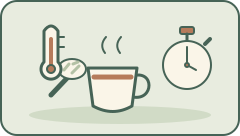



<!-- reader-guide:start -->
::: {.reader-guide}
**从一个问题开始**

量茶、注水、等待、奉茶：一套熟悉动作，提供了一段可以观察的次序。哪些关乎重复动作，哪些关乎期望，哪些又关乎饮品？

**阅读时试一试:** 先描述一套熟悉程序，暂时不解释它的效果；再想想，要测试其中一个解释，需要怎样比较。

[首页](../../index.qmd) · [章节地图](../../modules/index.qmd)
:::
<!-- reader-guide:end -->
::: {.zh-door-nav}
**本站中文入口：** [首页](../../index.qmd) · [茶叶入门](../../tea-basics.qmd) · [茶叶标签](../../tea-labels.qmd) · [杯量参考](../../cup-reference.qmd) · [词汇表](../../glossary.qmd) · [章节总览](../../modules/index.qmd) · [第一章](../module-01/index.qmd) · [第二章](../module-02/index.qmd) · [第三章](../module-03/index.qmd) · [第四章](../module-04/index.qmd) · [第五章](../module-05/index.qmd) · [联结桥梁](../../linkages.qmd) · [参考文献](../../bibliography.qmd)
:::

<!-- reading-fold:start -->
:::::::: {.callout-note collapse="true" title="原有导读与阅读提示"}


::: {.callout-note}
**核对数字和出处，以英文页为准。** 用页顶语言切换栏在英文／繁体／简体之间跳转。
:::

::: {.callout-tip}
**第四章 · 第二节（共四节）** — 属于 [第四章 · 情境与仪式心理](index.qmd)。第一次来？先到 [本章入口](index.qmd) 看整章地图。
:::

::: {.callout-note collapse="true" title="怎样读这一节（脚注＋折叠）"}
上标数字是可以点的脚注。点一下跳到出处，再点箭头回到正文；鼠标停在数字上，多数时候也会弹出摘要。更密的自主神经数据、错误相关负波的笔记，以及“正念”和“固定流程”的区别，都放在折叠的“更多详情……”里。有一篇著名论文**不**当作证据，原因见警示框。
:::
::::::::
<!-- reading-fold:end -->
## 手比脑子先记住流程

<!-- lesson-illustration:ritual-actions:start -->
```{=html}
<figure class="tea-lesson-figure" data-lesson-illustration="ritual-actions">
  
  <figcaption>量取、留意、等待：熟悉的动作是这一课的具体起点。插图不作临床效果的承诺。</figcaption>
</figure>
```
<!-- lesson-illustration:ritual-actions:end -->

大考之前，或者一场难缠的会议之前，你每次都做同样的三件事：烧水、泡茶、喝一口。双手已经把这套流程记住了。在这些资料看来，要紧的正是这份可以预料，而不是什么玄而又玄的说法。

一段短而熟悉的流程，能给头脑一件具体的事做。量茶叶、看水、再等一等，也许能成为面对下一件难事前的注意力锚点；下面引用的研究没有测试泡茶小憩是否会降低心率。

数得清的动作很重要：量好茶叶，看水温到了没有，再等到浸泡结束。这些步骤也许可以在考试或难写的邮件前成为注意力锚点。但这只是教学设想，不是经过检验的泡茶方案；要知道它能否影响担忧，还需比较研究。

上一节的温暖大多是被动的，握着一只杯子就行。这一节的仪式是主动的，你要*亲手*把茶泡出来。本站认真看待这个区别。

## 本站强调的三点

有三个彼此相关的说法，会反复出现。

1. **注意力锚点。** 泡茶的动作需要注意力：量茶叶、看水、等浸泡结束。它们是否会打断焦虑的来回打转，这里引用的研究没有检验。
2. **身体指标还需要单独检验。** 朗和同事发现，诱发焦虑后，动作更重复、更刻板；心率升高也能预测这些动作。[^2] 这项研究没有发现做仪式会降低心率、皮肤紧张信号，或提高[心率变异性（HRV）](../../glossary.qmd#hrv)。
3. **把脑力留住。** 从艰苦的分析里短短抽身，可以减轻疲劳。再回到问题上时，仔细想的能力还在，而不是被一点点磨掉。

仪式心理学的综合性综述把仪式说成：有结构、会重复、带象征意义的一连串动作。这样的动作可以减轻焦虑，帮人找回掌控感，尤其是下一件事利害很大的时候。[^1] 霍布森（Hobson）和同事把仪式的功能收成三个方面：调节情绪，调节表现上的目标状态，以及维系社会联结。[^1]

::: {.callout-note collapse="true" title="更多详情：霍布森 2018——仪式怎样定义，又有什么用"}
霍布森、施罗德（Schroeder）、里森（Risen）、克西加拉塔斯（Xygalatas）和因兹利希特（Inzlicht）（2018）在综述里把仪式心理学看成一个**过程**，而不是一个单一的神奇结果。[^1] 本站教学时先记下这些。

**定义里的几样东西**（综述列出的一组特征，用白话说）：

- 一连串**有结构**、往往**会重复**的动作。
- 相对于目的而言，动作是**刻板**的、不变的。就算有捷径“也能行”，你还是照步骤来。
- 往往带有**象征意义**。这串动作的意义，超出了它在物理上的结果。泡一杯茶本来可以更快，流程本身才是重点。

**综述收拢的三种功能**（本页后面还会展开）：

1. 调节**情绪**（焦虑、悲伤、兴奋）。
2. 调节**表现目标状态**（高风险任务之前的准备）。
3. 调节**社会联结**（大家一起做同一件事）。

**两条路。** 一条是自下而上的物理特征：重复、刻板、同步。另一条是自上而下的意义：为什么*这一套*动作对你重要。一个人独自泡茶歇一会儿，主要靠情绪调节，也靠进入状态。和别人一起喝茶，就多了一层联结。不过，两条路都不是去引用一篇已经撤稿的焦虑论文的理由。见下面关于布鲁克斯的警示。[^1][^4]
:::

朗和同事发现，诱发焦虑会增加动作的重复性和刻板程度；心率升高能预测这些动作特征。[^2] 第二章的[茶氨酸](../../glossary.qmd#l-theanine)研究则测量了高难度心算时的压力反应。[^3] 两项实验都没有测试泡茶是否让身体平静。下面的折叠框把各研究的设计和结果分开说明。

::: {.callout-note collapse="true" title="更多详情：朗与霍布森的实验测量了什么"}
| 指标 | 发现 | 出处 |
| --- | --- | --- |
| 仪式心理学（综述） | 有结构的仪式可以减轻焦虑，并在压力下支持表现（机制：情绪调节、掌控感） | 霍布森等人（2018）[^1] |
| 焦虑与自发动作 | 诱发焦虑后，动作更重复、更刻板；心率升高能预测这些动作。仪式并非实验处理。 | 朗（Lang）等人（2015）[^2] |
| 大脑的快速“糟了”警报（错误相关负波，ERN） | 练习过一套任意动作后，仪式组的 ERN 减弱；任务表现没有改善。 | 霍布森、邦克与因兹利希特（2017）[^5] |
| 心算压力下的茶氨酸 | 与安慰剂相比，心率和压力指标更低 | 木村（Kimura）等人（2007）[^3] |

| 指标 | 处理思路 | 论文速写 | 出处线索 |
| --- | --- | --- | --- |
| 心率与动作 | 诱发焦虑，然后测量手部动作 | 心率升高能预测动作更重复、更刻板；并未测试仪式是否让心率下降 | 朗等人（2015）[^2] |
| 错误相关负波（ERN） | 练习过的仪式与对照动作，在动作前后测量 | 仪式组的 ERN 在动作后减弱；错误率和反应时间没有改善 | 霍布森、邦克与因兹利希特（2017）[^5] |
| 茶氨酸＋高难度心算 | 约 **200 毫克** 级别的茶氨酸实验设计（与第二章的桥梁） | 与安慰剂相比，心率和压力指标更低 | 木村等人（2007）[^3] |

仪式心理学的综述（霍布森等人，2018）是这样说的：有结构的仪式，可以经由自下而上的物理特征，以及自上而下的意义，去调节情绪、表现目标和社会联结。[^1]

**本表不收：** 布鲁克斯等人（2016）的状态—特质焦虑量表（STAI）分数。见警示框和撤稿的折叠框。这些数字在本站**不**当作证据。
:::

::: {.callout-note collapse="true" title="更多详情：心率与犯错信号——实验实际检验了什么"}
两项实验测量了不同的结果，都不能证明泡茶小憩会令脉搏或脑电发生固定幅度的变化。

**朗和同事（2015），焦虑与动作。** 参与者经历诱发焦虑的情境后，完成手部动作任务。诱发焦虑使动作更重复、更刻板；心率升高能预测这些动作特征。[^2] 论文没有比较“让人平静的仪式”和没有固定步骤的小憩。本站先前所写的心率下降 **4.3 次／分**，并非这项实验的结果。

**霍布森、邦克与因兹利希特（2017），错误相关负波。** 参与者在家练习一套任意动作一周，随后在实验室做任务，并在仪式或对照动作的前后接受测量。仪式组在动作后出现较弱的 ERN，但错误率和反应时间没有改善。[^5] 本站先前所写的 **1.85 μV** 降幅与期刊信息，都不符合这篇论文。它没有测试泡茶，也没有直接证明焦虑的反复思量减少。

**木村这座桥（不是讲仪式流程的论文）。** 在高难度心算里，茶氨酸与安慰剂相比，降低了心率和压力指标。[^3] 化学和手上的动作编排可以彼此呼应，机制仍然不同。见 [第二章 · 身体信号](../module-02/04-body-signals.qmd)。
:::

## 一篇我们不采用的文献

::: {.callout-caution title="布鲁克斯等人（2016）已被撤稿——不要使用其焦虑量表数据"}
文献里引用过一篇论文（布鲁克斯［Brooks］等人，2016，《不要停止相信……》）。它报告说，仪式能降低焦虑（状态—特质焦虑量表，STAI），并能提升表现。这篇文章因为数据完整性出了问题，已于 **2024 年被撤稿**。我们保留综述和其他实验（霍布森、朗、木村）里更宽的仪式故事，但**不会**把布鲁克斯的焦虑量表数字，或它任何关于表现的结论，当作证据。[^4]

如果你在别处看见这篇论文被当作正面结果来引，请把它当成一个警示标签，而不是一项研究发现。
:::

::: {.callout-caution collapse="true" title="更多详情：为什么排除布鲁克斯 2016（是撤稿，不是挑刺）"}
作者的文中有一行布鲁克斯等人（2016）的数据：仪式动作对比随机动作，焦虑量表的均值大约是 **34.6** 对 **42.8**，另外还有一个关于表现的故事。**本站不讲这些数字。** 这篇发表在《组织行为与人类决策过程》（*Organizational Behavior and Human Decision Processes*）上的文章，已于 **2024 年被撤稿**。[^4][^6]

期刊撤稿声明里说了什么，用白话转述如下。[^6]

- 作者团队自己核查数据之后联系了编辑，表示**对数据的完整性已经失去信心**，并请求撤稿。
- 期刊拿不到研究 1a、1b 和 2 的原始数据。研究 1b 公开出来的数据里，心率评分出现了**异常的一串重复**。
- 对研究 3 和 4 重新分析之后，发现有**没有报告的排除**（分别排除了 6 名和 11 名参与者）。把所有人都放回去之后，**核心效应不再显著**。

**因此：**

| 你可能在别处看到 | 本站的做法 |
| --- | --- |
| “仪式让焦虑量表分数从约 43 降到约 35” | **不采用。** 这些数字出自已撤稿的论文，或引用了它的本站条目 |
| “仪式能提升表现（布鲁克斯 2016）” | **不采用** |
| 霍布森 2018 综述；朗的焦虑与动作实验；霍布森 2017 错误相关负波实验；木村的茶氨酸研究 | **仍留在故事里**，但各有不同设计与局限 [^1][^2][^5][^3] |

把布鲁克斯的论文排除在外，**并不**等于说“仪式毫无作用”。它只是说，这一篇有名的、把焦虑和表现绑在一起的论文，不能当作证据。如果某份幻灯片仍然拿它打头阵，那就是一个警示标签。
:::

## 仪式不等于正念

人们常常把两件事说成一件：“泡茶仪式就是正念。”正念是对当下保持开放的觉察。在这些资料里，仪式更多是指**固定、可以预料的步骤**。

你愿意带着开放的觉察去泡茶，也可以。这里引用的仪式实验使用的是练习过的一套任意动作，并没有测试泡茶或正念练习。[^5] 这个区别有助于设计下一步的比较研究。

在一项实验中，完成练习过的任意动作后，[错误相关负波](../../glossary.qmd#ern)（ERN，犯错时出现的快速脑电反应）减弱了。[^5] 研究没有直接测量泡茶流程是否减轻焦虑或反复思量。

泡茶小憩也许能提供一段可重复的流程；它能否改变犯错信号，或让人觉得更平静，仍是待检验的问题。

::: {.callout-note collapse="true" title="更多详情：正念与固定流程的泡茶小憩"}
流行的管理文章，常把“泡茶仪式”收成“正念”两个字。把本站的资料和霍布森的综述仔细读过，界线会清楚一些。[^1][^5]

| | 正念（通俗意义上的） | 仪式流程（本节所说的） |
| --- | --- | --- |
| 姿态 | 对浮现的一切保持开放、接纳的觉察 | 几乎不用做决定就能完成的固定步骤 |
| 被引用的实验检验了什么 | 没有作为比较对象接受检验 | 练习过的任意动作使 ERN 减弱；没有测量泡茶是否缓解焦虑 [^5] |
| 失败的样子 | “我没能活在当下” | 跳过流程，在任务上越想越乱 |
| 泡茶的例子 | 留意香气、温度，以及来来去去的念头 | 同样的茶量，同样地看水，同样地等待——哪怕今天过得很糟 |

你当然*可以*带着正念泡茶，也可以照固定流程去做。这里引用的实验既没有测试泡茶，也没有测试正念；它测量的是练习过的任意仪式之后，人们对错误的脑电反应。[^5] [第三章第二节](../module-03/02-monastic-path.qmd) 的寺院清规只是历史上的类比，不是实验室里的复制品。
:::

## 化学与动作编排，可以相互呼应

固定的泡茶流程是一种文化实践；这里引用的茶氨酸研究，检验的是心算中的成分作用，并没有检验泡茶仪式或 HRV。[^3] 读[第二章 · 身体信号](../module-02/04-body-signals.qmd)及第五章的决策游戏时，要记住这种区别：仪式对选择是否有影响，还需要单独检验。

这句呼应要说得小心。第二章的[茶氨酸](../../glossary.qmd#l-theanine)研究，在心算时检验的是给予茶氨酸后的压力反应。[^3] 泡茶流程也许能成为注意力锚点，但这些论文没有检验它是否减轻反复思量，或改变犯错信号。一个是成分，另一个是动作；两者的作用需要分别检验。

情境是剂量的一部分。温度、仪式和心里的预期，会跟着咖啡因和茶氨酸一起进来。带着这句话走进 [第五章](../module-05/index.qmd)。[第四节](04-context-dials-map.qmd) 的三旋钮地图，会把温暖、流程和名字收在同一张图里，却不把这一节的工作抢走。

::: {.callout-tip collapse="true" title="点开更多详情：三步泡茶小憩（教学示意，不是临床方案）"}
下面这三步，借的是本站用白话强调的重点，不是医疗处方。

1. **量** — 用你平时一直用的茶量，让注意力落在一个数得清的动作上。
2. **看** — 看水，也看茶叶。[第三章第二节](../module-03/02-monastic-path.qmd) 里陆羽“看水泡辨火候”的习惯，可以当作可有可无的一点历史味道。
3. **等** — 浸泡的时间就是一次暂停。别把这段等待当成“开工前浪费掉的时间”。

然后再回到那件难事上。这是一套教学示意，不是经过验证的泡茶方案；它对注意力、焦虑和自主神经指标的影响，仍需比较研究来检验。
:::


## 心里打转时，可预期性为什么有用

焦虑的来回打转，代价很高。脑子一遍又一遍地预演那场考试、那个会议、那封邮件。泡茶的流程用一些“当下就有对错”的动作，把这种预演打断：水开了没有？茶叶量好了没有？

这就是**注意力的锚点**。它不是把性格改造一遍。

现有证据没有显示熟悉的泡茶仪式会降低心率、皮肤紧张信号或改变 HRV。朗的实验反而把诱发焦虑和心率升高，联系到更重复、更刻板的动作。[^2] 第二章的茶氨酸研究检验的是心算中的另一种处理。[^3]

::: {.callout-note collapse="true" title="更多详情：霍布森归纳的仪式三大功能（教学地图）"}
霍布森等人（2018）把仪式心理学收成对以下三方面的调节。[^1]

1. **情绪** — 焦虑、悲伤、兴奋。
2. **表现目标状态** — 高风险任务之前的准备。
3. **社会联结** — 大家协调在一起之后生出的意义。

一个人泡茶歇一会儿，主要靠（1）和（2）。和别人一起喝茶，还会用上（3）。几百年前，寺院清规（[第三章第二节](../module-03/02-monastic-path.qmd)）就已经把（2）和（3）做成了制度。

在这篇综述的框架里，自下而上的特征（重复、刻板、同步）和自上而下的意义（为什么这套动作重要），都会起作用。[^1]
:::

## 带进第五章的三句话

把这几句话带进“决策”。

1. 一项实验中，练习过的任意仪式减弱了与犯错有关的脑电信号，却没有改善任务表现。[^5] 泡茶小憩是否影响焦虑或第五章的决策，仍需要检验。
2. 布鲁克斯（2016）的焦虑量表数字和表现上的结论，在 2024 年撤稿之后**不得使用**。[^4] 如果幻灯片仍然拿它们打头阵，请把它当成警示标签。
3. 情境旋钮会跟着成分一起进来。温暖来自[第一节](01-warmth-trust.qmd)，仪式来自这一节，预期来自[第三节](03-expectation-labels.qmd)。所以第五章要把方法锁住（杯子配成一对、冲洗期、标签写清楚）。综合的地图在[第四节](04-context-dials-map.qmd)。方案表仍在[第五章 · 第四节](../module-05/04-study-protocols.qmd)。

想看决策游戏，就打开 [第五章](../module-05/index.qmd)。若想先把三颗旋钮收进同一张图，就先读完情境旋钮那张地图。


::: {.callout-tip title="你可以先停在这里"}
- 熟悉的泡茶流程也许能让注意力落在具体步骤上；这里引用的实验没有测试它能否减轻焦虑。
- 在这些资料里，要紧的是可以预料。你不必变成冥想老师。
- 布鲁克斯等人（2016）的焦虑量表数字，在 2024 年撤稿之后**不得使用**。
- 化学和手上的动作可以彼此呼应，机制仍然不同。见 [第二章 · 身体信号](../module-02/04-body-signals.qmd)。
:::

***

**导航：** [↑ 第四章入口](index.qmd) · [← 上一节](01-warmth-trust.qmd) · [下一节 →](03-expectation-labels.qmd)

## 参考文献

1. Hobson, N. M., Schroeder, J., Risen, J. L., Xygalatas, D., & Inzlicht, M. (2018). The psychology of rituals: An integrative review and process-based framework. *Personality and Social Psychology Review, 22*(3), 260–284. https://doi.org/10.1177/1088868317734944
2. Lang, M., Krátký, J., Shaver, J. H., Jerotijević, D., & Xygalatas, D. (2015). Effects of anxiety on spontaneous ritualized behavior. *Current Biology, 25*(14), 1892–1897. https://doi.org/10.1016/j.cub.2015.05.049
3. Kimura, K., Ozeki, M., Juneja, L. R., & Ohira, H. (2007). L-Theanine reduces psychological and physiological stress responses. *Biological Psychology, 74*(1), 39–45. https://doi.org/10.1016/j.biopsycho.2006.06.006
4. Brooks, A. W., Schroeder, J., Risen, J. L., Gino, F., Galinsky, A. D., Norton, M. I., & Schweitzer, M. E. (2016). Don't stop believing: Rituals improve performance by decreasing anxiety. *Organizational Behavior and Human Decision Processes* — **2024 年撤稿**；不作证据。 https://doi.org/10.1016/j.obhdp.2016.07.004
5. Hobson, N. M., Bonk, D., & Inzlicht, M. (2017). Rituals decrease the neural response to performance failure. *PeerJ, 5*, e3363. https://doi.org/10.7717/peerj.3363
6. 撤稿声明（2024）。Brooks et al., *Organizational Behavior and Human Decision Processes*. https://doi.org/10.1016/j.obhdp.2024.104377 — 数据完整性细节；**本站不作证据。**

[^1]: Hobson, N. M., Schroeder, J., Risen, J. L., Xygalatas, D., & Inzlicht, M. (2018). The psychology of rituals: An integrative review and process-based framework. *Personality and Social Psychology Review, 22*(3), 260–284. https://doi.org/10.1177/1088868317734944

[^2]: Lang, M., Krátký, J., Shaver, J. H., Jerotijević, D., & Xygalatas, D. (2015). Effects of anxiety on spontaneous ritualized behavior. *Current Biology, 25*(14), 1892–1897. https://doi.org/10.1016/j.cub.2015.05.049

[^3]: Kimura, K., Ozeki, M., Juneja, L. R., & Ohira, H. (2007). L-Theanine reduces psychological and physiological stress responses. *Biological Psychology, 74*(1), 39–45. https://doi.org/10.1016/j.biopsycho.2006.06.006

[^4]: Brooks, A. W., Schroeder, J., Risen, J. L., Gino, F., Galinsky, A. D., Norton, M. I., & Schweitzer, M. E. (2016). Don't stop believing: Rituals improve performance by decreasing anxiety. *Organizational Behavior and Human Decision Processes* — **2024 年撤稿**；不作证据。 https://doi.org/10.1016/j.obhdp.2016.07.004

[^5]: Hobson, N. M., Bonk, D., & Inzlicht, M. (2017). Rituals decrease the neural response to performance failure. *PeerJ, 5*, e3363. https://doi.org/10.7717/peerj.3363

[^6]: 撤稿声明（2024）。Brooks et al., *Organizational Behavior and Human Decision Processes*. https://doi.org/10.1016/j.obhdp.2024.104377 — 数据完整性细节；**本站不作证据。**
