

<!-- interactive-pilot:start -->
## 试做茶叶标签侦探 {#label-detective}

```{=html}
<div data-tea-detective data-locale="zh-hans">
<p>互动侦探需要 JavaScript。你仍可用下方表格练习：分开产地、风格、茶类、调配及等级字眼；不能确定的意思，先保留疑问。</p>
</div>
```
<!-- interactive-pilot:end -->

<!-- reader-guide:start -->
::: {.reader-guide}
**从一个问题开始**

一个茶名，可能同时像地名、品种名、制法，也像一句推荐。先分清每个词在说什么，标签就容易读得多。

**阅读时试一试:** 找一个真实包装或菜单上的茶名，标出产地、茶类、等级与冲泡方式；暂时分不清的词，先留作问题。

[首页](index.qmd) · [章节地图](modules/index.qmd)
:::
<!-- reader-guide:end -->
::: {.zh-door-nav}
**本站中文入口：** [首页](index.qmd) · [茶叶入门](tea-basics.qmd) · [茶叶标签](tea-labels.qmd) · [厨房排障](tea-troubleshoot.qmd) · [读懂茶研究](tea-reading-studies.qmd) · [杯量参考](cup-reference.qmd) · [词汇表](glossary.qmd) · [章节总览](modules/index.qmd) · [第一章](modules/module-01/index.qmd) · [第二章](modules/module-02/index.qmd) · [第三章](modules/module-03/index.qmd) · [第四章](modules/module-04/index.qmd) · [第五章](modules/module-05/index.qmd) · [联结桥梁](linkages.qmd) · [参考文献](bibliography.qmd)
:::

<!-- reading-fold:start -->
:::::::: {.callout-note collapse="true" title="原有导读与阅读提示"}


::: {.callout-note}
**核对数字与出处，以英文页为准。** 用页顶语言切换在英文／繁体／简体之间跳转。
:::

[茶叶入门](tea-basics.qmd)已经带你倒了第一杯，也认了三个名字。本页是**货架与咖啡馆字典**。中文、日文和西方的日常标签都收在这里，旁边还有一幅**六大成品茶类**的**分类地图**，一段讲**等级用语**的说明（说的是颗粒大小，还是品质档次标签），以及一条**薄薄的**茶壶与冲泡器具带。这条带只讲器具*是什么*，不讲萃取化学。

它不是第二本第一章，不是毫克表，不是厨房投诉单，也不是购物或“最好茶”排行榜。典型毫克数在 [杯量参考](cup-reference.qmd)。杯子发苦或发淡，去 [厨房排障](tea-troubleshoot.qmd)。潮汕工夫茶和港式奶茶的文化厚度，写在 [第三章 · 第四节——地域剧本](modules/module-03/04-regional-scripts.qmd)。

入门看完，如果盒子或菜单还是糊的，就用**本页**。最常遇到的是两件事：要把一个名字对上茶类，或者想问某个“等级”词说的是叶子大小，还是品质档次。

点脚注上的数字，可以跳到来源，再点箭头跳回来。鼠标停在数字上，常常会弹出一段摘要。

::: {.callout-tip title="五分钟标签路径"}
1. **先挑一块。** 看中文名、日文名，或者西方与咖啡馆的名字。
2. **读“一般指什么”那一列。** 把它当成翻译表，不要当成牌子的保证。
3. **要看分类地图吗？** 把盒子对上下面的六大成品茶类。
4. **遇到等级词？** 先问它说的是颗粒、大小，还是品质档次标签。两样都不是道德排名。
5. **写着花草？** 先确认喝的是茶树的叶，还是别的植物。
6. **是器具名？** 对一下下面那条薄带。要拧旋钮，打开 [厨房排障](tea-troubleshoot.qmd) 或 [第一章 · 第三节](modules/module-01/03-brewing.qmd)。问的若是文化场面，就打开 [第三章 · 第四节](modules/module-03/04-regional-scripts.qmd)。
:::

::: {.callout-tip title="本页会用到的词"}
- **做法／传统名。** 这是工序或流派的标签（煎茶、龙井、乌龙…），多半仍是茶树。
- **拼配／加香配方。** 店家把叶子混在一起，或另外加香（英式早餐茶、伯爵茶）。
- **产地标。** 盒子上的地名（阿萨姆、大吉岭、锡兰…）。
- **茶类名。** 盒子落在六大成品茶类里的哪一类（绿、黄、白、乌龙、红、黑）。[^3]
- **等级用语。** 可能是 **（甲）** 颗粒或大小的词（橙白毫、碎橙白毫、碎茶、末茶），也可能是 **（乙）** 品质档次标签（例如有些中国包装上的特级／一级）。两样都不是另一个物种，也不是购物用的“最好茶”名单。
:::

***
::::::::
<!-- reading-fold:end -->
<span id="label-reading"></span>

## 怎样读一张茶标签

<!-- lesson-illustration:read-label:start -->
```{=html}
<figure class="tea-lesson-figure" data-lesson-illustration="read-label">
  
  <figcaption>细看标签上的字：产地、风格、拼配、茶类与等级，各有不同作用。</figcaption>
</figure>
```
<!-- lesson-illustration:read-label:end -->

一张标签上，常常混着五样东西：

1. **地方。** 例如阿萨姆、大吉岭、云南。
2. **工厂做法。** 例如煎茶、龙井、抹茶。
3. **拼配或加香。** 例如英式早餐茶、伯爵茶、茉莉花茶。
4. **茶类名。** 绿、乌龙、红、白、黄或黑（见下面的分类地图）。
5. **等级用语。** 颗粒或大小的词（橙白毫、碎茶、末茶），*或者*有些包装上的品质档次标签。见 [等级用语](#grades)。

下面各表写的是**一般意思**。牌子会吵架，配方也不会处处一样。想知道*为什么*绿茶和红茶在化学上分了家，打开 [第一章 · 第二节——加工](modules/module-01/02-processing.qmd)。想再倒第一杯，回到 [茶叶入门](tea-basics.qmd)。

***

<span id="label-chinese-names"></span>

## 常见中文名

<!-- tea-name-gallery:chinese:start -->
```{=html}
<details class="tea-name-gallery" data-tea-name-gallery="chinese" open>
  <summary>图像茶架 · 12 个中文名</summary>
  <p class="tea-name-intro">原创示意图，不是鉴别图鉴。形状与颜色会有差别，图像不按比例；茶名、工序与标签资料比外观更重要。</p>
  <p class="tea-name-map-key">地图上北下南，各图比例不同。圆点只标产地的大致位置，不代表茶园或产区边界。海岸线资料：<a href="https://www.naturalearthdata.com/about/terms-of-use/">Natural Earth</a>.</p>
<ul class="tea-name-grid" role="list">
  <li><figure class="tea-name-card" data-tea-name="longjing">
    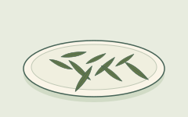
    <figcaption><strong class="tea-name-title">龙井（Longjing）</strong><span class="tea-name-kind">做法 · 绿茶</span><span class="tea-name-note">常见的扁平叶形示例；形状与颜色会有差别。</span></figcaption>
  </figure></li>
  <li><figure class="tea-name-card" data-tea-name="jasmine-green">
    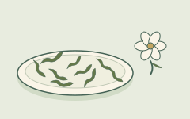
    <figcaption><strong class="tea-name-title">茉莉绿茶</strong><span class="tea-name-kind">窨香茶 · 绿茶底</span><span class="tea-name-note">旁边的花只提示香气；成茶不一定留有花朵。</span></figcaption>
  </figure></li>
  <li><figure class="tea-name-card" data-tea-name="gunpowder">
    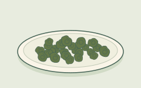
    <figcaption><strong class="tea-name-title">珠茶（Gunpowder）</strong><span class="tea-name-kind">做法 · 绿茶</span><span class="tea-name-note">冲泡前，揉成小珠粒的叶子。</span></figcaption>
  </figure></li>
  <li><figure class="tea-name-card" data-tea-name="tieguanyin">
    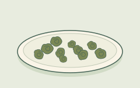
    <figcaption><strong class="tea-name-title">铁观音</strong><span class="tea-name-kind">做法 · 乌龙茶</span><span class="tea-name-note">揉成球状的一例；焙火与氧化程度各有不同。</span></figcaption>
  </figure></li>
  <li><figure class="tea-name-card" data-tea-name="baozhong">
    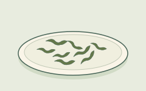
    <figcaption><strong class="tea-name-title">包种</strong><span class="tea-name-kind">做法 · 乌龙茶</span><span class="tea-name-note">松卷条形的叶子示例，不是紧实球形。</span></figcaption>
  </figure></li>
  <li><figure class="tea-name-card" data-tea-name="da-hong-pao">
    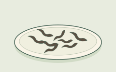
    <figcaption><strong class="tea-name-title">大红袍</strong><span class="tea-name-kind">做法 · 乌龙茶</span><span class="tea-name-note">武夷岩茶的一例：色深、扭卷的条索。</span></figcaption>
  </figure></li>
  <li><figure class="tea-name-card" data-tea-name="keemun">
    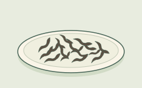
    <figcaption><strong class="tea-name-title">祁门（Keemun）</strong><span class="tea-name-kind">做法 · 红茶</span><span class="tea-name-note">细条卷曲的干叶示例；英文 black tea 是红茶。</span></figcaption>
  </figure></li>
  <li><figure class="tea-name-card" data-tea-name="yunnan">
    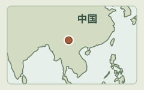
    <figcaption><strong class="tea-name-title">云南（作红茶词用时）</strong><span class="tea-name-kind">产地／做法名 · 红茶</span><span class="tea-name-note">中国西南部的云南。地图标示大致位置，不是特定茶园。</span></figcaption>
  </figure></li>
  <li><figure class="tea-name-card" data-tea-name="lapsang-souchong">
    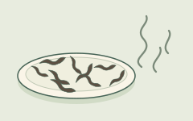
    <figcaption><strong class="tea-name-title">正山小种（Lapsang Souchong）</strong><span class="tea-name-kind">做法 · 红茶</span><span class="tea-name-note">这里示意烟熏型；也有不经烟熏的版本。</span></figcaption>
  </figure></li>
  <li><figure class="tea-name-card" data-tea-name="puerh-dark">
    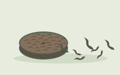
    <figcaption><strong class="tea-name-title">普洱／黑茶</strong><span class="tea-name-kind">茶名／茶类</span><span class="tea-name-note">散茶与紧压茶示例；生、熟茶不同。Dark tea 是黑茶。</span></figcaption>
  </figure></li>
  <li><figure class="tea-name-card" data-tea-name="white-tea">
    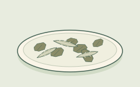
    <figcaption><strong class="tea-name-title">白茶</strong><span class="tea-name-kind">茶类 · 白茶</span><span class="tea-name-note">图中有芽也有叶；白茶不一定全是芽。</span></figcaption>
  </figure></li>
  <li><figure class="tea-name-card" data-tea-name="yellow-tea">
    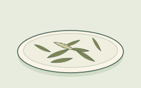
    <figcaption><strong class="tea-name-title">黄茶</strong><span class="tea-name-kind">茶类 · 黄茶</span><span class="tea-name-note">一份散茶示例；分类看工序，不只看颜色。</span></figcaption>
  </figure></li>
  </ul>
</details>
```
<!-- tea-name-gallery:chinese:end -->

| 你看到的标签 | 一般是什么意思 | 桥去哪 |
| --- | --- | --- |
| **龙井（Longjing / Dragon Well）** | 许多菜单上都能见到的**炒青中国绿茶**做法名 | 落在下面地图的**绿**。见 [第一章](modules/module-01/index.qmd) |
| **茉莉花茶／茉莉绿茶** | 绿茶**窨**过茉莉花香。底子仍是茶树的绿茶 | 加香不是花草茶。在地图上，这是**绿**那一行 |
| **珠茶（Gunpowder）** | 揉成小颗粒的绿茶。这个词是做法名 | 走的是**绿**这条路线 |
| **铁观音** | 著名的**乌龙**传统名。氧化到多深，各厂并不一样 | 地图上的**乌龙**行，处在绿↔红那把尺的中间[^1] |
| **包种** | 偏浅的**乌龙**做法名，常常和台湾连在一起 | 属于**乌龙**这一带 |
| **大红袍** | 著名的**武夷岩茶／乌龙**，菜单和货架上都能见到 | 属于**乌龙**这一带。这里不讲那个传说 |
| **祁门（Keemun）** | 中国**红茶**的一种做法名，拼配里常见，也可以单独喝 | 地图上的**红**那一行[^1] |
| **云南**（作红茶词用时） | 许多带麦芽感的中国红茶，用它标产地，或标做法 | 产地不是另一个物种。这些茶多半走**红**这条路线 |
| **正山小种（Lapsang Souchong）** | **带烟熏味**的红茶。贸易上常见的印象是松烟 | 加香或烟熏的**红**路线[^1] |
| **普洱／黑茶** | 云南（以及相关地方）的黑茶，会经过微生物陈化。**生茶**和**熟茶**的做法并不相同 | 地图上的**黑**那一行。这是真正发酵的那个例外[^2] |
| **白茶** | 处理较少的茶树叶。杯子通常比较清淡 | 地图上的**白**那一行。工厂里的戏份比较少[^1] |
| **黄茶** | 中国以外很少见。路子接近绿茶，贸易名单里多一道“闷黄” | 地图上的**黄**那一行，也写在六大茶类的名单里[^3] |

工夫茶作为**日常社交场面**（一把小壶，茶要短短地倒很多次），是一套文化剧本。要看这套剧本，打开 [第三章 · 第四节](modules/module-03/04-regional-scripts.qmd)。下面的器具带只负责点出用具的名字。

***

<span id="label-japanese-names"></span>

## 常见日文名

<!-- tea-name-gallery:japanese:start -->
```{=html}
<details class="tea-name-gallery" data-tea-name-gallery="japanese" open>
  <summary>图像茶架 · 6 个日文名</summary>
  <p class="tea-name-intro">原创示意图，不是鉴别图鉴。形状与颜色会有差别，图像不按比例；茶名、工序与标签资料比外观更重要。</p>
  <ul class="tea-name-grid" role="list">
  <li><figure class="tea-name-card" data-tea-name="sencha">
    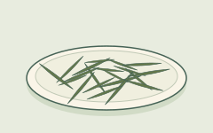
    <figcaption><strong class="tea-name-title">煎茶（Sencha）</strong><span class="tea-name-kind">做法 · 绿茶</span><span class="tea-name-note">常见的揉卷针形茶叶示例。</span></figcaption>
  </figure></li>
  <li><figure class="tea-name-card" data-tea-name="matcha">
    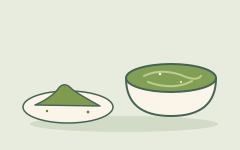
    <figcaption><strong class="tea-name-title">抹茶（Matcha）</strong><span class="tea-name-kind">粉末绿茶</span><span class="tea-name-note">细粉与搅拌后的一碗茶；叶粉一起喝下，不滤走。</span></figcaption>
  </figure></li>
  <li><figure class="tea-name-card" data-tea-name="gyokuro">
    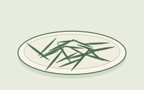
    <figcaption><strong class="tea-name-title">玉露（Gyokuro）</strong><span class="tea-name-kind">做法 · 绿茶</span><span class="tea-name-note">遮荫后制成的冲泡茶叶；针形本身不能证明种植方法。</span></figcaption>
  </figure></li>
  <li><figure class="tea-name-card" data-tea-name="tencha">
    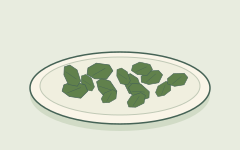
    <figcaption><strong class="tea-name-title">碾茶（Tencha）</strong><span class="tea-name-kind">做法 · 绿茶</span><span class="tea-name-note">磨成抹茶之前、未经揉捻的片状茶叶。</span></figcaption>
  </figure></li>
  <li><figure class="tea-name-card" data-tea-name="genmaicha">
    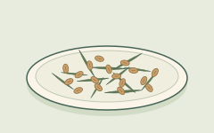
    <figcaption><strong class="tea-name-title">玄米茶（Genmaicha）</strong><span class="tea-name-kind">拼配 · 绿茶＋米</span><span class="tea-name-note">绿茶加炒米；这里的米确实是配料。</span></figcaption>
  </figure></li>
  <li><figure class="tea-name-card" data-tea-name="houjicha">
    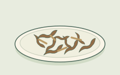
    <figcaption><strong class="tea-name-title">焙茶（Houjicha）</strong><span class="tea-name-kind">焙火做法 · 绿茶</span><span class="tea-name-note">焙过的叶与茶梗示例；褐色不等于红茶。</span></figcaption>
  </figure></li>
  </ul>
</details>
```
<!-- tea-name-gallery:japanese:end -->

| 你看到的标签 | 一般是什么意思 | 桥去哪 |
| --- | --- | --- |
| **煎茶（Sencha）** | 日本人日常喝的**绿茶**。叶子多半先**蒸**，然后再揉，再烘干 | 地图上的**绿**那一行。入门页还有一张迷你表[^4] |
| **抹茶（Matcha）** | 遮荫长成的绿叶，磨成**细粉**，搅进水里。连叶子一起喝下去 | 走**绿**这条路线。在杯量范围里，茶氨酸往往更高。见 [杯量参考](cup-reference.qmd)[^5] |
| **玉露（Gyokuro）** | 遮荫做成的日本**绿茶**（泡的是叶子，不是把粉搅开）。它是做法加上遮荫路线的名字，不是橙白毫那种颗粒等级 | 遮荫的说明见 [第一章 · 第一节](modules/module-01/01-plants.qmd)。要看数字，去杯量参考[^5] |
| **碾茶（Tencha）** | 遮荫叶在石磨成抹茶之前的样子 | 它是通往抹茶的桥，走的是**绿**这条路线[^4] |
| **玄米茶（Genmaicha）** | 绿茶里加了**炒米**。除非标签另外说明，底子仍是茶树 | **绿**这条路线，另外加了米 |
| **焙茶（Houjicha）** | **焙过**的日本绿茶。一般的印象是烤香 | **绿**这条路线，只是焙过火 |

煎茶、抹茶和碾茶的做法说明，对应的是入门页引用的那些日本行业类型页。[^4]

***

<span id="label-western-names"></span>

## 常见西方与咖啡馆名

<!-- tea-name-gallery:western:start -->
```{=html}
<details class="tea-name-gallery" data-tea-name-gallery="western" open>
  <summary>图像茶架 · 10 个西方与咖啡馆常见茶饮名称</summary>
  <p class="tea-name-intro">原创示意图，不是鉴别图鉴。形状与颜色会有差别，图像不按比例；茶名、工序与标签资料比外观更重要。</p>
  <p class="tea-name-map-key">地图上北下南，各图比例不同。圆点只标产地的大致位置，不代表茶园或产区边界。海岸线资料：<a href="https://www.naturalearthdata.com/about/terms-of-use/">Natural Earth</a>.</p>
<ul class="tea-name-grid" role="list">
  <li><figure class="tea-name-card" data-tea-name="english-breakfast">
    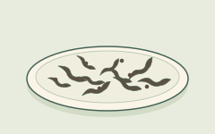
    <figcaption><strong class="tea-name-title">英式早餐茶（English Breakfast）</strong><span class="tea-name-kind">拼配 · 通常是红茶</span><span class="tea-name-note">红茶拼配示例；叶片大小和配方会不同。</span></figcaption>
  </figure></li>
  <li><figure class="tea-name-card" data-tea-name="earl-grey">
    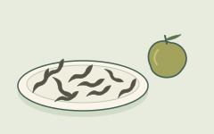
    <figcaption><strong class="tea-name-title">伯爵茶（Earl Grey）</strong><span class="tea-name-kind">调香茶 · 通常是红茶</span><span class="tea-name-note">佛手柑只提示香气；茶里不一定有果皮。</span></figcaption>
  </figure></li>
  <li><figure class="tea-name-card" data-tea-name="assam">
    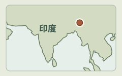
    <figcaption><strong class="tea-name-title">阿萨姆（Assam）</strong><span class="tea-name-kind">产地名</span><span class="tea-name-note">印度东北部的阿萨姆。只标大致位置，不是茶园。</span></figcaption>
  </figure></li>
  <li><figure class="tea-name-card" data-tea-name="darjeeling">
    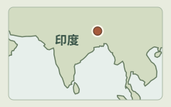
    <figcaption><strong class="tea-name-title">大吉岭（Darjeeling）</strong><span class="tea-name-kind">产地名</span><span class="tea-name-note">印度西孟加拉邦北部的大吉岭，在阿萨姆以西、喜马拉雅山麓。</span></figcaption>
  </figure></li>
  <li><figure class="tea-name-card" data-tea-name="ceylon-kenyan">
    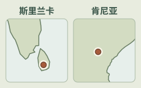
    <figcaption><strong class="tea-name-title">锡兰／肯尼亚（Ceylon / Kenyan）</strong><span class="tea-name-kind">产地名</span><span class="tea-name-note">左：斯里兰卡（锡兰）。右：东非肯尼亚。这是两个不同产地。</span></figcaption>
  </figure></li>
  <li><figure class="tea-name-card" data-tea-name="nilgiri">
    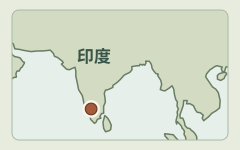
    <figcaption><strong class="tea-name-title">尼尔吉里（Nilgiri）</strong><span class="tea-name-kind">产地名</span><span class="tea-name-note">印度南部的尼尔吉里山区。只标大致位置，不是茶园。</span></figcaption>
  </figure></li>
  <li><figure class="tea-name-card" data-tea-name="masala-chai">
    
    <figcaption><strong class="tea-name-title">马萨拉茶／印度奶茶拿铁</strong><span class="tea-name-kind">调制饮品 · 配方家族</span><span class="tea-name-note">加奶与香料的一例；材料与比例各有不同。</span></figcaption>
  </figure></li>
  <li><figure class="tea-name-card" data-tea-name="milk-tea">
    
    <figcaption><strong class="tea-name-title">奶茶／港式奶茶</strong><span class="tea-name-kind">调制饮品 · 奶茶</span><span class="tea-name-note">红茶加奶的一杯示例；配方与颜色会不同。</span></figcaption>
  </figure></li>
  <li><figure class="tea-name-card" data-tea-name="boba">
    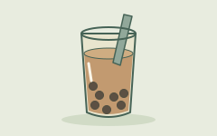
    <figcaption><strong class="tea-name-title">珍珠奶茶／波霸</strong><span class="tea-name-kind">调制饮品 · 加配料</span><span class="tea-name-note">奶茶加珍珠的一例；也有其他茶底与配料。</span></figcaption>
  </figure></li>
  <li><figure class="tea-name-card" data-tea-name="decaf">
    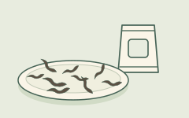
    <figcaption><strong class="tea-name-title">低因茶（Decaf）</strong><span class="tea-name-kind">处理方式 · 减少咖啡因</span><span class="tea-name-note">外观看不出低因处理；要读标签，也不代表零咖啡因。</span></figcaption>
  </figure></li>
  </ul>
</details>
```
<!-- tea-name-gallery:western:end -->

| 你看到的标签 | 一般是什么意思 | 桥去哪 |
| --- | --- | --- |
| **英式早餐茶（English Breakfast）** | 为浓口早茶配的**红茶拼配**。里面常有阿萨姆等红茶，配方则因牌子而不同 | 通常走**红**这条路线。日常的咖啡因范围，看杯量参考[^1] |
| **伯爵茶（Earl Grey）** | 通常是**加了佛手柑香**的红茶 | 香加在**红**这条路线上。它不是一种新的植物[^1] |
| **阿萨姆（Assam）** | 印度阿萨姆的红茶。一般的印象是浓，而且带麦芽味 | 产地，加上阿萨姆型植物的提示，见 [第一章 · 第一节](modules/module-01/01-plants.qmd)。地图上是**红**那一行 |
| **大吉岭（Darjeeling）** | 大吉岭的高山茶。一般比较细致。多半当红茶卖，不过有些批次氧化得浅一些 | 这是地理加上加工。它不是另一个物种 |
| **锡兰／肯尼亚（Ceylon / Kenyan）** | 用产地来命名的红茶（斯里兰卡；肯尼亚）。拼配时常常拿它们当原料 | 产地标不是另一个物种。这些茶多半走**红**[^1] |
| **尼尔吉里（Nilgiri）** | 南印度的产地标，红茶和拼配上都能见到 | 在本页，它只是一个产地词 |
| **马萨拉茶／印度奶茶拿铁（Masala chai / chai latte）** | 许多店的做法是：香料**红茶**，再加上奶和甜味。底子仍是茶树红茶，除非标签写成花草 | 这是一套配方，不是一个物种 |
| **奶茶／港式奶茶** | 把浓红茶（常常是细碎的，或 CTC）加上奶。这是一种文化喝法 | 文化上的工艺，见 [第三章 · 第四节](modules/module-03/04-regional-scripts.qmd) |
| **珍珠奶茶／波霸（Bubble / boba tea）** | 咖啡馆里的一类饮料：茶或奶茶做底，再加配料 | 它是店里的表亲。它不是工厂里的一种氧化做法 |
| **低因茶（Decaf）** | 经过处理、把咖啡因**减少**了的茶。这是产品的名字。它和花草所说的“无咖啡因”不是同一句话 | 本页只点出这个名字。这里不讲残留的百分比 |

***

## 六大成品茶类（分类地图） {#type-map}

<!-- tea-classification:types:start -->
```{=html}
<section class="tea-classification-visual" data-tea-classification="types" aria-labelledby="tea-type-visual-title">
<p id="tea-type-visual-title" class="tea-classification-title">同一种茶树，六类加工路线</p>
<p class="tea-classification-intro">把它们看成并列路线，不是一条氧化刻度。每幅图只突出关键工序，不是完整制茶流程。</p>
<p class="tea-classification-root">茶树 · Camellia sinensis</p>
<ul class="tea-classification-grid tea-type-grid"><li><figure class="tea-classification-card" data-tea-classification-card="green">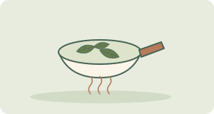<figcaption><strong class="tea-classification-name">绿茶</strong><span class="tea-classification-note">先加热抑制酶促氧化，再经整形、干燥等工序。</span></figcaption></figure></li><li><figure class="tea-classification-card" data-tea-classification-card="yellow">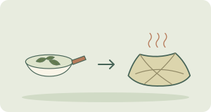<figcaption><strong class="tea-classification-name">黄茶</strong><span class="tea-classification-note">先杀青，再闷黄、干燥。重点是多了温热湿润的闷黄工序。</span></figcaption></figure></li><li><figure class="tea-classification-card" data-tea-classification-card="white">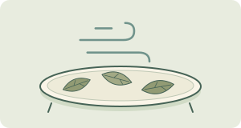<figcaption><strong class="tea-classification-name">白茶</strong><span class="tea-classification-note">萎凋后干燥，当中会有一定氧化；不是绿茶先杀青的路线。</span></figcaption></figure></li><li><figure class="tea-classification-card" data-tea-classification-card="oolong">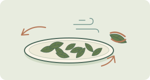<figcaption><strong class="tea-classification-name">乌龙茶</strong><span class="tea-classification-note">做青、部分氧化，再杀青、干燥。氧化程度因做法而异。</span></figcaption></figure></li><li><figure class="tea-classification-card" data-tea-classification-card="black">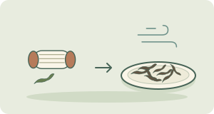<figcaption><strong class="tea-classification-name">红茶 · black tea</strong><span class="tea-classification-note">揉捻或切碎后充分酶促氧化，最后干燥。</span></figcaption></figure></li><li><figure class="tea-classification-card" data-tea-classification-card="dark">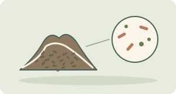<figcaption><strong class="tea-classification-name">黑茶 · dark tea</strong><span class="tea-classification-note">这一支重视微生物发酵与陈化；熟普洱是清楚的例子。</span></figcaption></figure></li></ul>
<p class="tea-classification-caution">示意图不是靠颜色认茶的图鉴，也不是品质排名。生普洱与熟普洱的加工路线不同；生茶会在储存中变化，分类时须交代这个背景。</p>
<p class="tea-classification-sources">本图解资料来源： <a href="https://www.iso.org/standard/75419.html">ISO 茶叶分类</a> · <a href="https://pmc.ncbi.nlm.nih.gov/articles/PMC8605308/">加工综述</a> · <a href="https://cnafun.moa.gov.cn/zt/gjcr/202005/t20200513_6343917.html">生／熟普洱</a></p>
</section>
```
<!-- tea-classification:types:end -->

这些茶来自同一种植物。工厂在不同的节点让褐变停下来。贸易名单和标准方面的工作，常常会点出**六类**成品：绿、黄、白、乌龙、红、黑。[^3] 英国茶与浸泡饮协会把日常的分法说得很直白。加工的时候氧化走了多久，或者根本没有走，就把红茶、绿茶、乌龙和白茶的杯感分开了。[^1]

这幅地图是一把**货架尺**。它不是健康排名，也不是第二本第一章。化学上的分岔在工序，不在物种。请打开 [第一章 · 第二节](modules/module-01/02-processing.qmd)。入门页只留一条薄薄的六类折叠，并指到这里来看完整的地图。[^3]

| 成品茶类 | 白话意思 | 日常名称（见上面各表） |
| --- | --- | --- |
| **绿** | 早点把叶子加热，不让它变褐 | 龙井、珠茶、茉莉绿茶；煎茶、抹茶、玉露、焙茶、玄米茶… |
| **黄** | 中国以外少见。路子近绿，贸易名单里多一道“闷黄” | 黄茶（多半只见得到这个名字）[^3] |
| **白** | 处理较少的茶树叶。一般的印象是，工厂里的戏份不多 | 白茶那几行[^1] |
| **乌龙** | 绿与红之间的一段部分氧化 | 铁观音、包种、大红袍…[^1] |
| **红** | 在一般的贸易印象里，酶促氧化走满了 | 祁门、阿萨姆、英式早餐茶的底、正山小种，以及许多咖啡馆里的红茶[^1] |
| **黑** | 微生物陈化的那一支（菜单上会写成普洱生茶或熟茶） | 普洱／黑茶[^2] |

**老实话（入门页已经写过）。** 做茶的人常把由绿转红叫“发酵”。说到普通的绿茶、乌龙、红茶，他们多半是指叶子里的酶，再加上空气。真正由微生物来主导的陈化，主要出现在普洱这类黑茶里。[^2]

### 中／日／西方名称怎样挂上地图

- **中文做法名**往往*就是*茶类本身，或者是某一类里面的著名传统。龙井归绿，铁观音归乌龙，祁门归红，普洱归黑（见上面各表）。
- **日文日常名**多半是**绿路线上的做法**：煎茶、抹茶、玉露、焙茶、玄米茶。工厂怎么做，或者人怎么喝，可以不同，成品属于哪一类却是一样的。[^4]
- **西方和咖啡馆的名字**把几样东西混在一起：**茶类**（绿或红）、**产地**（阿萨姆），还有**拼配／加香**（英式早餐茶、伯爵茶）。拼配的底子，通常仍是红路线上的叶子。[^1]

::: {.callout-note collapse="true" title="ISO 20715 与六类列表"}
标准和加工综述按茶**是怎么做出来的**来分类，不按咖啡馆里的英文。ISO 的茶类分类工作（ISO 20715:2023），以及那些加工调查，常见的就是上表这一套六类成品。[^3] 咖啡馆的菜单更乱，茶类、产地、拼配和加香搅在一处。黄茶在多数西方货架上很少见，所以读第一章之前，不必先去啃它。这一则折叠不贴标准的原文，也不把每一个店名对到某一条条款上。
:::

***

## 等级用语：颗粒大小与品质档次词 {#grades}

<!-- tea-classification:grades:start -->
```{=html}
<section class="tea-classification-visual" data-tea-classification="grades" aria-labelledby="tea-grade-visual-title">
<p id="tea-grade-visual-title" class="tea-classification-title">包装上的词，属于哪一种？</p>
<p class="tea-classification-intro">大小词与品质档次回答的是不同问题；制法和做法名称也要分开。</p>
<div class="tea-grade-block">
<p class="tea-grade-title">颗粒大小用语</p><p class="tea-grade-question">筛分后的茶叶颗粒，是什么形态？</p>
<ul class="tea-classification-grid tea-grade-sizes"><li><figure class="tea-classification-card" data-tea-classification-card="op">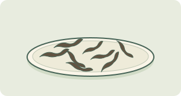<figcaption><strong class="tea-classification-name">OP · 橙白毫</strong><span class="tea-classification-note">全叶类等级词</span></figcaption></figure></li><li><figure class="tea-classification-card" data-tea-classification-card="bop">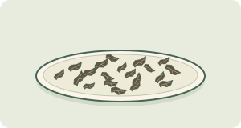<figcaption><strong class="tea-classification-name">BOP · 碎橙白毫</strong><span class="tea-classification-note">碎叶片</span></figcaption></figure></li><li><figure class="tea-classification-card" data-tea-classification-card="fannings">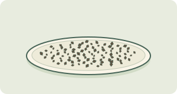<figcaption><strong class="tea-classification-name">Fannings · 碎茶</strong><span class="tea-classification-note">细小茶叶颗粒</span></figcaption></figure></li><li><figure class="tea-classification-card" data-tea-classification-card="dust">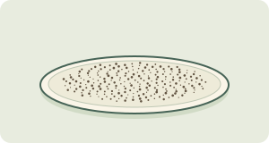<figcaption><strong class="tea-classification-name">Dust · 末茶</strong><span class="tea-classification-note">很细的茶叶颗粒</span></figcaption></figure></li></ul>
<p class="tea-classification-caution">形状只作示意，不代表通用筛孔尺寸。较大不一定较好；较细的颗粒往往浸出较快。</p>
</div>
<div class="tea-grade-block">
<p class="tea-grade-title">制法，不是颗粒等级</p>
<ul class="tea-classification-grid tea-grade-methods"><li><figure class="tea-classification-card" data-tea-classification-card="orthodox"><figcaption><strong class="tea-classification-name">传统制法 · Orthodox</strong><span class="tea-classification-note">揉捻后再筛分，可以得到全叶、碎叶、碎茶及末茶。</span></figcaption></figure></li><li><figure class="tea-classification-card" data-tea-classification-card="ctc">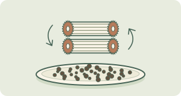<figcaption><strong class="tea-classification-name">CTC · 切碎揉捻</strong><span class="tea-classification-note">另一种机械加工路线形成颗粒，之后同样会按大小筛分。</span></figcaption></figure></li></ul>
</div>
<ul class="tea-classification-grid tea-grade-other"><li><figure class="tea-classification-card" data-tea-classification-card="tiers"><figcaption><strong class="tea-classification-name">品质档次标签</strong><span class="tea-classification-note">例如：特级／一级／二级。要看该茶所用的标准或分级方法；这些词不能换算成 OP 或 BOP。</span></figcaption></figure></li><li><figure class="tea-classification-card" data-tea-classification-card="shade">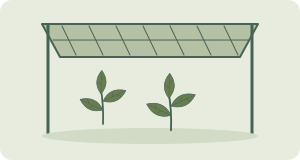<figcaption><strong class="tea-classification-name">做法＋遮荫名称</strong><span class="tea-classification-note">玉露、碾茶、抹茶描述遮荫栽培与加工做法，不是 OP 等级；抹茶粉也不是红茶的末茶等级。</span></figcaption></figure></li></ul>
<p class="tea-classification-sources">本图解资料来源： <a href="https://teasrilanka.org/tea-grade">斯里兰卡分级例子</a> · <a href="https://www.upasitearesearch.org/orthodox/">传统制法</a> · <a href="https://www.forestry.gov.cn/c/www/yltl/592556.jhtml">个别茶类的品质标准</a> · <a href="https://www.ujicha.or.jp/en/knowledge/kinds/">日本茶做法</a></p>
</section>
```
<!-- tea-classification:grades:end -->

货架上的“等级”，至少混着**两套**说法。先把它们分开，才不会误以为橙白毫一定胜过碎橙白毫，理由只是“因为更好”；也不会把特级当成各国通用的品质分数，拿去跟橙白毫的代码对照。这些词都不是另一个物种，也不是道德意义上的“最好茶”排名。

### 叶碎／颗粒用语（红茶贸易）

**茶包和散茶**的差别，多半在**份量和颗粒大小**，不是另一种植物。茶包是预先量好的一份。散茶则是按重量来卖的同一种植物。茶包常用比较碎的叶子，好让颜色和浓度很快出来。入门和杯量参考用的日常基准，大约是 **2 克**干叶配 **250 毫升**。[^6]

**传统制法和切碎揉捻（CTC）**是两种**红茶加工方法**，不是叶片大小等级。传统揉捻与 CTC 机械加工茶叶的方式不同；成茶之后还要按大小筛分。[^7]

| | **传统制法（Orthodox）** | **切碎揉捻（CTC）** |
| --- | --- | --- |
| 常见叶形 | 卷曲的整叶或碎叶，之后按大小筛分 | 细小颗粒，同样按大小筛分 |
| 冲泡提示 | 浸出速度取决于成茶颗粒大小与冲泡条件 | 小颗粒往往浸出较快，常用于茶包和奶茶 |

**橙白毫（Orange Pekoe, OP）、碎橙白毫（BOP）、碎茶（fannings）、末茶（dust）**是许多红茶贸易里用来讲**叶子有多碎**的等级词。它们不是另一个物种，也不是道德排名。较细的等级往往出汤快，短短一浸就显得浓。

杯子如果发浑，或者“一下子太猛”，打开 [厨房排障](tea-troubleshoot.qmd)。

想知道颗粒为什么会改变出场的速度，打开 [第一章 · 第三节](modules/module-01/03-brewing.qmd)。

### 品质档次用语（跟颗粒词分开）

有些包装用的是**另一套**等级用语，也就是品质档次的*标签*。它和橙白毫、碎橙白毫、碎茶、末茶**不是同一套系统**。

**你可能见到的中国零售档次**（特级、一级、二级，以及往后的档）。在一部分中国包装的茶上，这些字是产地或厂家自己的**品质档次标签**。它们**不是**橙白毫的颗粒代码，不是跨国通用的排名，也不是本页在没有引到标准时就能替你下的保证。这里只把它们当作货架上的用字点出来，免得你不小心拿去跟 OP 对照。

**日本的遮荫路线做法。** 玉露、抹茶、碾茶是**做法加上遮荫路线的名字**。它们说的是叶子怎么种、怎么做完，不是橙白毫那种颗粒梯子。[^4] 英文贸易里的口语，有时会把玉露叫成“高档”。这个习惯仍然**不等于**红茶那些表示大小的代码。遮荫的说明在 [第一章 · 第一节](modules/module-01/01-plants.qmd)。茶氨酸的范围在 [杯量参考](cup-reference.qmd)。[^5]

::: {.callout-note collapse="true" title="为什么“等级”会把人绕晕"}
| 用语 | 例子 | 它*不是*什么 |
| --- | --- | --- |
| **颗粒／大小** | 橙白毫、碎橙白毫、碎茶、末茶 | 不是另一个物种，也不是“道德上更好” |
| **加工方法** | 传统制法、CTC | 不是叶片大小等级 |
| **品质档次标签** | 有些中国包装上的特级／一级… | 不是 OP 的代码，也不是本站给出的全球统一排名 |
| **做法＋遮荫名** | 玉露、抹茶、碾茶 | 不是 OP 那种梯子。多半仍是**绿**路线上的叶子 |

请记住：盒子上的等级用语是一条**字典线索**，不是购物用的“最好茶”名单。名茶的评选、奖项、牌子的排行，都不在本页范围里。
:::

***

## 花草提醒

| 你看到的标签 | 一般是什么意思 |
| --- | --- |
| **洋甘菊／薄荷／姜／路易波士“茶”** | 花草浸泡出来的饮品。除非标签上也写了茶叶，否则**不是**茶树 |

它们不在第一章的化学核心里。真茶和花草怎么分开，那一小节短课仍在 [茶叶入门](tea-basics.qmd)。[^8][^9]

***

## 薄带：茶壶与冲泡方法

这里只讲器具的**名称**，也就是它一般是什么。没有萃取动力学，没有仪式的步骤表，也没有第二张排障矩阵。

<!-- tea-brewing-illustrations:start -->
```{=html}
<details class="tea-brewing-gallery" open>
<summary>认识茶具 · 六组图解</summary>
<p class="tea-brewing-intro">把名称对上器具的模样。图中只是例子，不是固定款式或冲泡步骤；各图并非按同一比例绘制。</p>
<ul class="tea-brewing-grid">
<li><figure class="tea-brewing-card" data-tea-brewing="mug">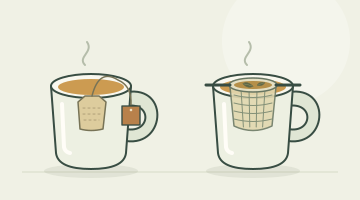<figcaption><strong class="tea-brewing-name">杯 + 茶包／滤篮</strong><span class="tea-brewing-note">茶包或可取出的滤篮。剖面示意让你看见杯内。</span></figcaption></figure></li>
<li><figure class="tea-brewing-card" data-tea-brewing="western-pot">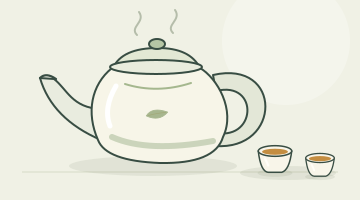<figcaption><strong class="tea-brewing-name">英式／西式茶壶</strong><span class="tea-brewing-note">较大的有盖茶壶，一壶可分着喝。</span></figcaption></figure></li>
<li><figure class="tea-brewing-card" data-tea-brewing="gaiwan">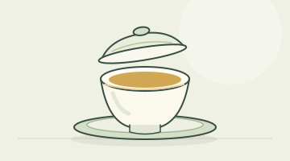<figcaption><strong class="tea-brewing-name">盖碗</strong><span class="tea-brewing-note">带盖的碗；图中配有碟托。</span></figcaption></figure></li>
<li><figure class="tea-brewing-card" data-tea-brewing="gongfu-kit">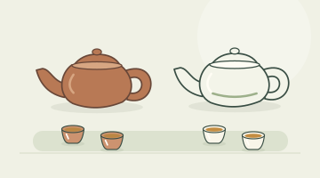<figcaption><strong class="tea-brewing-name">小壶 · 工夫茶用具</strong><span class="tea-brewing-note">小壶配小杯；图示陶壶和瓷壶。</span></figcaption></figure></li>
<li><figure class="tea-brewing-card" data-tea-brewing="grandpa-style">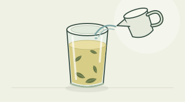<figcaption><strong class="tea-brewing-name">爷爷杯（grandpa style）</strong><span class="tea-brewing-note">续水时，散茶叶仍留在玻璃杯里。</span></figcaption></figure></li>
<li><figure class="tea-brewing-card" data-tea-brewing="matcha-whisk">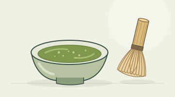<figcaption><strong class="tea-brewing-name">茶碗 + 茶筅（抹茶）</strong><span class="tea-brewing-note">用来搅拌茶粉的茶碗和竹茶筅。</span></figcaption></figure></li>
</ul>
</details>
```
<!-- tea-brewing-illustrations:end -->

| 器具／方法 | 白话意思 | 接着打开… |
| --- | --- | --- |
| **杯 + 茶包／滤篮** | 日常的默认喝法：一杯，浸一次 | 第一杯看 [茶叶入门](tea-basics.qmd)。觉得不对劲，去 [厨房排障](tea-troubleshoot.qmd) |
| **英式／西式茶壶** | 比较大的壶。叶子在壶里，或在滤芯里。一壶可以分着喝 | 看 [厨房排障](tea-troubleshoot.qmd)。时间、温度和叶量，看 [第一章 · 第三节](modules/module-01/03-brewing.qmd) |
| **盖碗** | 一只带盖的碗，用来短浸，而且浸很多次 | 去排障，或去第一章第三节。这不是一堂仪式课 |
| **小朱泥／瓷壶（工夫茶用具）** | 小壶、小杯，茶要短短地倒很多次 | **文化：** [第三章 · 第四节](modules/module-03/04-regional-scripts.qmd)。**旋钮：** 去排障，或去第一章第三节 |
| **爷爷杯（grandpa style）** | 叶子留在大杯或玻璃杯里，再加水续泡 | 去排障，或去第一章第三节（这里用得上第二泡的直觉） |
| **茶碗 + 茶筅（抹茶）** | 把粉搅开，悬在水里。连叶子一起喝 | 看上面抹茶那一行。茶氨酸的范围看 [杯量参考](cup-reference.qmd) |

***

## 这扇门坐在哪／下一步

把这些谈茶的门，想成一层一层的地图。

1. **[茶叶入门](tea-basics.qmd)。** 第一杯；真茶和花草怎么分；绿↔红；三个样例标签；还有一条薄薄的六类折叠，指到本页。
2. **茶叶标签（本页）。** 名称表；**六大茶类的分类地图**；**等级用语**（颗粒，还是品质档次）；器具的名词。
3. **[厨房排障](tea-troubleshoot.qmd)。** 杯已经不对了，接下来问该拧哪一颗旋钮。
4. **[第一章](modules/module-01/index.qmd)。** 植物、工厂、冲泡、化合物。
5. **[杯量参考](cup-reference.qmd)。** 一只 250 毫升杯里的典型毫克数。
6. **[第三章 · 第四节](modules/module-03/04-regional-scripts.qmd)。** 工夫茶、港式奶茶，以及相近的文化剧本。
7. **[读懂茶研究](tea-reading-studies.qmd)。** 对着标题用的那张清单。

还在倒第一杯的话，留在入门。准备看数字的话，打开杯量参考。

[^1]: UK Tea & Infusions Association. Types of tea, origins & varieties. https://www.tea.co.uk/types-of-tea (Black/green/white/dark overview; English Breakfast and Earl Grey as black-tea blends; oolong as partial oxidation; Keemun / Lapsang notes on trade type pages.)

[^2]: Ordinary oolong/black “fermentation” is enzymatic oxidation; true microbial fermentation mainly in post-fermented teas such as Pu-erh. See Subramanian et al. (1999) and Tanaka & Kouno (2003) as cited in [Chapter 1](modules/module-01/index.qmd). Wong et al. (2022) treat pu-erh among processing categories: https://doi.org/10.1111/1750-3841.16137

[^3]: Six manufactured types (green, yellow, white, oolong, black, dark) appear in processing overviews and ISO tea-type classification work (e.g. *Food Reviews International* tea-processing chapter, https://doi.org/10.1080/87559129509541052; ISO 20715:2023).

[^4]: Kyoto Prefectural Tea Industry Chamber. Types of tea (sencha; matcha/tencha). https://www.ujicha.or.jp/en/knowledge/kinds/

[^5]: Keenan, E. K., et al. (2011). How much theanine in a cup of tea? *Food Chemistry, 125*(2), 588–594. https://doi.org/10.1016/j.foodchem.2010.08.071 (Cup-reference baseline; shaded gyokuro/matcha noted higher.)

[^6]: Everyday baseline on the [Cup reference](cup-reference.qmd); formal tasting strength under ISO 3103:2019 — https://www.iso.org/standard/73224.html

[^7]: UK Tea & Infusions Association. Creating the perfect blend (orthodox rolling vs CTC / unorthodox smaller particles for quicker brew). https://www.tea.co.uk/tea-processing-and-blending

[^8]: U.S. Food and Drug Administration. (1996). Tea: A story of serendipity. *FDA Consumer*. https://permanent.access.gpo.gov/lps1609/www.fda.gov/fdac/features/296_tea.html

[^9]: Tea Association of the USA. (2019). Comment on FDA food standards of identity modernization (Docket FDA-2018-N-2381). https://downloads.regulations.gov/FDA-2018-N-2381-1376/attachment_1.pdf
