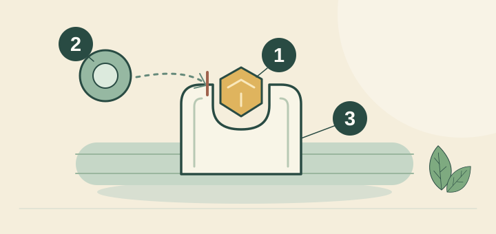
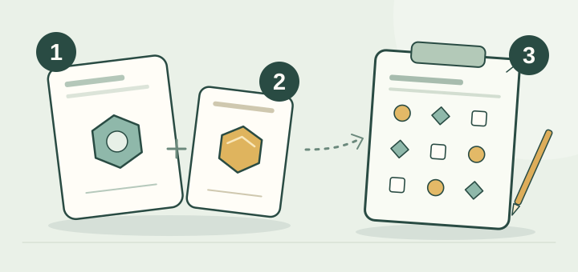
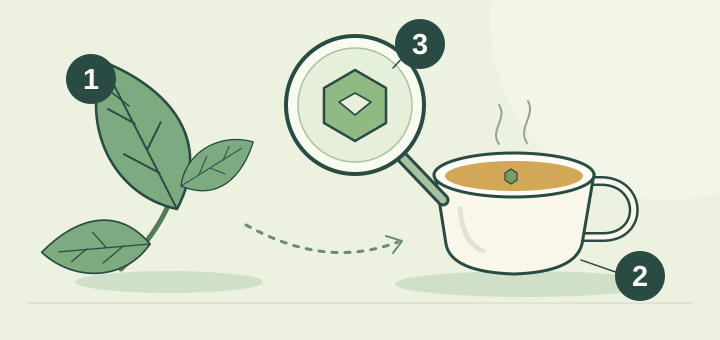



<!-- reader-guide:start -->
::: {.reader-guide}
**由一個問題開始**

三個化學名稱，可以令一杯茶聽來像補充劑標籤。這一節讓它們各就其位，也把飲品中的份量與研究使用的劑量分開。

**閱讀時試一試:** 每遇到一種成分，記下名稱、製備方式和時間相關主張。比較茶杯與膠囊之前，先沿註腳看來源。

[首頁](../../index.qmd) · [章節地圖](../../modules/index.qmd)
:::
<!-- reader-guide:end -->
::: {.zh-door-nav}
**本站中文入口：** [首頁](../../index.qmd) · [茶葉入門](../../tea-basics.qmd) · [茶葉標籤](../../tea-labels.qmd) · [杯量參考](../../cup-reference.qmd) · [詞彙表](../../glossary.qmd) · [章節總覽](../../modules/index.qmd) · [第一章](../module-01/index.qmd) · [第二章](../module-02/index.qmd) · [第三章](../module-03/index.qmd) · [第四章](../module-04/index.qmd) · [第五章](../module-05/index.qmd) · [連結橋樑](../../linkages.qmd) · [參考文獻](../../bibliography.qmd)
:::

<!-- reading-fold:start -->
:::::::: {.callout-note collapse="true" title="原有導讀與閱讀提示"}


::: {.callout-note}
**核對數字與出處，以英文頁為準。** 用頁頂語言切換列在英文／繁體／簡體之間跳轉。
:::

::: {.callout-tip}
**第一章 · 第四節（共四節）**——屬[第一章 化學核心](index.qmd)。第一次來？可先到[本章入口](index.qmd)看整章地圖。
:::

::: {.callout-note collapse="true" title="怎樣讀這一節（腳註＋摺疊）"}
上標數字是可點的腳註。點一下，就跳到出處；再點箭頭，就回到剛才那一句。滑鼠停在數字上，多數時候也會彈出摘要。化學式、半衰期表、受體和代謝途徑的名稱，以及膠囊與一罐茶的算術，都收在摺起來的「更多詳情…」裏，好讓打開的正文繼續用日常說法。
:::
::::::::
<!-- reading-fold:end -->
## 按不同時間表登場的客人

<!-- lesson-illustration:compound-clocks:start -->
```{=html}
<figure class="tea-lesson-figure" data-lesson-illustration="compound-clocks">
  
  <figcaption>談成分時，時間很重要。時鐘只是提醒，並非吸收曲線或精確時間表。</figcaption>
</figure>
```
<!-- lesson-illustration:compound-clocks:end -->

日常談到茶的化學，多半圍繞三個名字轉。不妨把它們想成三位客人：到達的速度不同，離開的時間也不同。在他們出場之前，植物（[第一章第一節](01-plants.qmd)）、工廠裏的分岔（[第一章第二節](02-processing.qmd)）和水煲（[第一章第三節](03-brewing.qmd)）都已經做完各自的工作。

正文先記住一個分別：血液濃度的變化，不等於感受的時間表。茶葉和沖泡方法不同，成分份量和時間也會不同；具體測量與機制留在摺疊方框裏。

::: {.callout-tip title="這一節用到的日常詞"}
- **提神的客人**是咖啡因。它擋住那種「該睡了」的感覺。
- **研究問題：**茶氨酸是茶裏的一種胺基酸，研究人員探討過它對注意力和情緒可能有甚麼影響。但不能因此保證一杯茶會令人平靜。[^8][^10][^11]
- **綠茶植物成分這位客人**是[表沒食子兒茶素沒食子酸酯（EGCG）](../../glossary.qmd#egcg)，也就是綠茶裏最突出的兒茶素。
- **不是即沖即有的禪定**提醒我們：研究的時間點對應某項測量，不代表喝茶後必然在某個時刻感到平靜。
:::

## 咖啡因：熟悉的提神客人

<!-- tea-compound-illustration:caffeine:start -->
```{=html}
<figure class="tea-compound-figure" data-tea-compound="caffeine">
  
  <figcaption>
    <div class="tea-compound-heading"><strong>咖啡因：位置已被佔用</strong><span class="tea-compound-formula">C₈H₁₀N₄O₂</span></div>
    <ol class="tea-compound-legend" role="list">
      <li><span class="tea-compound-key" aria-hidden="true">1</span><strong>咖啡因</strong><span>佔據腺苷受體。</span></li>
      <li><span class="tea-compound-key" aria-hidden="true">2</span><strong>腺苷</strong><span>在這個位置的訊號傳遞受到阻擋。</span></li>
      <li><span class="tea-compound-key" aria-hidden="true">3</span><strong>受體</strong><span>簡化畫成可容納符號的凹槽。</span></li>
    </ol>
    <p class="tea-compound-note">圖形只是符號，並非分子結構。這幅示意圖不能預測你有多清醒，或能維持多久。</p>
  </figcaption>
</figure>
```
<!-- tea-compound-illustration:caffeine:end -->

**咖啡因**令人保持警覺。說得淺白一點，它把大腦那個「你開始睏了」的訊號擋住，好讓你繼續做事。血液裏的典型故事是：它往往會逗留**好幾個小時**，不過人和人差得很多。[^1]

最後那一句很要緊。朋友說「到了晚飯還很精神」，可以是生物化學上的事，不必是誇張。想看化學式、半衰期的範圍，以及這條差異背後的肝臟酵素叫甚麼名字，打開下面的摺疊就行。

## 茶氨酸：一種正在研究的胺基酸

<!-- tea-compound-illustration:l-theanine:start -->
```{=html}
<figure class="tea-compound-figure" data-tea-compound="l-theanine">
  
  <figcaption>
    <div class="tea-compound-heading"><strong>茶氨酸：由成分到研究問題</strong><span class="tea-compound-formula">C₇H₁₄N₂O₃</span></div>
    <ol class="tea-compound-legend" role="list">
      <li><span class="tea-compound-key" aria-hidden="true">1</span><strong>茶氨酸</strong><span>茶裏的一種氨基酸。</span></li>
      <li><span class="tea-compound-key" aria-hidden="true">2</span><strong>咖啡因</strong><span>常與茶氨酸一起接受研究。</span></li>
      <li><span class="tea-compound-key" aria-hidden="true">3</span><strong>注意力測驗</strong><span>研究人員量度表現。</span></li>
    </ol>
    <p class="tea-compound-note">虛線表示「一起研究」，並不保證有益處。圖形只是符號；研究使用的配方和劑量，不一定等同於日常一杯茶。</p>
  </figcaption>
</figure>
```
<!-- tea-compound-illustration:l-theanine:end -->

**茶氨酸**是茶裏的一種胺基酸。研究人員單獨或與咖啡因一起研究它對注意力和情緒可能產生的影響。現有研究不能證明日常一杯茶必定有穩定的鎮靜作用：茶葉成分和沖泡方法各異，有些試驗使用的是份量明確的純化成分。[^8][^10][^11]人體血液測量顯示，茶氨酸的時間進程通常比咖啡因短；這並不能預測一個人會有甚麼感受。[^5][^6]

## EGCG：綠茶裏的兒茶素客人

<!-- tea-compound-illustration:egcg:start -->
```{=html}
<figure class="tea-compound-figure" data-tea-compound="egcg">
  
  <figcaption>
    <div class="tea-compound-heading"><strong>EGCG：混合物中的一種成分</strong><span class="tea-compound-formula">C₂₂H₁₈O₁₁</span></div>
    <ol class="tea-compound-legend" role="list">
      <li><span class="tea-compound-key" aria-hidden="true">1</span><strong>茶葉</strong><span>含有多種化合物。</span></li>
      <li><span class="tea-compound-key" aria-hidden="true">2</span><strong>泡好的茶</strong><span>部分化合物進入水中。</span></li>
      <li><span class="tea-compound-key" aria-hidden="true">3</span><strong>EGCG</strong><span>混合物中的一種兒茶素。</span></li>
    </ol>
    <p class="tea-compound-note">放大鏡用來辨認成分，並非展示分子的真實形狀、杯中的含量、人體吸收或健康效果。</p>
  </figcaption>
</figure>
```
<!-- tea-compound-illustration:egcg:end -->

**EGCG** 是綠茶裏一種主要的植物成分，屬於兒茶素。用第一章的日常說法，它就是[第一章第三節](03-brewing.qmd)裏那位要更高溫、更多時間才肯離開茶葉的客人。在研究文獻裏，它出現在關於發炎和細胞訊號的討論中。血液裏的典型故事是：口服以後以**數小時**計，介乎咖啡因的長時間逗留和茶氨酸的較短時鐘之間。[^4]

## 為甚麼「我一小時前喝了茶」其實是三個故事

日常話裏的「半衰期」，是指血液裏的份量大約要多久才減少一半。它不是「完全消失」。這一點很要緊，因為「我一小時前喝了茶」對每一種成分都不是同一個故事。咖啡因往往要逗留好幾個小時。茶氨酸在血漿裏的時鐘較短。EGCG 介乎兩者之間。人體的時間進程研究顯示，口服以後的高峰大約在數十分鐘到一兩個小時，視乎成分和劑型而定。[^5][^6]

血液濃度、腦電記錄、測驗成績和主觀感受，是不同的測量結果。研究報告的是特定份量和實驗設計下的結果；這些數據不能為日常一杯茶的感受排出可靠的時間表。閱讀研究時，要一併看清製備方法、份量、參與者和測量指標。[^5][^6][^8][^10]

「喝茶即刻帶來禪定般專注」超出了這些研究能說明的範圍。對照份量和測驗結果，並不能證明每一杯茶都會令人平靜或專注。[^8][^10][^11]

::: {.callout-note collapse="true" title="更多詳情：化學式、半衰期，以及人與人為何不同"}
| 客人 | 化學式 | 約略分子量 | 一般血漿半衰期 | 日常角色 |
| --- | --- | --- | --- | --- |
| 咖啡因 | C₈H₁₀N₄O₂ | 194.19 克／摩爾 | 約 **3–7 小時** | 擋住腺苷那些令人「想睡」的受體 |
| 茶氨酸 | C₇H₁₄N₂O₃ | 174.20 克／摩爾 | 約 **50–80 分鐘** | 研究人員探討它對注意力和情緒可能產生的影響；不保證喝茶後會有特定感受 |
| EGCG | C₂₂H₁₈O₁₁ | 458.37 克／摩爾 | 約 **2–5 小時** | 綠茶主要的兒茶素；見於發炎／細胞訊號研究 |

半衰期的意思是「血液濃度大約多久會跌一半」，不是「完全消失」。咖啡因往往要逗留好幾個小時，茶氨酸在血漿裏的時鐘較短，EGCG 介乎兩者之間。[^1][^4][^5]

**咖啡因的範圍為甚麼這麼寬。** 大部分咖啡因的清除，要靠肝臟裏一種叫 **CYP1A2** 的酵素，而這種酵素的活躍程度人和人差得很大。吸煙、荷爾蒙、藥物、肝臟的健康，以及遺傳（包括常見的 CYP1A2 基因變異），都會改變一劑咖啡因留在體內多久。[^9] 因此，「我三小時前喝了茶」對每一個喝茶的人並不是同一個故事，哪怕還未計這杯有多濃。

**受體和途徑的名稱（方便連到第二章）。** 咖啡因在日常中的作用，是拮抗腺苷受體。[^1] 茶氨酸可以在某些谷氨酸受體位點上微弱地競爭（AMPA、紅藻胺酸〔kainate〕，以及與 NMDA 相關的受體），效力遠低於谷氨酸本身。這正符合「把嘈吵的雜音調低」這個畫面。[^2][^3] 文中，EGCG 出現在與 NF-κB 相關及其他細胞訊號的討論中。第一章只需要知道它的時間表，以及它作為綠茶代表的身份。[^4]

人體時程研究會測量血液中的成分濃度；認知試驗則按各自的實驗設計測量其他結果。兩者都不能為日常一杯茶的感受提供精確時間表。[^5][^6][^8][^10]
:::

::: {.callout-note collapse="true" title="更多詳情：實驗室的毫克數與超市的一杯"}
不少認知實驗和腦電波圖（EEG）實驗，用的是**純化**的茶氨酸和咖啡因，劑量以已知的毫克計。例如歐文（Owen）與同事用 **50–100 毫克** 茶氨酸配上 **50 毫克** 咖啡因；其他設計裏還有更高的單一劑量，包括哈斯克爾〔Haskell〕與同事的工作。[^8][^10] 你在超市買的茶包是一種混合物，成分隨茶葉、牌子和浸泡方法而變。

基南（Keenan）量過一杯茶，提醒我們：普通泡兩分鐘的一杯，茶氨酸往往只有**數十毫克**，而不是一粒 200 毫克 的膠囊。[^11] 抹茶和遮蔭綠茶可以高一些。匆匆泡一個紅茶包，茶氨酸通常較低，更偏「熟悉的咖啡因」那一邊。看到新聞標題說「茶可以做到某某」時，請打開[杯量參考](../../cup-reference.qmd)，問清楚：**是多少毫克、甚麼形式、甚麼時間**。

第二章會在腦子裏接上雙線故事，也就是咖啡因加上茶氨酸。這一節只堅持一件事：對劑量和時間要老實。
:::

::: {.callout-tip}
三位客人講完以後，[本章入口](index.qmd)還留着一份簡短的**喝茶人實地指南**（綠茶與紅茶怎樣選擇、冷泡的迷思、實驗劑量和一杯茶的分別），跨進第二章之前可以先看一看。
:::

## 一分鐘說完

<!-- reading-fold:start -->
:::::::: {.callout-note collapse="true" title="需要時重溫"}

三種成分，引出不同研究問題：咖啡因與警覺、茶氨酸與注意力或情緒的可能關係，以及 EGCG 與綠茶兒茶素化學。它們在血液中的時間進程不同，但血藥濃度不能換算成主觀感受的精確時間表。實驗室份量和日常茶飲不可混為一談。
::::::::
<!-- reading-fold:end -->
::: {.callout-tip title="你可以先停在這裏"}
- 三種成分引出不同問題：咖啡因與警覺、茶氨酸與注意力或情緒的可能關係、EGCG 與綠茶兒茶素化學。
- 一杯茶送出的是**數十 毫克**；很多實驗用的是 **100–200 毫克** 的膠囊。不要把兩者混為一談。
- 「不是即沖即有的禪定」：研究中的時間點不能預測一個人會否在喝茶後感到不同，或何時有這種感覺。
:::

::: {.callout-note collapse="true" title="更多詳情：這對你喝茶有甚麼意思"}
- 閱讀時間相關的研究結果時，要註明該研究使用的份量和測量指標；不要把實驗時間表當作喝茶後的注意力安排。[^8][^10]
- 還未對照[杯量參考](../../cup-reference.qmd)之前，不要拿你的茶包跟一粒 200 毫克 的茶氨酸膠囊比較。
- 記住，每個人清走咖啡因的速度並不相同。朋友說「還很精神」，可以是生物化學上的事，不必是誇張。[^9]
:::

::: {.callout-note collapse="true" title="更多詳情：怎樣閱讀研究時間點"}
每項研究的計時都從特定份量和製備方法開始。血液濃度、腦部測量和測驗成績是不同結果；它們都不能可靠預測日常一杯茶會有甚麼感受。把研究應用到喝茶時，先看參與者喝了甚麼、研究對象是誰，以及研究人員測量了甚麼。[^5][^6][^8][^10]
:::

::: {.callout-tip collapse="true" title="點開更多詳情：第一章第四節帶走清單"}
1. 咖啡因是腺苷受體的拮抗，半衰期以小時計。[^1]
2. 茶氨酸是對谷氨酸受體的低親和力拮抗，血漿時鐘較短。[^2][^3]
3. EGCG 是綠茶主要的兒茶素，藥物動力學以數小時計。[^4]
4. 對劑量要老實：一杯茶並不是膠囊（見[杯量參考](../../cup-reference.qmd)）。
5. CYP1A2 以及其他因素：人和人並不相同。[^9]
6. 下一步：第二章跟着這些客人，看喝下肚以後的事。
:::

## 三位客人怎樣為第二章鋪路

第二章的雙線故事要講得通，你就得記住血液裏是誰。

1. **咖啡因**令睡意訊號沒那麼容易「佔位」，在很多人身上可以是好幾個小時。[^1]
2. **茶氨酸**曾用於注意力和情緒研究；單獨補充劑的結果不能證明日常一杯茶會帶來同樣感受。[^8][^10][^11]
3. **EGCG** 是綠茶兒茶素中的頭條成分。它對杯子裏泡出了甚麼很重要（[第一章第三節](03-brewing.qmd)），即使第二章把更多篇幅給了咖啡因和茶氨酸的配合。

略過劑量和時間，第二章就只剩下口號。守住它們，第二章才成為一張地圖。

::: {.callout-note collapse="true" title="更多詳情：把補充劑標籤和一罐茶放在一起讀"}
假設一粒膠囊寫着**茶氨酸 200 毫克**，而一篇論文報告了 60 分鐘時的注意力效果。基南的研究顯示，普通一杯茶泡兩分鐘後，茶氨酸往往只有**數十毫克**。[^11] 這並不表示茶「沒有用」。它表示的是另外幾件事。

- 多喝幾杯、改用抹茶或遮蔭的茶葉，或者把浸泡拉長，數字就會不同。
- 膠囊實驗回答的是膠囊的問題。
- 老實的做法，是在引用實驗的效果有多大之前，先問*你那一杯*實際送出了甚麼。

[杯量參考](../../cup-reference.qmd)就是為了這一次換算。
:::

***

**導航：** [↑ 第一章入口](index.qmd) · [← 上一節](03-brewing.qmd) · [下一章 →](../module-02/index.qmd)

[^1]: Fredholm, B. B., Bättig, K., Holmén, J., Nehlig, A., & Zvartau, E. E. (1999). Actions of caffeine in the brain with special reference to factors that contribute to its widespread use. *Pharmacological Reviews, 51*(1), 83–133. https://pharmrev.aspetjournals.org/content/51/1/83

[^2]: Kakuda, T., Nozawa, A., Sugimoto, A., & Niino, H. (2002). Inhibition by theanine of binding of [³H]AMPA, [³H]kainate, and [³H]MDL 105,519 to glutamate receptors. *Bioscience, Biotechnology, and Biochemistry, 66*(12), 2683–2686. https://doi.org/10.1271/bbb.66.2683

[^3]: Kakuda, T. (2011). Neuroprotective effects of theanine and its preventive effects on cognitive dysfunction. *Pharmacological Research, 64*(2), 162–168.

[^4]: Chow, H. H. S., et al. (2001). Pharmacokinetics and safety of green tea polyphenols after multiple-dose administration of epigallocatechin gallate and Polyphenon E in healthy individuals. *Clinical Cancer Research, 7*(5), 1204–1212.

[^5]: van der Pijl, P. C., et al. (2010). Human pharmacokinetic profile of green tea catechins and L-theanine. *British Journal of Nutrition, 104*(8), 1157–1164.

[^6]: Scheid, L., et al. (2012). Kinetics of L-theanine uptake and metabolism in healthy humans (cited *Journal of Nutrition* entry).


[^8]: Owen, G. N., et al. (2008). The combined effects of L-theanine and caffeine on cognitive performance and mood. *Nutritional Neuroscience, 11*(4), 193–198. https://doi.org/10.1179/147683008X301513

[^9]: Nehlig, A. (2018). Interindividual differences in caffeine metabolism and factors driving caffeine consumption. *Pharmacological Reviews, 70*(2), 384–411. https://doi.org/10.1124/pr.117.014407

[^10]: Haskell, C. F., et al. (2008). The effects of L-theanine, caffeine and their combination on cognition and mood. *Biological Psychology, 77*(2), 113–122. https://doi.org/10.1016/j.biopsycho.2007.09.008

[^11]: Keenan, E. K., et al. (2011). How much theanine in a cup of tea? Effects of tea type and method of preparation. *Food Chemistry, 125*(2), 588–594. https://doi.org/10.1016/j.foodchem.2010.08.071
