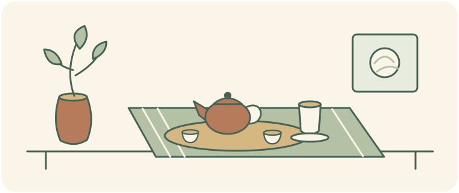



<!-- reader-guide:start -->
::: {.reader-guide}
**由一個問題開始**

茶檔、共坐的茶桌、細心安排的奉茶場面，各有值得留意的地方。讀這幾幅地方圖景時，把人物與場合一起放進視線。

**閱讀時試一試:** 用同一組問題比較兩個場景：誰準備、誰奉茶、用了甚麼器具，以及這個場合對參與者有甚麼要求？

[首頁](../../index.qmd) · [章節地圖](../../modules/index.qmd)
:::
<!-- reader-guide:end -->
::: {.zh-door-nav}
**本站中文入口：** [首頁](../../index.qmd) · [茶葉入門](../../tea-basics.qmd) · [茶葉標籤](../../tea-labels.qmd) · [杯量參考](../../cup-reference.qmd) · [詞彙表](../../glossary.qmd) · [章節總覽](../../modules/index.qmd) · [第一章](../module-01/index.qmd) · [第二章](../module-02/index.qmd) · [第三章](../module-03/index.qmd) · [第四章](../module-04/index.qmd) · [第五章](../module-05/index.qmd) · [連結橋樑](../../linkages.qmd) · [參考文獻](../../bibliography.qmd)
:::

<!-- reading-fold:start -->
:::::::: {.callout-note collapse="true" title="原有導讀與閱讀提示"}


::: {.callout-note}
**核對數字與出處，以英文頁為準。** 用頁頂語言切換列在英文／繁體／簡體之間跳轉。
:::

::: {.callout-tip}
**第三章 · 第四節（共四節）** — 屬於[第三章 · 歷史與文化](index.qmd)。第一次來的話，先到[本章入口](index.qmd)看整章地圖。
:::

::: {.callout-note collapse="true" title="怎樣讀這一節（腳註＋摺疊）"}
上標數字是腳註。點一下，跳到出處；再點箭頭，跳回來。滑鼠停在數字上，多數時候會彈出摘要。器具的細節、寫得出年份的編年，以及民間傳說和編年、民族誌之間的界線，都收在摺頁的「更多詳情……」裏。打開的正文講的是還在過的喝茶方式，不是周遊世界，也不是一堂實驗室裏的儀式課。
:::
::::::::
<!-- reading-fold:end -->
<!-- tea-table:start -->
## 擺好茶席 {#set-the-tea-table}

```{=html}
<link rel="stylesheet" href="../../../assets/tea-table-game.css">
<div data-tea-table data-locale="zh-hant-hk">
<div class="tea-table-fallback">
<p>沒有 JavaScript 也可比較以下三張示例茶桌。留意每個出處描述的器具、節奏和目的，不要把例子當成普遍規則。</p>
<h3>潮汕日常茶桌</h3>
<p>朋友圍着小壺而坐，茶泡了一輪又一輪，話題也繼續。試擺出 d’Abbs 田野研究中的日常場景。</p>
<ul>
<li><strong>桌上的器具:</strong> 小陶壺與小杯. 這幅圖景以小陶壺和小杯配合多次沖泡。台灣茶藝也會用相似器具，但器具相似不代表社交場合相同。</li>
<li><strong>奉茶節奏:</strong> 多次短浸泡. 同一批茶葉反覆短浸，讓相聚繼續。這是在描述圖景，不是普遍適用的步驟或沖泡配方。</li>
<li><strong>這個場合的重點:</strong> 交談與日常待客. d’Abbs 描述茶怎樣融入日常社交連繫。同一研究也談精緻修養和商業茶館休閒，所以日常待客只是其中一種框架。</li>
</ul>
<p>這個圖景的出處: <a href="https://doi.org/10.1080/14442213.2019.1611908">d’Abbs (2019)</a></p>
<h3>香港奶茶櫃位</h3>
<p>茶餐廳把製作奶茶放進每天的服務流程。試擺出本節的櫃位技藝圖景，而不是正式的小壺茶會。</p>
<ul>
<li><strong>桌上的器具:</strong> 細棉布濾袋與飲用杯. 香港記憶描述的是細棉布濾袋。茶染後的形狀和顏色帶來「絲襪」這個稱呼，並非真的用絲襪。這張簡化茶桌沒有列出完整配方。</li>
<li><strong>奉茶節奏:</strong> 可重複的茶餐廳製作與奉茶. 本節着重可重複的櫃位技藝和茶餐廳服務。這是在比較場合，不是說香港每個人喝茶都很匆忙。</li>
<li><strong>這個場合的重點:</strong> 茶餐廳櫃位的工作節奏. 這幅圖景追溯飲品在戰後食肆的本地化，以及後來普及於茶餐廳的過程。這裏着重服務流程；到茶餐廳仍然可以交談，也可以有其他意義。</li>
</ul>
<p>這個圖景的出處: <a href="https://www.hkmemory.hk/en/collections-ichhk_ii-hong_kong_style_milk_tea_making_technique-history_hong_kong_style_milk_tea.html">Hong Kong Memory / 香港記憶 / 香港记忆</a></p>
<h3>台灣茶藝聚會</h3>
<p>主人為聚會安排茶席，留意動作、器具和氣氛。試擺出 Yu 和 Zhang 討論的茶藝圖景。</p>
<ul>
<li><strong>桌上的器具:</strong> 小壺、小杯與安排過的茶席. 這幅圖景的基本器具有工夫式小壺和小杯。安排過的「茶席」把空間設計帶進場合，但這不代表台灣所有喝茶場合都採用這套擺法。</li>
<li><strong>奉茶節奏:</strong> 講究沖泡動作與器具安排. 出處把規範化的動作與安排視為茶藝的一部分，並沒有替每個聚會訂立同一套必須遵守的動作次序。</li>
<li><strong>這個場合的重點:</strong> 感官與美感經過設計的茶會. Yu 描述香氣、光線、聲音、器具和氛圍組成感官場景。着重美感不等於排除待客，也不能等同台灣所有飲茶生活。</li>
</ul>
<p>這個圖景的出處: <a href="https://doi.org/10.1016/j.ajss.2022.08.007">Yu (2022)</a> · <a href="https://doi.org/10.1525/gfc.2016.16.1.53">Zhang (2016)</a></p>
<p>這些是特定場合的教學例子，不是整個文化的規則。人物、場所和場合各有不同；插圖經過簡化，並非歷史復原圖。</p>
</div>
</div>
<script src="../../../assets/tea-table-data.js" defer></script>
<script src="../../../assets/tea-table-game.js" defer></script>
```

::: {.callout-note collapse="true" title="關於這些例子" #tea-table-notes}
改編自本節三幅圖景：d’Abbs 的潮汕日常工夫茶、香港記憶的奶茶製作，以及 Yu 和 Zhang 的台灣茶藝研究。活動比較場合，不教授沖泡配方、判定正宗身份或訂立嚴格禮儀。任何選擇都不會儲存或傳送。
:::

```{=html}
<div id="tea-table-reading"></div>
```
<!-- tea-table:end -->

## 茶室門口之後

[第二節](02-monastic-path.qmd)停在寺院的作息，和日本茶室裏的「齊平」。這一節換一個問題：場面換成潮汕的桌子、台灣的茶藝聚會，或香港的奶茶櫃位時，這片葉子還要按甚麼**做法和場面**來喝？

這裏說的「做法」，是**怎樣把這杯茶擺出來**：用甚麼器具，按甚麼次序，誰坐在甚麼位置。它不是[茶葉入門](../../tea-basics.qmd)上的購物標籤，也不是[第一章](../module-01/03-brewing.qmd)裏那個萃取的旋鈕。[第三節](03-plantation-aftershock.qmd)的商品茶葉可以走到任何地方；人們究竟怎樣坐下來喝，由當地的做法決定。莊園的餘波解釋茶包為甚麼在歷史上可以便宜。這一節問的是：三個還在過日子的空間，怎樣把同一家族的葉子擺成不同的場面。

::: {.callout-caution title="不是實驗室儀式"}
那些可以預期、大家一起做的步驟，會在[第四章 · 第二節](../module-04/02-ritual-stress.qmd)以*情境心理學*再出現。本頁**不**講霍布森，不講心率怎樣被緩衝，也不講錯誤相關負波。先看文化。心理留到下一章。
:::

## 肖像一——潮汕工夫：日常搭台

<!-- history-illustration:chaoshan-table:start -->
```{=html}
<figure class="tea-history-figure" data-history-illustration="chaoshan-table">
  
  <figcaption><strong>小杯子，日常相聚</strong> 潮汕這一幅肖像裏，一泡又一泡為日常待客留出空間。這個虛構聚會用來說明情境，不是固定的全國茶禮，也不是每個家庭的規則。</figcaption>
</figure>
```
<!-- history-illustration:chaoshan-table:end -->

想象一張潮汕桌子：一把小砂壺，一簇小杯，葉子泡得很短，也倒得很勤。客人不是在等一次盛大的長泡。他們坐着，一遍遍衝，一邊說話——家裏人、朋友、做生意的——屋子就這樣轉下去。壺一次次回到同一把葉子上。杯子一直很小。沒有人需要一座舞台。在潮汕，也就是粵東，工夫茶最好當成**日常待客**來講，而不是博物館裏的「中國茶道」。[^1] 田野想說的是：喝茶怎樣織進每天的人情，而不是另演一出叫「茶藝」的戲。[^1]

同一把葉子、同一套器具，可以換一種過法，傢俬卻不用換。有的場合仍是日常待客，桌子負責把人留住。有的場合則把辨味做細：看壺，看葉子，在意這杯落到嘴裏是甚麼味道，說話也輕。茶館把閒暇賣給付錢的客人。d'Abbs 的田野把這三種一起看：日常的做法、把品嚐做講究，以及茶館裏拿來賣的消閒。[^1] 正文先守住日常這一條，讓初學的人先遇見人，而不是一套打包好的課程。器具、「發明的傳統」這條界線，以及福建烏龍怎樣走進潮州、變成當地做法的那條有年份的線索，都放在摺頁裏。[^1][^2][^7]

正文不接受的，是把它包成「國家儀式」。當地喝茶很久了。把「一千年沒斷過」說成*那*一種中國茶道，是另一種故事。論文這條線把它叫做發明的傳統。[^2] 如今把「工夫茶就是中國茶藝」推向全國的包裝，也有一條二十世紀的傳播線：台灣先接過去，審美裏帶着日本*煎茶道*［*senchadō*］的味道。後來的敘述有時會把這條線蓋住。[^3] 這和第二節核對達摩傳說是同一個習慣：民間傳說和品牌只是點綴，編年和民族誌守住界線。若導遊把「古老的中國茶道」賣成全國只有一套，這幅肖像請你先聽潮汕日常的那張桌子。

::: {.callout-note collapse="true" title="更多詳情：潮汕工夫——實踐對包裝成「儀式」"}
d'Abbs 的田野把今天潮汕的情形分開：日常的做法、把品嚐做講究，以及茶館裏拿來賣的消閒。[^1] 另一條更長的論文則主張：把潮汕工夫說成「延續千年的國家儀式」，是一種**發明的傳統**。當地人喝茶確實很久，但那個「一脈相承」的包裝，並沒有中世紀的一手材料撐着。[^2]

Zhang 的歷史論文把地域收緊：工夫茶認的是潮州，以及福建、廣東東南這一帶海岸。林語堂在 1937 年已經寫過，這套喝法在華北、在別的地方的品茶圈子裏，一般並不為人知道。[^3] 清代的觀察者把小壺一遍遍衝，寫成外地人眼中的**新鮮事**（袁枚寫武夷；俞蛟約 1800 年寫廣東），不是一本正經早已寫進書裏的國家儀式。[^3] 世紀中葉，潮汕人翁輝東寫過一部專講工夫茶的著作（**1957** 年；按 Zhang 的記述，稿子流傳過，但沒有正式出版）。裏面有器具清單和做法。外地來的人覺得吃驚，而這套喝法在田裏、在工廠裏卻很普遍。[^3] **不要**把任何一套「七個步驟」的轉述當成全潮汕的定法，除非標明：這只是對當地那部專論的轉述。[^3]

推向全國的現代包裝，也有一條二十世紀的傳播線：台灣接過去，再加上日本*茶道*和*煎茶道*的影響。後來的敘述有時會把這條線蓋住。細節見下面的傳播摺頁。[^3]

**給初學的器具（只放摺頁）：** 小砂壺、小杯，留意一遍遍的短泡。這不是第一章的溫度表，也不是主張日常的潮汕做法*就等於*台灣的*茶藝*（*chayi*）。
:::

::: {.callout-note collapse="true" title="更多詳情：潮汕／潮州成形編年（劉）"}
Liu（2023；劉嫦雲）給潮州工夫怎樣成形，寫過一份登在學系刊物上的編年。信心只到**中等**。它是摺頁裏的骨架，不是正文的一手材料。[^7] 它補 d'Abbs 的當代民族誌，並不取代它。

| 節點 | 摘要支持甚麼 | 界線 |
| --- | --- | --- |
| **地理** | 潮州工夫茶流行在粵東，中心在潮州[^7] | 是這一帶的事，不是全國的茶 |
| **18 世紀** | 武夷（福建）烏龍興起，由茶商帶進潮州；乾隆到嘉慶，品嚐很盛[^7] | 這是摘要的措辭。不要編造「第一年」是哪一年 |
| **19 世紀** | 潮州工夫把福建烏龍的做法收進來，形成本地的一套[^7] | 在劉的論點裏，商人是關鍵 |
| **20 世紀初** | 烏龍的生產和製作在潮州鳳凰山落地，並成熟起來[^7] | 這是產地的地理，不是咖啡館的課 |
| **20 世紀中後期** | 潮州工夫大多改用鳳凰單叢，不再以武夷葉為主[^7] | 換了葉子的來源。不是說做法到那時才開始 |
| **論題線** | 成形深受福建茶文化的影響；潮州商人少不了[^7] | 排年份是一回事，做民族誌是另一回事 |

**先說清楚：** 本頁沒有按頁給出的產量噸數，也不主張劉推翻了 d'Abbs 關於日常人情的說法。
:::

## 肖像二——香港奶茶櫃位

<!-- lesson-illustration:milk-tea-tools:start -->
```{=html}
<figure class="tea-lesson-figure" data-lesson-illustration="milk-tea-tools">
  
  <figcaption>布濾袋與飲用杯帶出奶茶櫃位的手藝。濾袋並非真正的絲襪，圖中也沒有列出完整配方。</figcaption>
</figure>
```
<!-- lesson-illustration:milk-tea-tools:end -->

對亞洲讀者、尤其對香港讀者，奶茶櫃位就是本地還在過的做法。本地人把它暱稱為**絲襪**奶茶：那張幼棉網隔用久了會染成茶褐色，形狀和顏色都讓人想到絲襪。再加上濃的葉子、煉奶，以及戰後經*冰室*和*大牌檔*變成當地的喝法，後來又普及成*茶餐廳*裏隨處都有的一杯。[^4] 這不是潮汕客廳裏把人留住的那張桌子，也不是台灣那種講究的*茶席*（*chaxi*）。它是櫃位上手藝：快，可以重複，給一座既要熱量、又要順口、還得趕時間的城市。

要比茶餐廳更早說起。**1842 年**之後，英國管治帶來西式茶——幼錫蘭葉、奶、糖——進了高檔的西餐廳。那杯淡，也貴，社交上還有門檻。[^4] 對香港大眾的口味，那杯太溫和，也太貴。第二次世界大戰之後，人口急增，基本食肆的牌照大批發出，這杯茶被重做成打工的人的喝法：幼棉網隔為了順口，用**等級較低**的葉子在更低的成本上把味道**做濃**，再用**煉奶**代替鮮奶，兼顧熱量，也兼顧體力勞動時的花費。[^4] 有年份的那張表——殖民時期引進，然後是精英的淡杯，然後是 1950 年代變成當地喝法，然後是場所轉移——收在摺頁裏。正文記住這一環就夠：帝國那杯淡茶調子不對，於是這座城市把這杯茶重做了。[^4]

經濟好起來之後，*冰室*轉向港式的*茶餐廳*。街邊的檔口少了。奶茶變成全城餐館都有的一杯，不再只是低檔檔口的杯子。[^4] 遺產的說法是有的。官方的品牌和地方營造，可以把櫃位手藝變成一座城市的故事；幾種互相頂着的意義留在 Mak 的摺頁裏，免得這一頁寫成品牌文章。[^5] 講手藝的專書以後可以把器具和編號的步驟寫深。這一節只留櫃位的做法，和一條書目的指標。正文不編沖泡的比例。[^4]

::: {.callout-note collapse="true" title="更多詳情：港式奶茶——櫃位劇本時間線"}
下面這些有年份的節點，來自「香港記憶」非物質文化遺產口述傳承系列。那是一頁公開的歷史，把本地化的主線寫得比較好讀：[^4]

| 節點 | 來源支持甚麼 | 界線 |
| --- | --- | --- |
| **暱稱** | 「絲襪奶茶」來自幼網的**棉**隔。網會染成茶褐色，形狀和顏色讓人想到絲襪[^4] | 是棉隔，不是照着絲襪來做的食譜 |
| **1842 年之後** | 英國管治之下引進西式茶（幼錫蘭葉、奶、糖）[^4] | 引進了，不等於馬上就成了大眾的一杯 |
| **20 世紀初** | 高檔西餐廳等於精英才進得去[^4] | 對本地大眾的口味來說，又淡又貴 |
| **戰後／1950 年代** | 第二次世界大戰之後才真正成為當地喝法。人口急增，餐飲的需求跟着來，*冰室*和*大牌檔*一類食肆領到許多牌照[^4] | 這是一段本地化的時間，不是單獨某一天「創立」 |
| **手藝創新** | 幼棉網隔；用等級較低的葉子把味道做濃；煉奶代替鮮奶（兼顧熱量和花費）[^4] | 不要編造葉子等級的百分比，也不要編造沖泡比例 |
| **場域轉移** | *冰室*走向*茶餐廳*；街邊檔口減少；奶茶成了覆蓋很廣的餐館供應[^4] | 這是普及的故事，不是連鎖店的歷史 |

**手藝專書的指標（只作書目）：** 劉智鵬、黃君健、盧惠玲（2023）。《港式奶茶製作技藝》。香港：中華書局。ISBN 9789888860357（約 208 頁；嶺南／非遺資助計劃）。出版簡介把這套技藝放在香港 **2017** 年第一份非物質文化遺產代表作名錄上，並許諾會寫歷史、物料、器具、步驟、熱飲和凍飲、傳承。**不要**在還沒有從這本書貼出某一頁的原文之前，就在本頁編造編號的沖泡步驟、比例或「秘方」。
:::

::: {.callout-note collapse="true" title="更多詳情：遺產化（Mak）"}
Mak（2020）順着看奶茶的製作技藝怎樣在香港變成遺產，也變成營造地方的對象。這是一扇看後殖民時期文化管治、身份和城市品牌的窗口。[^5] 政府、做生意的人和消費者一起動手，把傳統和手藝變成可以賣的東西，用來做品牌、做經濟發展、也做身份政治。[^5]

就摘要這一層，意思上要誠實：官方的敘述可以支撐一種和諧社會、**勞動很馴順**的想象；更年輕的讀者則可能把奶茶看成**反叛**的標誌。政治變得很快的時候，這兩種讀法會拉開。[^5] 正文守住櫃位的做法：網隔、濃度、煉奶、茶餐廳。遺產政治留在摺頁裏，免得這一頁變成城市品牌的文章，或變成茶葉入門那種標籤表。
:::

## 奶茶櫃位以外：涼茶與飲茶

香港的茶史不止一種茶。「涼茶舖」把植物材料煎煮成飲品，和沖泡 *Camellia sinensis* 茶葉是不同的做法。香港記憶指出，涼茶何時成為商業生意並無確切年代；有些家族經營的老字號已有逾百年歷史。早期店舖可以是前舖後廠：前面售茶，後面設廚房煎煮。[^10][^11]

殖民時期的一項紀錄，讓我們看到這些做法如何隨人遠行。1869 年一項法例要求載送華工出洋的船隻，按乘客人數攜帶中藥材，以便航程中有人患病時煎煮涼茶。[^10] 這是海上規例的證據，並不能說明每個家庭喝涼茶的頻率，也不是療效證明。1950 至 60 年代，涼茶舖亦成為街坊聚腳的廉價場所，人們可以見面聊天、聽音樂和看電視。隨着西醫普及，生意其後轉變；即沖、罐裝和樽裝產品都是商戶適應市場的方式。[^10]

茶也屬於共享的一餐。「飲茶」是在茶樓或餐館一邊喝茶、一邊吃點心。香港大學的一篇論文把飲茶視為整體飲食實踐，涵蓋準備、供應和進食，而非把點心製作當成整個傳統。[^12] 另一篇研究則從移民與殖民歷史，分析香港茶餐廳的混合菜式和空間。[^13] 這些故事呈現幾種本地茶文化場景：涼茶舖、共享的一餐，以及方便快捷的茶餐廳飲品。它們在香港並存，但並非一種從未改變的傳統。

::: {.callout-note collapse="true" title="更多資料：涼茶、店舖與共享的一餐"}
| 時段 | 出處記載 | 閱讀時要留意 |
| --- | --- | --- |
| **商業年代** | 香港記憶指出，涼茶何時成為商業生意並無確切年代；有些家族老字號已有逾百年歷史。[^11] | 不要替整個行業定下一個創辦年份。 |
| **1869 年** | 殖民政府法例要求載送華工出洋的船隻攜帶中藥材，以便長途航程中煎煮涼茶。[^10] | 船上規例不等於每位乘客的實際經歷。 |
| **1950 至 60 年代** | 街坊涼茶舖提供廉價地方，讓人喝茶、聊天、聽音樂和看電視。[^10] | 店舖同時是社交場所。 |
| **其後的適應** | 隨着生意轉變，商戶和生產者改做即沖、罐裝和樽裝產品。[^10] | 傳承之中也包括商業轉型。 |
| **飲茶** | 茶樓與餐館把喝茶和點心組成共享實踐；研究把整個飲食方式納入討論，而非只談一項手藝。[^12] | 一餐的文化比食譜或飲品更廣。 |
:::

## 肖像三——台灣茶藝

<!-- history-illustration:taiwan-tea-art:start -->
```{=html}
<figure class="tea-history-figure" data-history-illustration="taiwan-tea-art">
  
  <figcaption><strong>布置也成為茶的一部分</strong> 台灣茶藝這一幅肖像着重動作、器具與設計過的茶空間。高身聞香杯是文中討論的一項特色，並非每次聚會的必備器物。</figcaption>
</figure>
```
<!-- history-illustration:taiwan-tea-art:end -->

台灣當代的*茶藝*（*cha yi*）聚會，用沖泡、身體的姿態、器具的佈置（*茶席*［*chaxi*］），以及設計過的茶空間，把雅緻擺出來。這是一種走感官、又有儀式感的審美，常被稱作文人茶。[^6] Yu 把公開的茶會寫成一片「感官上的風景」：香氣、光、聲音、器具和氣氛，一起劃出誰是「我們」、誰是「他們」。[^6] 工夫式的小壺和小杯是基本的一套。這幅肖像比潮汕那種靠桌子維繫人情多出來的，是把雅緻當成修養來演：姿態、衣着、茶席、空間的設計，於是房間本身也成了這杯茶的一部分。[^6] 它不再是舊稿裏「偏薄的第三幅」。在正文裏，台灣和潮汕、香港並肩。

這套做法可以同時說自己有中國的傳承，又受了日本的浸潤。Zhang 給正文的一環是：台灣*茶藝*也用帶着日本*煎茶道*味道的審美，把潮州工夫**重新構想**了一遍——茶席、把動作做成固定的程序、聞香杯的技法——然後這套重新包好的「中國茶藝」，從 **1980 年代**起回到大陸。[^3] 有年份的節點（*茶藝*作為二十世紀後半才用開的詞、1970 年代的茶藝館、1981 年協會用語裏的「復興」、聞香杯作為台灣加上去的器具）收在傳播的摺頁裏。正文只要這一環：潮汕的地方做法，台灣的重新構想，再回到大陸。[^3] Yu 指出一個悖論：一種被強烈認成台灣的做法，在大陸也被熱切地當成「傳統」接過去。[^3][^6] 這是文化史。不是說每一場沖泡比賽都等於第二節寺院作息的延續，也不是把岡倉的*茶道*（*chadō*）課綱重搭一遍。那道茶室的門，仍歸第二節。

旁邊還有一條*地方風味*的線索，和聚會的做法並排放：台灣高山茶（*gaoshancha*）從 **1980 年代**興起，成了招牌商品。它那種「清新」的山味，既是種出來的，也是被人講出來的。細節見 Jiang 的摺頁。化學和海拔的旋鈕仍在第一章。[^8] 葉子的浪漫和聚會的雅緻可以在同一間屋子裏。它們仍然不是潮汕的待客，也不是奶茶櫃位拉一杯的那份工作。

::: {.callout-note collapse="true" title="更多詳情：二十世紀傳播——台灣*茶藝*、*煎茶道*、大陸回流（Zhang）"}
Zhang（2016）主張：今天被包成「標準中國茶道」、當成全國工夫茶來講的那一套，本來是**潮州的地方習俗**。台灣的先行者接過它，重新包成典型的中國文化，從 **1980 年代**起再送回大陸。日本*煎茶道*，以及更廣的茶道審美，滲進了這次重新構想。外來的那一部分，後來被國家的敘述蓋住了。[^3]

| 節點 | Zhang 支持甚麼 | 界線 |
| --- | --- | --- |
| ***茶藝*作為新詞** | 在 Zhang 查過的詞典條目裏，*茶藝*這個詞大約在 1970 年之前沒有譜系。選這個詞，一部分是為了避免和日本的*茶道*、*chadō*攪在一起[^3] | 說它是新詞，是 Zhang 查詞典的結果，不是把所有口語都普查過 |
| **1970 年代孵化** | 茶藝館（*chayiguan*）在 **1970 年代**出現在台灣，並隨着生活水平、閒暇和身份區分一起多起來[^3] | 這是場所的社會史，不是說寺院一直傳到這裏 |
| **1981 樞紐** | 中華民國茶藝協會成立。宗旨裏有「**復興**中國茶藝文化……」這樣的話。Zhang 指出，「復興」和*茶藝*本身是新的這件事對不上[^3] | 這是制度上的轉折，不是中世紀真的復興過的證據 |
| **為甚麼以潮州為底** | 台灣和潮州、福建、廣東有聯繫；工夫茶已經熟悉；小壺的手藝加上一整套器具，比別處那種實用的大杯，更容易被抬成「藝」[^3] | 拿它當底，並不等於把原來的身份抹掉 |
| ***茶席*＋動作** | 空間上的茶席（*chaxi*），加上把身體動作做成固定程序，在 **1970 年代**之前，對中國工夫茶的論述大體是**新**的。這和日本、尤其是*煎茶道*強調佈置和過程，是平行的。更早的潮汕文本（例如翁）講的是沖泡，不是桌子好不好看[^3] | 不要把它說成*抹茶茶道*的直接模板 |
| **聞香杯** | 台灣加上的技術：細長的聞香杯（*wenxiangbei*）。先倒進聞香杯，再倒進飲杯，和潮州習慣的直接倒進飲杯不同[^3] | 這是技術上的改動，不是自古到處都這樣 |
| **大陸陌生（作者框架）** | Zhang 上課時的說法：在他寫作大約三十年之前，中國大部分地方幾乎沒聽過這套小壺的方法，或者會把它讀成外來的[^3] | **這是作者的說法**，不是一次普查 |

**界線：** 不要在這裏重搭岡倉或*茶道*的課綱。茶室那道門歸第二節。也不要主張禪從寺院的作息一直延續到咖啡館的雅緻。
:::

::: {.callout-note collapse="true" title="更多詳情：台灣茶藝——器具與感官景觀（Yu）"}
在 Yu 的教學輪廓裏，工夫式的小壺和小杯是基本的一套。台灣茶藝為這幅肖像多加的，是把雅緻當成修養來演：姿態、衣着、茶席、空間的設計，超出潮汕那種靠桌子維繫的人情。[^6] 公開的聚會組織起一片感官上的風景：香氣、光、聲音、器具、氣氛，也一起劃出誰算「我們」、誰算「他們」。[^6]

**接到高山茶：** 把地方風味當成商品來研究（Jiang），是相關的一條線，用來說明台灣的葉子為甚麼能把山的浪漫帶進同一間屋子。兒茶素、茶氨酸和海拔的化學，留給第一章。[^8]
:::

::: {.callout-note collapse="true" title="更多詳情：高山葉作為地方風味商品（Jiang）"}
Jiang（2024）追蹤台灣高山茶（*gaoshancha*）。那是一種商品，味道被綁在自然和地方的觀念上，不是第一章的實驗表。[^8]

| 節點 | 摘要支持甚麼 | 界線 |
| --- | --- | --- |
| **興起** | *高山茶*從 **1980 年代**起步，長得很快，成了有招牌意義的台灣茶[^8] | 這是商品的編年，不是本頁編出來的「第一座園」神話 |
| **地方風味建構** | 業界把*高山茶*和高山自然、地方那種「清新」味道連在一起。自然和地方的文化意義塑造了這件商品[^8] | 味道是被社會講出來的，不是 mg/L 的化學 |
| **「變綠」取捨** | 氧化更輕（「變綠」）可能把味道收窄，削弱製茶人施展手藝的餘地，並且——**按 Jiang 的主張**——甚至給喝的人的身體帶來負面效應。把這話**歸到作者**。不要在臨牀上把它放大[^8] | 是作者的主張，不是本頁的醫學課 |
| **另路製茶人** | 有的製茶人並不圍着*高山茶*這個中心格子做，而是去碰葉子材料本身的複雜[^8] | 做法並不只一種，沒有唯一的正杯 |

**這裏把話說死：** 沒有海拔對毫克的化學表；不用 TRES 風味輪當一手引用；不把第一章的植物再教一遍。
:::

## 劇本怎樣互相對話

三處喝茶的地方，做三件不同的事。潮汕的日常工夫用小壺和一遍遍斟倒，把人情留在桌子上：先是待客，儀式的包裝放在後面。[^1] 香港奶茶是櫃位上手的工業活——網隔、濃度、煉奶——帝國那杯淡茶對大眾口味調子不對之後，才變成當地的喝法。[^4] 台灣*茶藝*把雅緻養成一場表演：姿態、*茶席*、設計過的空間、感官上的風景。[^6] 同一家族的葉子，擺場面的工作不同。若把這三處收成一套古老的國家儀式，或收成禪寺的作息，那種「一直沒斷」的神話，用的界線和第二節約好相同：民間傳說歸民間傳說，編年歸編年。[^2][^3]

## 本章收束——並橋接心理學

本站的歷史主線是這樣走的：誰掌握了葉子，然後做法怎樣進了日常生活，然後莊園的餘波，然後**許多還在過的喝法**。心理從下一章開始。溫暖、儀式、預期，是放在化學旁邊的情境旋鈕。

只留一句橋。那些可以預期、大家一起做的步驟，會在[第四章](../module-04/index.qmd)再以儀式和情境效應出現。本頁不把潮汕的待客、奶茶櫃位的節奏，或*茶藝*的雅緻，說成實驗室裏「儀式能減輕焦慮」的發現。

::: {.callout-tip title="你可以先停在這裏"}
- 潮汕工夫是日常的社交場面，有三種過法（日常、講究、茶館），不是博物館裏的儀式。[^1]
- 成形的編年（劉）和「發明的傳統」這條界線，留在摺頁裏，和桌子的畫面並排放，當作誠實的一層。[^7][^2]
- 香港奶茶是櫃位的做法，戰後變成當地喝法，有文獻可查：絲襪網隔、更濃的葉子、煉奶、茶餐廳。[^4]
- 遺產政治（Mak）和手藝專書裏的步驟，留在摺頁裏，或只作指標。不是這一頁的正文。[^5]
- 台灣茶藝把器具、姿態和空間當成修養出來的審美。Zhang 的傳播轉折落在 1970 年代到 1980 年代。高山茶是相關的一種地方風味商品。[^6][^3][^8]
- 「一直沒斷」的神話，用的界線和第二節約好相同：民間傳說對編年。
- 下一章：情境也是劑量的一部分。不是說每一種地方做法都是實驗室裏的儀式。
:::

***

**導航：** [↑ 第三章入口](index.qmd) · [← 上一節](03-plantation-aftershock.qmd) · [第四章入口 →](../module-04/index.qmd)

## 參考文獻

1. d'Abbs, P. H. (2019). Tea art as everyday practice: Gongfu tea in Chaoshan, Guangdong, today. *The Asia Pacific Journal of Anthropology, 20*(3), 213–231. https://doi.org/10.1080/14442213.2019.1611908
2. d'Abbs, P. H. N. (2018). *Art as everyday practice: A study of gongfu tea in Chaoshan, China* (Master's thesis, University of New England). https://hdl.handle.net/1959.11/23092
3. Zhang, L. C. L. (2016). A foreign infusion: The forgotten legacy of Japanese *chadō* on modern Chinese tea arts. *Gastronomica, 16*(1), 53–62. https://doi.org/10.1525/gfc.2016.16.1.53
4. Hong Kong Memory. The History of Hong Kong-style Milk Tea (ICH Oral Legacies Series II). https://www.hkmemory.hk/en/collections-ichhk_ii-hong_kong_style_milk_tea_making_technique-history_hong_kong_style_milk_tea.html
5. Mak, V. S. W. (2020). The heritagization of milk tea: Cultural governance and placemaking in Hong Kong. *Asian Anthropology*. https://doi.org/10.1080/1683478x.2020.1773616
6. Yu, S.-D. (2022). Sense-making in Taiwan's tea art ritual. *Asian Journal of Social Science, 50*(3), 229–235. https://doi.org/10.1016/j.ajss.2022.08.007
7. Liu, Changyun (劉嫦雲). (2023). A Study of the Creation of Chaozhou Kungfu Tea Practice / 潮州工夫茶の成立に関する考察. *比較日本文化学研究*, 16, 23–43. https://doi.org/10.15027/53587
8. Jiang, H. (2024). Commodity, nature, and taste: The making of Taiwan's high-mountain tea. *Geographical Review*. https://doi.org/10.1080/00167428.2024.2319255
9. 劉智鵬、黃君健、盧惠玲 (2023). 《港式奶茶製作技藝》. 香港：中華書局. ISBN 9789888860357. (Bibliographic pointer only—no page-mined steps on this site yet.)

10. Hong Kong Memory. Development of the Herbal Tea Culture in Hong Kong (The Oral Legacies (I) – Intangible Cultural Heritage of Hong Kong). https://www.hkmemory.hk/en/collections-ichhk-herbal_tea-development.html
11. Hong Kong Memory. History of Herbal Tea in Hong Kong (The Oral Legacies (I) – Intangible Cultural Heritage of Hong Kong). https://www.hkmemory.hk/en/collections-ichhk-herbal_tea-herbal_tea.html
12. Lau, H. C. D. (2017). *More than a craft: the food practice of yum cha as an intangible cultural heritage of Hong Kong* (Undergraduate thesis, University of Hong Kong). https://hub.hku.hk/handle/10722/350593
13. Chan, S. C. (2019). Tea cafés and the Hong Kong identity: Food culture and hybridity. *China Information, 33*(3), 311–328. https://doi.org/10.1177/0920203X18773409


[^1]: d'Abbs, P. H. (2019). Tea art as everyday practice: Gongfu tea in Chaoshan, Guangdong, today. *The Asia Pacific Journal of Anthropology, 20*(3), 213–231. https://doi.org/10.1080/14442213.2019.1611908

[^2]: d'Abbs, P. H. N. (2018). *Art as everyday practice: A study of gongfu tea in Chaoshan, China* (Master's thesis, University of New England). https://hdl.handle.net/1959.11/23092

[^3]: Zhang, L. C. L. (2016). A foreign infusion: The forgotten legacy of Japanese *chadō* on modern Chinese tea arts. *Gastronomica, 16*(1), 53–62. https://doi.org/10.1525/gfc.2016.16.1.53

[^4]: Hong Kong Memory. The History of Hong Kong-style Milk Tea (ICH Oral Legacies Series II). https://www.hkmemory.hk/en/collections-ichhk_ii-hong_kong_style_milk_tea_making_technique-history_hong_kong_style_milk_tea.html

[^5]: Mak, V. S. W. (2020). The heritagization of milk tea: Cultural governance and placemaking in Hong Kong. *Asian Anthropology*. https://doi.org/10.1080/1683478x.2020.1773616

[^6]: Yu, S.-D. (2022). Sense-making in Taiwan's tea art ritual. *Asian Journal of Social Science, 50*(3), 229–235. https://doi.org/10.1016/j.ajss.2022.08.007

[^7]: Liu, Changyun (劉嫦雲). (2023). A Study of the Creation of Chaozhou Kungfu Tea Practice / 潮州工夫茶の成立に関する考察. *比較日本文化学研究*, 16, 23–43. https://doi.org/10.15027/53587

[^8]: Jiang, H. (2024). Commodity, nature, and taste: The making of Taiwan's high-mountain tea. *Geographical Review*. https://doi.org/10.1080/00167428.2024.2319255

[^10]: Hong Kong Memory. Development of the Herbal Tea Culture in Hong Kong (The Oral Legacies (I) – Intangible Cultural Heritage of Hong Kong). https://www.hkmemory.hk/en/collections-ichhk-herbal_tea-development.html

[^11]: Hong Kong Memory. History of Herbal Tea in Hong Kong (The Oral Legacies (I) – Intangible Cultural Heritage of Hong Kong). https://www.hkmemory.hk/en/collections-ichhk-herbal_tea-herbal_tea.html

[^12]: Lau, H. C. D. (2017). *More than a craft: the food practice of yum cha as an intangible cultural heritage of Hong Kong* (Undergraduate thesis, University of Hong Kong). https://hub.hku.hk/handle/10722/350593

[^13]: Chan, S. C. (2019). Tea cafés and the Hong Kong identity: Food culture and hybridity. *China Information, 33*(3), 311–328. https://doi.org/10.1177/0920203X18773409
