

<!-- interactive-pilot:start -->
## 試做茶葉標籤偵探 {#label-detective}

```{=html}
<div data-tea-detective data-locale="zh-hant-hk">
<p>互動偵探需要 JavaScript。你仍可用下方表格練習：分開產地、風格、茶類、調配及等級字眼；不能確定的意思，先保留疑問。</p>
</div>
```
<!-- interactive-pilot:end -->

<!-- reader-guide:start -->
::: {.reader-guide}
**由一個問題開始**

一個茶名，可能同時像地名、品種名、製法，也像一句推介。先分清每個字在說甚麼，標籤就容易讀得多。

**閱讀時試一試:** 找一個真實包裝或餐牌上的茶名，標出產地、茶類、等級與沖泡方式；暫時分不清的字，先留作問題。

[首頁](index.qmd) · [章節地圖](modules/index.qmd)
:::
<!-- reader-guide:end -->
::: {.zh-door-nav}
**本站中文入口：** [首頁](index.qmd) · [茶葉入門](tea-basics.qmd) · [茶葉標籤](tea-labels.qmd) · [廚房排障](tea-troubleshoot.qmd) · [讀懂茶研究](tea-reading-studies.qmd) · [杯量參考](cup-reference.qmd) · [詞彙表](glossary.qmd) · [章節總覽](modules/index.qmd) · [第一章](modules/module-01/index.qmd) · [第二章](modules/module-02/index.qmd) · [第三章](modules/module-03/index.qmd) · [第四章](modules/module-04/index.qmd) · [第五章](modules/module-05/index.qmd) · [連結橋樑](linkages.qmd) · [參考文獻](bibliography.qmd)
:::

<!-- reading-fold:start -->
:::::::: {.callout-note collapse="true" title="原有導讀與閱讀提示"}


::: {.callout-note}
**核對數字與出處，以英文頁為準。** 用頁頂語言切換列在英文／繁體／簡體之間跳轉。
:::

[茶葉入門](tea-basics.qmd)已經帶你倒了第一杯，也認了三個名字。本頁是**貨架與咖啡店字典**。中文、日文和西方的日常標籤都收在這裏，旁邊還有一幅**六大成品茶類**的**分類地圖**，一段講**等級用語**的說明（說的是顆粒大小，還是品質檔次標籤），以及一條**薄薄的**茶壺與沖泡器具帶。這條帶只講器具*是甚麼*，不講萃取化學。

它不是第二本第一章，不是毫克表，不是廚房投訴單，也不是購物或「最好茶」排行榜。典型毫克數在 [杯量參考](cup-reference.qmd)。杯子發苦或發淡，去 [廚房排障](tea-troubleshoot.qmd)。潮汕工夫茶和港式奶茶的文化厚度，寫在 [第三章 · 第四節——地域劇本](modules/module-03/04-regional-scripts.qmd)。

入門看完，如果盒上或餐牌仍然看不清，就用**本頁**。最常遇到的是兩件事：要把一個名字對上茶類，或者想問某個「等級」詞說的是葉子大小，還是品質檔次。

點腳註上的數字，可以跳到來源，再點箭頭跳回來。滑鼠停在數字上，常常會彈出一段摘要。

::: {.callout-tip title="五分鐘標籤路徑"}
1. **先挑一塊。** 看中文名、日文名，或者西方與咖啡店的名字。
2. **讀「一般指甚麼」那一列。** 把它當成翻譯表，不要當成牌子的保證。
3. **要看分類地圖嗎？** 把盒子對上下面的六大成品茶類。
4. **遇到等級詞？** 先問它說的是顆粒、大小，還是品質檔次標籤。兩樣都不是道德排名。
5. **寫着花草？** 先確認喝的是茶樹的葉，還是別的植物。
6. **是器具名？** 對一下下面那條薄帶。要扭旋鈕，打開 [廚房排障](tea-troubleshoot.qmd) 或 [第一章 · 第三節](modules/module-01/03-brewing.qmd)。問的若是文化場面，就打開 [第三章 · 第四節](modules/module-03/04-regional-scripts.qmd)。
:::

::: {.callout-tip title="本頁會用到的詞"}
- **做法／傳統名。** 這是工序或流派的標籤（煎茶、龍井、烏龍…），多半仍是茶樹。
- **拼配／加香配方。** 店家把葉子混在一起，或另外加香（英式早餐茶、伯爵茶）。
- **產地標。** 盒子上的地名（阿薩姆、大吉嶺、錫蘭…）。
- **茶類名。** 盒子落在六大成品茶類裏的哪一類（綠、黃、白、烏龍、紅、黑）。[^3]
- **等級用語。** 可能是 **（甲）** 顆粒或大小的詞（橙白毫、碎橙白毫、碎茶、末茶；傳統製法還是 CTC），也可能是 **（乙）** 品質檔次標籤（例如有些中國包裝上的特級／一級）。兩樣都不是另一個物種，也不是購物用的「最好茶」名單。
:::

***
::::::::
<!-- reading-fold:end -->
<span id="label-reading"></span>

## 怎樣讀一張茶標籤

<!-- lesson-illustration:read-label:start -->
```{=html}
<figure class="tea-lesson-figure" data-lesson-illustration="read-label">
  
  <figcaption>細看標籤上的字：產地、風格、拼配、茶類與等級，各有不同作用。</figcaption>
</figure>
```
<!-- lesson-illustration:read-label:end -->

一張標籤上，常常混着五樣東西：

1. **地方。** 例如阿薩姆、大吉嶺、雲南。
2. **工廠做法。** 例如煎茶、龍井、抹茶。
3. **拼配或加香。** 例如英式早餐茶、伯爵茶、茉莉花茶。
4. **茶類名。** 綠、烏龍、紅、白、黃或黑（見下面的分類地圖）。
5. **等級用語。** 顆粒或大小的詞（橙白毫、碎茶、末茶），*或者*有些包裝上的品質檔次標籤。見 [等級用語](#grades)。

下面各表寫的是**一般意思**。牌子會吵架，配方也不會處處一樣。想知道*為甚麼*綠茶和紅茶在化學上分了家，打開 [第一章 · 第二節——加工](modules/module-01/02-processing.qmd)。想再倒第一杯，回到 [茶葉入門](tea-basics.qmd)。

***

<span id="label-chinese-names"></span>

## 常見中文名

<!-- tea-name-gallery:chinese:start -->
```{=html}
<details class="tea-name-gallery" data-tea-name-gallery="chinese" open>
  <summary>圖像茶架 · 12 個中文名</summary>
  <p class="tea-name-intro">原創示意圖，不是鑑別圖鑑。形狀與顏色會有差別，圖像不按比例；茶名、工序與標籤資料比外觀更重要。</p>
  <p class="tea-name-map-key">地圖上北下南，各圖比例不同。圓點只標產地的大致位置，不代表茶園或產區邊界。海岸線資料：<a href="https://www.naturalearthdata.com/about/terms-of-use/">Natural Earth</a>.</p>
<ul class="tea-name-grid" role="list">
  <li><figure class="tea-name-card" data-tea-name="longjing">
    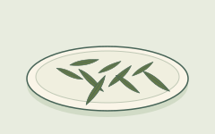
    <figcaption><strong class="tea-name-title">龍井（Longjing）</strong><span class="tea-name-kind">做法 · 綠茶</span><span class="tea-name-note">常見的扁平葉形示例；形狀與顏色會有差別。</span></figcaption>
  </figure></li>
  <li><figure class="tea-name-card" data-tea-name="jasmine-green">
    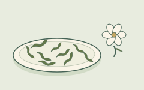
    <figcaption><strong class="tea-name-title">茉莉綠茶</strong><span class="tea-name-kind">窨香茶 · 綠茶底</span><span class="tea-name-note">旁邊的花只提示香氣；成茶不一定留有花朵。</span></figcaption>
  </figure></li>
  <li><figure class="tea-name-card" data-tea-name="gunpowder">
    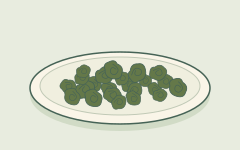
    <figcaption><strong class="tea-name-title">珠茶（Gunpowder）</strong><span class="tea-name-kind">做法 · 綠茶</span><span class="tea-name-note">沖泡前，揉成小珠粒的葉子。</span></figcaption>
  </figure></li>
  <li><figure class="tea-name-card" data-tea-name="tieguanyin">
    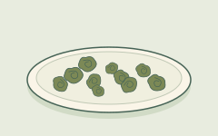
    <figcaption><strong class="tea-name-title">鐵觀音</strong><span class="tea-name-kind">做法 · 烏龍茶</span><span class="tea-name-note">揉成球狀的一例；焙火與氧化程度各有不同。</span></figcaption>
  </figure></li>
  <li><figure class="tea-name-card" data-tea-name="baozhong">
    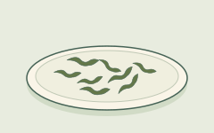
    <figcaption><strong class="tea-name-title">包種</strong><span class="tea-name-kind">做法 · 烏龍茶</span><span class="tea-name-note">鬆捲條形的葉子示例，不是緊實球形。</span></figcaption>
  </figure></li>
  <li><figure class="tea-name-card" data-tea-name="da-hong-pao">
    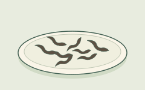
    <figcaption><strong class="tea-name-title">大紅袍</strong><span class="tea-name-kind">做法 · 烏龍茶</span><span class="tea-name-note">武夷岩茶的一例：色深、扭捲的條索。</span></figcaption>
  </figure></li>
  <li><figure class="tea-name-card" data-tea-name="keemun">
    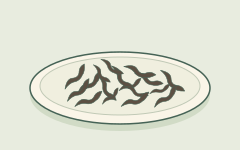
    <figcaption><strong class="tea-name-title">祁門（Keemun）</strong><span class="tea-name-kind">做法 · 紅茶</span><span class="tea-name-note">細條捲曲的乾葉示例；英文 black tea 是紅茶。</span></figcaption>
  </figure></li>
  <li><figure class="tea-name-card" data-tea-name="yunnan">
    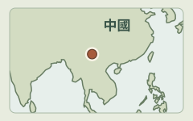
    <figcaption><strong class="tea-name-title">雲南（作紅茶詞用時）</strong><span class="tea-name-kind">產地／做法名 · 紅茶</span><span class="tea-name-note">中國西南部的雲南。地圖標示大致位置，不是特定茶園。</span></figcaption>
  </figure></li>
  <li><figure class="tea-name-card" data-tea-name="lapsang-souchong">
    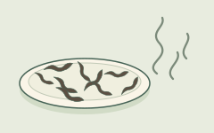
    <figcaption><strong class="tea-name-title">正山小種（Lapsang Souchong）</strong><span class="tea-name-kind">做法 · 紅茶</span><span class="tea-name-note">這裏示意煙燻型；也有不經煙燻的版本。</span></figcaption>
  </figure></li>
  <li><figure class="tea-name-card" data-tea-name="puerh-dark">
    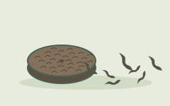
    <figcaption><strong class="tea-name-title">普洱／黑茶</strong><span class="tea-name-kind">茶名／茶類</span><span class="tea-name-note">散茶與緊壓茶示例；生、熟茶不同。Dark tea 是黑茶。</span></figcaption>
  </figure></li>
  <li><figure class="tea-name-card" data-tea-name="white-tea">
    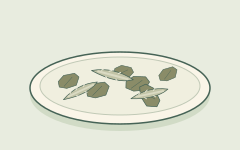
    <figcaption><strong class="tea-name-title">白茶</strong><span class="tea-name-kind">茶類 · 白茶</span><span class="tea-name-note">圖中有芽也有葉；白茶不一定全是芽。</span></figcaption>
  </figure></li>
  <li><figure class="tea-name-card" data-tea-name="yellow-tea">
    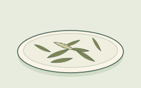
    <figcaption><strong class="tea-name-title">黃茶</strong><span class="tea-name-kind">茶類 · 黃茶</span><span class="tea-name-note">一份散茶示例；分類看工序，不只看顏色。</span></figcaption>
  </figure></li>
  </ul>
</details>
```
<!-- tea-name-gallery:chinese:end -->

| 你看到的標籤 | 一般是甚麼意思 | 橋去哪 |
| --- | --- | --- |
| **龍井（Longjing / Dragon Well）** | 許多餐牌上都能見到的**炒青中國綠茶**做法名 | 落在下面地圖的**綠**。見 [第一章](modules/module-01/index.qmd) |
| **茉莉花茶／茉莉綠茶** | 綠茶**窨**過茉莉花香。底子仍是茶樹的綠茶 | 加香不是花草茶。在地圖上，這是**綠**那一行 |
| **珠茶（Gunpowder）** | 揉成小顆粒的綠茶。這個詞是做法名 | 走的是**綠**這條路線 |
| **鐵觀音** | 著名的**烏龍**傳統名。氧化到多深，各廠並不一樣 | 地圖上的**烏龍**行，處在綠↔紅那把尺的中間[^1] |
| **包種** | 偏淺的**烏龍**做法名，常常和台灣連在一起 | 屬於**烏龍**這一帶 |
| **大紅袍** | 著名的**武夷岩茶／烏龍**，餐牌和貨架上都能見到 | 屬於**烏龍**這一帶。這裏不講那個傳說 |
| **祁門（Keemun）** | 中國**紅茶**的一種做法名，拼配裏常見，也可以單獨喝 | 地圖上的**紅**那一行[^1] |
| **雲南**（作紅茶詞用時） | 許多帶麥芽感的中國紅茶，用它標產地，或標做法 | 產地不是另一個物種。這些茶多半走**紅**這條路線 |
| **正山小種（Lapsang Souchong）** | **帶煙燻味**的紅茶。貿易上常見的印象是松煙 | 加香或煙燻的**紅**路線[^1] |
| **普洱／黑茶** | 雲南（以及相關地方）的黑茶，會經過微生物陳化。**生茶**和**熟茶**的做法並不相同 | 地圖上的**黑**那一行。這是真正發酵的那個例外[^2] |
| **白茶** | 處理較少的茶樹葉。杯子通常比較清淡 | 地圖上的**白**那一行。工廠裏的戲份比較少[^1] |
| **黃茶** | 中國以外很少見。路子接近綠茶，貿易名單裏多一道「悶黃」 | 地圖上的**黃**那一行，也寫在六大茶類的名單裏[^3] |

工夫茶作為**日常社交場面**（一把小壺，茶要短短地倒很多次），是一套文化劇本。要看這套劇本，打開 [第三章 · 第四節](modules/module-03/04-regional-scripts.qmd)。下面的器具帶只負責點出用具的名字。

***

<span id="label-japanese-names"></span>

## 常見日文名

<!-- tea-name-gallery:japanese:start -->
```{=html}
<details class="tea-name-gallery" data-tea-name-gallery="japanese" open>
  <summary>圖像茶架 · 6 個日文名</summary>
  <p class="tea-name-intro">原創示意圖，不是鑑別圖鑑。形狀與顏色會有差別，圖像不按比例；茶名、工序與標籤資料比外觀更重要。</p>
  <ul class="tea-name-grid" role="list">
  <li><figure class="tea-name-card" data-tea-name="sencha">
    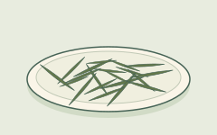
    <figcaption><strong class="tea-name-title">煎茶（Sencha）</strong><span class="tea-name-kind">做法 · 綠茶</span><span class="tea-name-note">常見的揉捲針形茶葉示例。</span></figcaption>
  </figure></li>
  <li><figure class="tea-name-card" data-tea-name="matcha">
    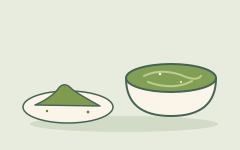
    <figcaption><strong class="tea-name-title">抹茶（Matcha）</strong><span class="tea-name-kind">粉末綠茶</span><span class="tea-name-note">細粉與攪拌後的一碗茶；葉粉一起喝下，不濾走。</span></figcaption>
  </figure></li>
  <li><figure class="tea-name-card" data-tea-name="gyokuro">
    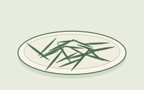
    <figcaption><strong class="tea-name-title">玉露（Gyokuro）</strong><span class="tea-name-kind">做法 · 綠茶</span><span class="tea-name-note">遮蔭後製成的沖泡茶葉；針形本身不能證明種植方法。</span></figcaption>
  </figure></li>
  <li><figure class="tea-name-card" data-tea-name="tencha">
    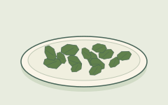
    <figcaption><strong class="tea-name-title">碾茶（Tencha）</strong><span class="tea-name-kind">做法 · 綠茶</span><span class="tea-name-note">磨成抹茶之前、未經揉捻的片狀茶葉。</span></figcaption>
  </figure></li>
  <li><figure class="tea-name-card" data-tea-name="genmaicha">
    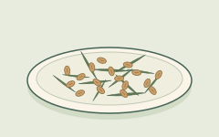
    <figcaption><strong class="tea-name-title">玄米茶（Genmaicha）</strong><span class="tea-name-kind">拼配 · 綠茶＋米</span><span class="tea-name-note">綠茶加炒米；這裏的米確實是配料。</span></figcaption>
  </figure></li>
  <li><figure class="tea-name-card" data-tea-name="houjicha">
    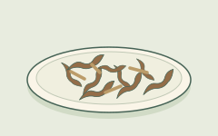
    <figcaption><strong class="tea-name-title">焙茶（Houjicha）</strong><span class="tea-name-kind">焙火做法 · 綠茶</span><span class="tea-name-note">焙過的葉與茶梗示例；褐色不等於紅茶。</span></figcaption>
  </figure></li>
  </ul>
</details>
```
<!-- tea-name-gallery:japanese:end -->

| 你看到的標籤 | 一般是甚麼意思 | 橋去哪 |
| --- | --- | --- |
| **煎茶（Sencha）** | 日本人日常喝的**綠茶**。葉子多半先**蒸**，然後再揉，再烘乾 | 地圖上的**綠**那一行。入門頁還有一張迷你表[^4] |
| **抹茶（Matcha）** | 遮蔭長成的綠葉，磨成**細粉**，攪進水裏。連葉子一齊喝下去 | 走**綠**這條路線。在杯量範圍裏，茶氨酸往往更高。見 [杯量參考](cup-reference.qmd)[^5] |
| **玉露（Gyokuro）** | 遮蔭做成的日本**綠茶**（泡的是葉子，不是把粉攪開）。它是做法加上遮蔭路線的名字，不是橙白毫那種顆粒等級 | 遮蔭的說明見 [第一章 · 第一節](modules/module-01/01-plants.qmd)。要看數字，去杯量參考[^5] |
| **碾茶（Tencha）** | 遮蔭葉在石磨成抹茶之前的樣子 | 它是通往抹茶的橋，走的是**綠**這條路線[^4] |
| **玄米茶（Genmaicha）** | 綠茶裏加了**炒米**。除非標籤另外說明，底子仍是茶樹 | **綠**這條路線，另外加了米 |
| **焙茶（Houjicha）** | **焙過**的日本綠茶。一般的印象是烤香 | **綠**這條路線，只是焙過火 |

煎茶、抹茶和碾茶的做法說明，對應的是入門頁引用的那些日本行業類型頁。[^4]

***

<span id="label-western-names"></span>

## 常見西方與咖啡店名

<!-- tea-name-gallery:western:start -->
```{=html}
<details class="tea-name-gallery" data-tea-name-gallery="western" open>
  <summary>圖像茶架 · 10 個西方與咖啡店常見茶飲名稱</summary>
  <p class="tea-name-intro">原創示意圖，不是鑑別圖鑑。形狀與顏色會有差別，圖像不按比例；茶名、工序與標籤資料比外觀更重要。</p>
  <p class="tea-name-map-key">地圖上北下南，各圖比例不同。圓點只標產地的大致位置，不代表茶園或產區邊界。海岸線資料：<a href="https://www.naturalearthdata.com/about/terms-of-use/">Natural Earth</a>.</p>
<ul class="tea-name-grid" role="list">
  <li><figure class="tea-name-card" data-tea-name="english-breakfast">
    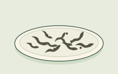
    <figcaption><strong class="tea-name-title">英式早餐茶（English Breakfast）</strong><span class="tea-name-kind">拼配 · 通常是紅茶</span><span class="tea-name-note">紅茶拼配示例；葉片大小和配方會不同。</span></figcaption>
  </figure></li>
  <li><figure class="tea-name-card" data-tea-name="earl-grey">
    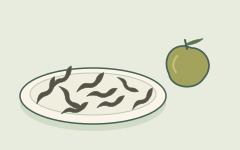
    <figcaption><strong class="tea-name-title">伯爵茶（Earl Grey）</strong><span class="tea-name-kind">調香茶 · 通常是紅茶</span><span class="tea-name-note">佛手柑只提示香氣；茶裏不一定有果皮。</span></figcaption>
  </figure></li>
  <li><figure class="tea-name-card" data-tea-name="assam">
    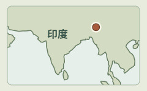
    <figcaption><strong class="tea-name-title">阿薩姆（Assam）</strong><span class="tea-name-kind">產地名</span><span class="tea-name-note">印度東北部的阿薩姆。只標大致位置，不是茶園。</span></figcaption>
  </figure></li>
  <li><figure class="tea-name-card" data-tea-name="darjeeling">
    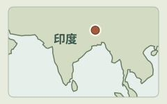
    <figcaption><strong class="tea-name-title">大吉嶺（Darjeeling）</strong><span class="tea-name-kind">產地名</span><span class="tea-name-note">印度西孟加拉邦北部的大吉嶺，在阿薩姆以西、喜馬拉雅山麓。</span></figcaption>
  </figure></li>
  <li><figure class="tea-name-card" data-tea-name="ceylon-kenyan">
    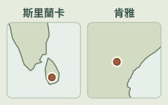
    <figcaption><strong class="tea-name-title">錫蘭／肯雅（Ceylon / Kenyan）</strong><span class="tea-name-kind">產地名</span><span class="tea-name-note">左：斯里蘭卡（錫蘭）。右：東非肯雅。這是兩個不同產地。</span></figcaption>
  </figure></li>
  <li><figure class="tea-name-card" data-tea-name="nilgiri">
    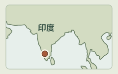
    <figcaption><strong class="tea-name-title">尼爾吉里（Nilgiri）</strong><span class="tea-name-kind">產地名</span><span class="tea-name-note">印度南部的尼爾吉里山區。只標大致位置，不是茶園。</span></figcaption>
  </figure></li>
  <li><figure class="tea-name-card" data-tea-name="masala-chai">
    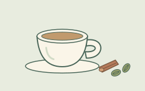
    <figcaption><strong class="tea-name-title">馬薩拉茶／印度奶茶拿鐵</strong><span class="tea-name-kind">調製飲品 · 配方家族</span><span class="tea-name-note">加奶與香料的一例；材料與比例各有不同。</span></figcaption>
  </figure></li>
  <li><figure class="tea-name-card" data-tea-name="milk-tea">
    
    <figcaption><strong class="tea-name-title">奶茶／港式奶茶</strong><span class="tea-name-kind">調製飲品 · 奶茶</span><span class="tea-name-note">紅茶加奶的一杯示例；配方與顏色會不同。</span></figcaption>
  </figure></li>
  <li><figure class="tea-name-card" data-tea-name="boba">
    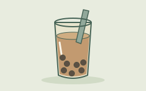
    <figcaption><strong class="tea-name-title">珍珠奶茶／波霸</strong><span class="tea-name-kind">調製飲品 · 加配料</span><span class="tea-name-note">奶茶加珍珠的一例；也有其他茶底與配料。</span></figcaption>
  </figure></li>
  <li><figure class="tea-name-card" data-tea-name="decaf">
    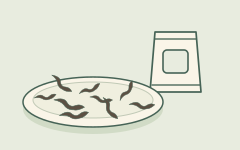
    <figcaption><strong class="tea-name-title">低因茶（Decaf）</strong><span class="tea-name-kind">處理方式 · 減少咖啡因</span><span class="tea-name-note">外觀看不出低因處理；要讀標籤，也不代表零咖啡因。</span></figcaption>
  </figure></li>
  </ul>
</details>
```
<!-- tea-name-gallery:western:end -->

| 你看到的標籤 | 一般是甚麼意思 | 橋去哪 |
| --- | --- | --- |
| **英式早餐茶（English Breakfast）** | 為濃口早茶配的**紅茶拼配**。裏面常有阿薩姆等紅茶，配方則因牌子而不同 | 通常走**紅**這條路線。日常的咖啡因範圍，看杯量參考[^1] |
| **伯爵茶（Earl Grey）** | 通常是**加了佛手柑香**的紅茶 | 香加在**紅**這條路線上。它不是一種新的植物[^1] |
| **阿薩姆（Assam）** | 印度阿薩姆的紅茶。一般的印象是濃，而且帶麥芽味 | 產地，加上阿薩姆型植物的提示，見 [第一章 · 第一節](modules/module-01/01-plants.qmd)。地圖上是**紅**那一行 |
| **大吉嶺（Darjeeling）** | 大吉嶺的高山茶。一般比較細緻。多半當紅茶賣，不過有些批次氧化得淺一些 | 這是地理加上加工。它不是另一個物種 |
| **錫蘭／肯雅（Ceylon / Kenyan）** | 用產地來命名的紅茶（斯里蘭卡；肯雅）。拼配時常常拿它們當原料 | 產地標不是另一個物種。這些茶多半走**紅**[^1] |
| **尼爾吉里（Nilgiri）** | 南印度的產地標，紅茶和拼配上都能見到 | 在本頁，它只是一個產地詞 |
| **馬薩拉茶／印度奶茶拿鐵（Masala chai / chai latte）** | 許多店的做法是：香料**紅茶**，再加上奶和甜味。底子仍是茶樹紅茶，除非標籤寫成花草 | 這是一套配方，不是一個物種 |
| **奶茶／港式奶茶** | 把濃紅茶（常常是細碎的，或 CTC）加上奶。這是一種文化喝法 | 文化上的工藝，見 [第三章 · 第四節](modules/module-03/04-regional-scripts.qmd) |
| **珍珠奶茶／波霸（Bubble / boba tea）** | 咖啡店裏的一類飲料：茶或奶茶做底，再加配料 | 它是店裏的表親。它不是工廠裏的一種氧化做法 |
| **低因茶（Decaf）** | 經過處理、把咖啡因**減少**了的茶。這是產品的名字。它和花草所說的「無咖啡因」不是同一句話 | 本頁只點出這個名字。這裏不講殘留的百分比 |

***

## 六大成品茶類（分類地圖） {#type-map}

<!-- tea-classification:types:start -->
```{=html}
<section class="tea-classification-visual" data-tea-classification="types" aria-labelledby="tea-type-visual-title">
<p id="tea-type-visual-title" class="tea-classification-title">同一種茶樹，六類加工路線</p>
<p class="tea-classification-intro">把它們看成並列路線，不是一條氧化刻度。每幅圖只突出關鍵工序，不是完整製茶流程。</p>
<p class="tea-classification-root">茶樹 · Camellia sinensis</p>
<ul class="tea-classification-grid tea-type-grid"><li><figure class="tea-classification-card" data-tea-classification-card="green">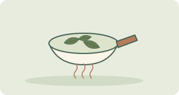<figcaption><strong class="tea-classification-name">綠茶</strong><span class="tea-classification-note">先加熱抑制酶促氧化，再經整形、乾燥等工序。</span></figcaption></figure></li><li><figure class="tea-classification-card" data-tea-classification-card="yellow">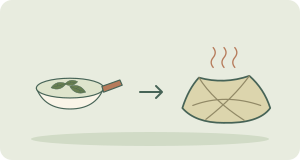<figcaption><strong class="tea-classification-name">黃茶</strong><span class="tea-classification-note">先殺青，再悶黃、乾燥。重點是多了溫熱濕潤的悶黃工序。</span></figcaption></figure></li><li><figure class="tea-classification-card" data-tea-classification-card="white">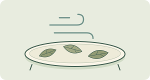<figcaption><strong class="tea-classification-name">白茶</strong><span class="tea-classification-note">萎凋後乾燥，當中會有一定氧化；不是綠茶先殺青的路線。</span></figcaption></figure></li><li><figure class="tea-classification-card" data-tea-classification-card="oolong">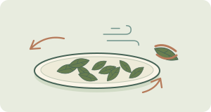<figcaption><strong class="tea-classification-name">烏龍茶</strong><span class="tea-classification-note">做青、部分氧化，再殺青、乾燥。氧化程度因做法而異。</span></figcaption></figure></li><li><figure class="tea-classification-card" data-tea-classification-card="black">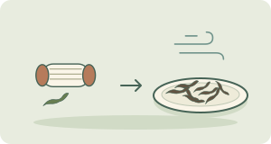<figcaption><strong class="tea-classification-name">紅茶 · black tea</strong><span class="tea-classification-note">揉捻或切碎後充分酶促氧化，最後乾燥。</span></figcaption></figure></li><li><figure class="tea-classification-card" data-tea-classification-card="dark">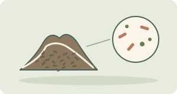<figcaption><strong class="tea-classification-name">黑茶 · dark tea</strong><span class="tea-classification-note">這一支重視微生物發酵與陳化；熟普洱是清楚的例子。</span></figcaption></figure></li></ul>
<p class="tea-classification-caution">示意圖不是靠顏色認茶的圖鑑，也不是品質排名。生普洱與熟普洱的加工路線不同；生茶會在儲存中變化，分類時須交代這個背景。</p>
<p class="tea-classification-sources">本圖解資料來源： <a href="https://www.iso.org/standard/75419.html">ISO 茶葉分類</a> · <a href="https://pmc.ncbi.nlm.nih.gov/articles/PMC8605308/">加工綜述</a> · <a href="https://cnafun.moa.gov.cn/zt/gjcr/202005/t20200513_6343917.html">生／熟普洱</a></p>
</section>
```
<!-- tea-classification:types:end -->

這些茶來自同一種植物。工廠在不同的節點讓褐變停下來。貿易名單和標準方面的工作，常常會點出**六類**成品：綠、黃、白、烏龍、紅、黑。[^3] 英國茶與浸泡飲協會把日常的分法說得很直白。加工的時候氧化走了多久，或者根本沒有走，就把紅茶、綠茶、烏龍和白茶的杯感分開了。[^1]

這幅地圖是一把**貨架尺**。它不是健康排名，也不是第二本第一章。化學上的分岔在工序，不在物種。請打開 [第一章 · 第二節](modules/module-01/02-processing.qmd)。入門頁只留一條薄薄的六類摺疊，並指到這裏來看完整的地圖。[^3]

| 成品茶類 | 白話意思 | 日常名稱（見上面各表） |
| --- | --- | --- |
| **綠** | 早點把葉子加熱，不讓它變褐 | 龍井、珠茶、茉莉綠茶；煎茶、抹茶、玉露、焙茶、玄米茶… |
| **黃** | 中國以外少見。路子近綠，貿易名單裏多一道「悶黃」 | 黃茶（多半隻見得到這個名字）[^3] |
| **白** | 處理較少的茶樹葉。一般的印象是，工廠裏的戲份不多 | 白茶那幾行[^1] |
| **烏龍** | 綠與紅之間的一段部分氧化 | 鐵觀音、包種、大紅袍…[^1] |
| **紅** | 在一般的貿易印象裏，酶促氧化走滿了 | 祁門、阿薩姆、英式早餐茶的底、正山小種，以及許多咖啡店裏的紅茶[^1] |
| **黑** | 微生物陳化的那一支（餐牌上會寫成普洱生茶或熟茶） | 普洱／黑茶[^2] |

**老實話（入門頁已經寫過）。** 做茶的人常把由綠轉紅叫「發酵」。說到普通的綠茶、烏龍、紅茶，他們多半是指葉子裏的酶，再加上空氣。真正由微生物來主導的陳化，主要出現在普洱這類黑茶裏。[^2]

### 中／日／西方名稱怎樣掛上地圖

- **中文做法名**往往*就是*茶類本身，或者是某一類裏面的著名傳統。龍井歸綠，鐵觀音歸烏龍，祁門歸紅，普洱歸黑（見上面各表）。
- **日文日常名**多半是**綠路線上的做法**：煎茶、抹茶、玉露、焙茶、玄米茶。工廠怎麼做，或者人怎麼喝，可以不同，成品屬於哪一類卻是一樣的。[^4]
- **西方和咖啡店的名字**把幾樣東西混在一起：**茶類**（綠或紅）、**產地**（阿薩姆），還有**拼配／加香**（英式早餐茶、伯爵茶）。拼配的底子，通常仍是紅路線上的葉子。[^1]

::: {.callout-note collapse="true" title="ISO 20715 與六類列表"}
標準和加工綜述按茶**是怎麼做出來的**來分類，不按咖啡店裏的英文。ISO 的茶類分類工作（ISO 20715:2023），以及那些加工調查，常見的就是上表這一套六類成品。[^3] 咖啡店的餐牌更亂，茶類、產地、拼配和加香攪在一處。黃茶在多數西方貨架上很少見，所以讀第一章之前，不必先去啃它。這一則摺疊不貼標準的原文，也不把每一個店名對到某一條條款上。
:::

***

## 等級用語：顆粒大小與品質檔次詞 {#grades}

<!-- tea-classification:grades:start -->
```{=html}
<section class="tea-classification-visual" data-tea-classification="grades" aria-labelledby="tea-grade-visual-title">
<p id="tea-grade-visual-title" class="tea-classification-title">包裝上的詞，屬於哪一種？</p>
<p class="tea-classification-intro">大小詞與品質檔次回答的是不同問題；製法和做法名稱也要分開。</p>
<div class="tea-grade-block">
<p class="tea-grade-title">顆粒大小用語</p><p class="tea-grade-question">篩分後的茶葉顆粒，是甚麼形態？</p>
<ul class="tea-classification-grid tea-grade-sizes"><li><figure class="tea-classification-card" data-tea-classification-card="op">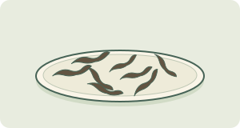<figcaption><strong class="tea-classification-name">OP · 橙白毫</strong><span class="tea-classification-note">全葉類等級詞</span></figcaption></figure></li><li><figure class="tea-classification-card" data-tea-classification-card="bop">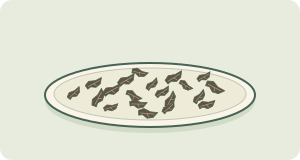<figcaption><strong class="tea-classification-name">BOP · 碎橙白毫</strong><span class="tea-classification-note">碎葉片</span></figcaption></figure></li><li><figure class="tea-classification-card" data-tea-classification-card="fannings">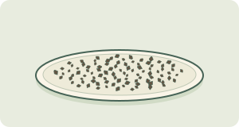<figcaption><strong class="tea-classification-name">Fannings · 碎茶</strong><span class="tea-classification-note">細小茶葉顆粒</span></figcaption></figure></li><li><figure class="tea-classification-card" data-tea-classification-card="dust">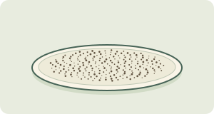<figcaption><strong class="tea-classification-name">Dust · 末茶</strong><span class="tea-classification-note">很細的茶葉顆粒</span></figcaption></figure></li></ul>
<p class="tea-classification-caution">形狀只作示意，不代表通用篩孔尺寸。較大不一定較好；較細的顆粒往往浸出較快。</p>
</div>
<div class="tea-grade-block">
<p class="tea-grade-title">製法，不是顆粒等級</p>
<ul class="tea-classification-grid tea-grade-methods"><li><figure class="tea-classification-card" data-tea-classification-card="orthodox">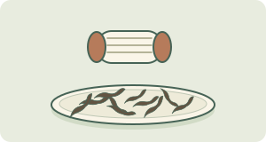<figcaption><strong class="tea-classification-name">傳統製法 · Orthodox</strong><span class="tea-classification-note">揉捻後再篩分，可以得到全葉、碎葉、碎茶及末茶。</span></figcaption></figure></li><li><figure class="tea-classification-card" data-tea-classification-card="ctc">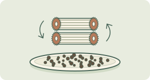<figcaption><strong class="tea-classification-name">CTC · 切碎揉捻</strong><span class="tea-classification-note">另一種機械加工路線形成顆粒，之後同樣會按大小篩分。</span></figcaption></figure></li></ul>
</div>
<ul class="tea-classification-grid tea-grade-other"><li><figure class="tea-classification-card" data-tea-classification-card="tiers"><figcaption><strong class="tea-classification-name">品質檔次標籤</strong><span class="tea-classification-note">例如：特級／一級／二級。要看該茶所用的標準或分級方法；這些詞不能換算成 OP 或 BOP。</span></figcaption></figure></li><li><figure class="tea-classification-card" data-tea-classification-card="shade"><figcaption><strong class="tea-classification-name">做法＋遮蔭名稱</strong><span class="tea-classification-note">玉露、碾茶、抹茶描述遮蔭栽培與加工做法，不是 OP 等級；抹茶粉也不是紅茶的末茶等級。</span></figcaption></figure></li></ul>
<p class="tea-classification-sources">本圖解資料來源： <a href="https://teasrilanka.org/tea-grade">斯里蘭卡分級例子</a> · <a href="https://www.upasitearesearch.org/orthodox/">傳統製法</a> · <a href="https://www.forestry.gov.cn/c/www/yltl/592556.jhtml">個別茶類的品質標準</a> · <a href="https://www.ujicha.or.jp/en/knowledge/kinds/">日本茶做法</a></p>
</section>
```
<!-- tea-classification:grades:end -->

貨架上的「等級」，至少混着**兩套**說法。先把它們分開，才不會誤以為橙白毫一定勝過碎橙白毫，理由只是「因為更好」；也不會把特級當成各國通用的品質分數，拿去跟橙白毫的代碼對照。這些詞都不是另一個物種，也不是道德意義上的「最好茶」排名。

### 葉碎／顆粒用語（紅茶貿易）

**茶包和散茶**的差別，多半在**份量和顆粒大小**，不是另一種植物。茶包是預先量好的一份。散茶則是按重量來賣的同一種植物。茶包常用比較碎的葉子，好讓顏色和濃度很快出來。入門和杯量參考用的日常基準，大約是 **2 克**乾葉配 **250 毫升**。[^6]

**傳統製法和切碎揉捻（CTC）**說的是**紅茶工廠**裏怎麼把葉子弄碎，不是綠茶的規則。[^7]

| | **傳統製法（Orthodox）** | **切碎揉捻（CTC）** |
| --- | --- | --- |
| 葉形 | 較大的卷葉，或較大的碎葉 | 細小而且均勻的顆粒 |
| 泡法習慣 | 出湯較慢，層次往往比較多 | 快，濃，顏色也深。茶包和奶茶裏很常見 |

**橙白毫（Orange Pekoe, OP）、碎橙白毫（BOP）、碎茶（fannings）、末茶（dust）**是許多紅茶貿易裏用來講**葉子有多碎**的等級詞。它們不是另一個物種，也不是道德排名。較細的等級往往出湯快，短短一浸就顯得濃。

杯子如果發渾，或者「一下子太猛」，打開 [廚房排障](tea-troubleshoot.qmd)。

想知道顆粒為甚麼會改變出場的速度，打開 [第一章 · 第三節](modules/module-01/03-brewing.qmd)。

### 品質檔次用語（跟顆粒詞分開）

有些包裝用的是**另一套**等級用語，也就是品質檔次的*標籤*。它和橙白毫、碎橙白毫、碎茶、末茶**不是同一套系統**。

**你可能見到的中國零售檔次**（特級、一級、二級，以及往後的檔）。在一部分中國包裝的茶上，這些字是產地或廠家自己的**品質檔次標籤**。它們**不是**橙白毫的顆粒代碼，不是跨國通用的排名，也不是本頁在沒有引到標準時就能替你下的保證。這裏只把它們當作貨架上的用字點出來，免得你不小心拿去跟 OP 對照。

**日本的遮蔭路線做法。** 玉露、抹茶、碾茶是**做法加上遮蔭路線的名字**。它們說的是葉子怎麼種、怎麼做完，不是橙白毫那種顆粒梯子。[^4] 英文貿易裏的口語，有時會把玉露叫成「高檔」。這個習慣仍然**不等於**紅茶那些表示大小的代碼。遮蔭的說明在 [第一章 · 第一節](modules/module-01/01-plants.qmd)。茶氨酸的範圍在 [杯量參考](cup-reference.qmd)。[^5]

::: {.callout-note collapse="true" title="為甚麼「等級」會把人繞暈"}
| 用語 | 例子 | 它*不是*甚麼 |
| --- | --- | --- |
| **顆粒／大小** | 橙白毫、碎橙白毫、碎茶、末茶；傳統製法還是 CTC | 不是另一個物種，也不是「道德上更好」 |
| **品質檔次標籤** | 有些中國包裝上的特級／一級… | 不是 OP 的代碼，也不是本站給出的全球統一排名 |
| **做法＋遮蔭名** | 玉露、抹茶、碾茶 | 不是 OP 那種梯子。多半仍是**綠**路線上的葉子 |

請記住：盒子上的等級用語是一條**字典線索**，不是購物用的「最好茶」名單。名茶的評選、獎項、牌子的排行，都不在本頁範圍裏。
:::

***

## 花草提醒

| 你看到的標籤 | 一般是甚麼意思 |
| --- | --- |
| **洋甘菊／薄荷／姜／路易波士「茶」** | 花草浸泡出來的飲品。除非標籤上也寫了茶葉，否則**不是**茶樹 |

它們不在第一章的化學核心裏。真茶和花草怎麼分開，那一小節短課仍在 [茶葉入門](tea-basics.qmd)。[^8][^9]

***

## 薄帶：茶壺與沖泡方法

這裏只講器具的**名稱**，也就是它一般是甚麼。沒有萃取動力學，沒有儀式的步驟表，也沒有第二張排障矩陣。

| 器具／方法 | 白話意思 | 接着打開… |
| --- | --- | --- |
| **杯 + 茶包／濾籃** | 日常的預設喝法：一杯，浸一次 | 第一杯看 [茶葉入門](tea-basics.qmd)。覺得不對勁，去 [廚房排障](tea-troubleshoot.qmd) |
| **英式／西式茶壺** | 比較大的壺。葉子在壺裏，或在濾芯裏。一壺可以分着喝 | 看 [廚房排障](tea-troubleshoot.qmd)。時間、溫度和葉量，看 [第一章 · 第三節](modules/module-01/03-brewing.qmd) |
| **蓋碗** | 一隻帶蓋的碗，用來短浸，而且浸很多次 | 去排障，或去第一章第三節。這不是一堂儀式課 |
| **小朱泥／瓷壺（工夫茶用具）** | 小壺、小杯，茶要短短地倒很多次 | **文化：** [第三章 · 第四節](modules/module-03/04-regional-scripts.qmd)。**旋鈕：** 去排障，或去第一章第三節 |
| **爺爺杯（grandpa style）** | 葉子留在大杯或玻璃杯裏，再加水續泡 | 去排障，或去第一章第三節（這裏用得上第二泡的直覺） |
| **茶碗 + 茶筅（抹茶）** | 把粉攪開，懸在水裏。連葉子一齊喝 | 看上面抹茶那一行。茶氨酸的範圍看 [杯量參考](cup-reference.qmd) |

***

## 這一扇門坐在哪／下一步

把這些談茶的門，想成一層一層的地圖。

1. **[茶葉入門](tea-basics.qmd)。** 第一杯；真茶和花草怎麼分；綠↔紅；三個樣例標籤；還有一條薄薄的六類摺疊，指到本頁。
2. **茶葉標籤（本頁）。** 名稱表；**六大茶類的分類地圖**；**等級用語**（顆粒，還是品質檔次）；器具的名詞。
3. **[廚房排障](tea-troubleshoot.qmd)。** 杯已經不對了，接下來問該扭哪一顆旋鈕。
4. **[第一章](modules/module-01/index.qmd)。** 植物、工廠、沖泡、化合物。
5. **[杯量參考](cup-reference.qmd)。** 一隻 250 毫升杯裏的典型毫克數。
6. **[第三章 · 第四節](modules/module-03/04-regional-scripts.qmd)。** 工夫茶、港式奶茶，以及相近的文化劇本。
7. **[讀懂茶研究](tea-reading-studies.qmd)。** 對着標題用的那張清單。

還在倒第一杯的話，留在入門。準備看數字的話，打開杯量參考。

[^1]: UK Tea & Infusions Association. Types of tea, origins & varieties. https://www.tea.co.uk/types-of-tea (Black/green/white/dark overview; English Breakfast and Earl Grey as black-tea blends; oolong as partial oxidation; Keemun / Lapsang notes on trade type pages.)

[^2]: Ordinary oolong/black “fermentation” is enzymatic oxidation; true microbial fermentation mainly in post-fermented teas such as Pu-erh. See Subramanian et al. (1999) and Tanaka & Kouno (2003) as cited in [Chapter 1](modules/module-01/index.qmd). Wong et al. (2022) treat pu-erh among processing categories: https://doi.org/10.1111/1750-3841.16137

[^3]: Six manufactured types (green, yellow, white, oolong, black, dark) appear in processing overviews and ISO tea-type classification work (e.g. *Food Reviews International* tea-processing chapter, https://doi.org/10.1080/87559129509541052; ISO 20715:2023).

[^4]: Kyoto Prefectural Tea Industry Chamber. Types of tea (sencha; matcha/tencha). https://www.ujicha.or.jp/en/knowledge/kinds/

[^5]: Keenan, E. K., et al. (2011). How much theanine in a cup of tea? *Food Chemistry, 125*(2), 588–594. https://doi.org/10.1016/j.foodchem.2010.08.071 (Cup-reference baseline; shaded gyokuro/matcha noted higher.)

[^6]: Everyday baseline on the [Cup reference](cup-reference.qmd); formal tasting strength under ISO 3103:2019 — https://www.iso.org/standard/73224.html

[^7]: UK Tea & Infusions Association. Creating the perfect blend (orthodox rolling vs CTC / unorthodox smaller particles for quicker brew). https://www.tea.co.uk/tea-processing-and-blending

[^8]: U.S. Food and Drug Administration. (1996). Tea: A story of serendipity. *FDA Consumer*. https://permanent.access.gpo.gov/lps1609/www.fda.gov/fdac/features/296_tea.html

[^9]: Tea Association of the USA. (2019). Comment on FDA food standards of identity modernization (Docket FDA-2018-N-2381). https://downloads.regulations.gov/FDA-2018-N-2381-1376/attachment_1.pdf
